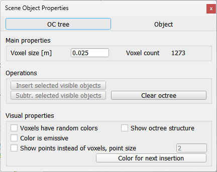

# OC tree dialog

The OC tree dialog is part of the [scene object dialog](sceneObjectPropertiesDialog.md), which is located at [Tools > Scene object properties]. You can also open the dialog with a double-click on an object icon in the [scene hierarchy](userInterface.md#SceneHierarchy), or with a click on its [toolbar](userInterface.md#toolbars) button:

*[Scene object properties toolbar button]*

In the scene object dialog, click the **OC tree** button to display the OC tree dialog (the **OC tree** button only appears if the last selection is an [OC tree](octrees.md)). The dialog displays the settings and parameters of the last selected OC tree:

*[OC tree dialog]*

- **Voxel size**: the size of the OC tree voxels. The smaller the size, the more memory will be used for the OC tree data structure. Refer also to [`ocTree.voxelSize`](sim-2/property_ocTree_voxelSize.htm).
- **Insert selected visible objects**: allows you to insert voxels based on the selected, visible objects. Only [dummies](dummies.md), [shapes](shapes.md), [OC trees](octrees.md) and [point clouds](pointClouds.md) are taken into account. Select all objects you want to insert, then select the target OC tree object last. Refer also to [`ocTree:addFromObjects`](sim-2/ocTree_addFromObjects.htm) and [`ocTree:addVoxels`](sim-2/ocTree_addVoxels.htm).
- **Subtract selected visible objects**: allows you to remove voxels based on the selected, visible objects. Only [dummies](dummies.md), [shapes](shapes.md), [OC trees](octrees.md) and [point clouds](pointClouds.md) are taken into account. Select all objects you want to insert, then select the target OC tree object last. Refer also to [`ocTree:subtractFromObjects`](sim-2/ocTree_subtractFromObjects.htm) and [`ocTree:subtractVoxels`](sim-2/ocTree_subtractVoxels.htm).
- **Clear OC tree**: removes all the voxels from the OC tree. Refer also to [`ocTree:clear`](sim-2/ocTree_clear.htm).
- **Voxels have random colors**: each voxel will have a random color. Refer also to [`ocTree.randomColors`](sim-2/property_ocTree_randomColors.htm).
- **Show OC tree structure**: shows the OC tree data structure, mainly for debugging purposes.
- **Color is emissive**: voxels will be shown in emissive colors.
- **Show points instead of voxels**: for OC trees containing a large amount of voxels, display can be quite slow. In that case you have the possibility to display pixel voxels, instead of cubic voxels. Refer also to [`ocTree.showPoints`](sim-2/property_ocTree_showPoints.htm).
- **Color for next insertion**: allows you to select a new color, which will be used for new voxel insertions.
