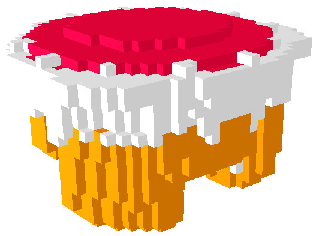

# OC trees

An OC-tree is an instance of the [ocTree type](mainObjectTypes.md#ocTree), which in turn derives from the [sceneObject type](mainObjectTypes.md#sceneObject). It represents a spacial partitioning. It is made up of a tree data structure in which each node has exactly eight children. Occupied leaf nodes are represented as voxels. OC trees can be used to offer a simplified representation for [shapes](shapes.md) or [point clouds](pointClouds.md), or can act as an occupancy grid/space:

*[OC tree]*

OC trees are [collidable](collidableObjects.md), [measurable](measurableObjects.md) and [detectable objects](detectableObjects.md). This means that OC trees:

- Can be used in [collision detections](collisionDetection.md) with other collidable objects.
- Can be used in [minimum distance calculations](distanceCalculation.md) with other measurable objects.
- Can be detected by [proximity sensors](proximitySensors.md).

Refer also to [sceneObject.collidable](sim/property_sceneObject_collidable.htm), [sceneObject.measurable](sim/property_sceneObject_measurable.htm) and [sceneObject.detectable](sim/property_sceneObject_detectable.htm).

OC trees can be added to the [scene](scenes.md) with [Add > OC tree], and edited via the [OC tree dialog](octreePropertiesDialog.md). Refer also to [sim.scene:createObject](sim/scene_createObject.htm) and [ocTree-related methods and properties](apiFunctions.md#methodsAndProperties_ocTree).

The OC tree calculations (i.e. collision, distance and proximity sensor calculations) available in CoppeliaSim are also available as stand-alone routines via the [Coppelia geometric routines](coppeliaGeometricRoutines.md). See also [sceneObject:checkCollision](sim/sceneObject_checkCollision.htm), [collection:checkCollision](sim/collection_checkCollision.htm), [sceneObject:checkDistance](sim/sceneObject_checkDistance.htm), [collection:checkDistance](sim/collection_checkDistance.htm) and [proximitySensor:checkSensor](sim/proximitySensor_checkSensor.htm).
