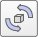
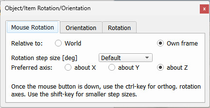
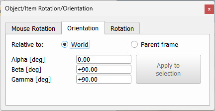
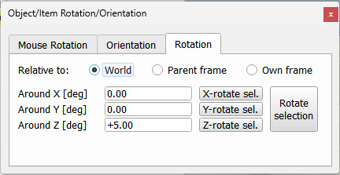

# Orientation dialog

The orientation dialog becomes visible when the object rotation toolbar button is selected:

*[Object rotation toolbar button]*

The dialog has three distinct tabs:

## Mouse Rotation

*[Mouse rotation tab]*

In this section of the dialog, rotation parameters of objects manipulated with the mouse can be set. See also the page on [object movement via the mouse](objectMovement.md).

- **Relative to world/own frame**: indicates that a mouse drag will rotate the selected object about an axis of the absolute reference frame, or the object's own reference frame.
- **Rotation step size**: the step size used when rotating the selected object with a mouse drag (see the [user settings dialog](settings.md) for default step sizes). Smaller step sizes can still be used during manipulation by pressing the shift-key **after** the mouse button was pressed down.
- **Preferred axis: about X/ about Y/ about Z**: indicates that a mouse drag allows rotating the selected object about a preferred axis of the reference frame selected above. Other axes can be used during manipulation by pressing the ctrl-key **after** the mouse button was pressed down.

## Orientation

*[Orientation tab]*

In this section of the dialog, setting a precise object orientation can be achieved.

- **Relative to world/parent frame**: indicates that the indicated [Euler angles](positionOrientationTransformation.md#euler) are relative to the absolute reference frame, or relative to the parent reference frame.
- **Alpha / Beta / Gamma**: [Euler angles](positionOrientationTransformation.md#euler) of the selected object relative to the indicated reference frame (world or parent).

## Rotation

*[Rotation tab]*

In this section of the dialog, precise object rotation can be achieved.

- **Relative to world/parent frame/own frame**: indicates that the rotation will be relative to the absolute reference frame, relative to the parent reference frame, or relative to the object's own reference frame.
- Rotate **around X / Y / Z**: indicates the desired rotation amounts around the x-, y- and z-axis of the indicated reference frame (world, parent or own frame).
