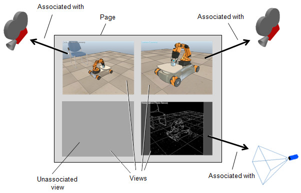
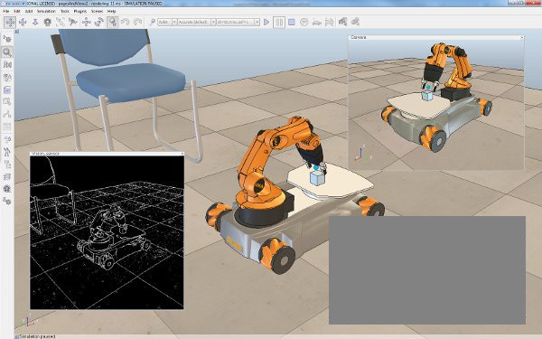
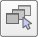
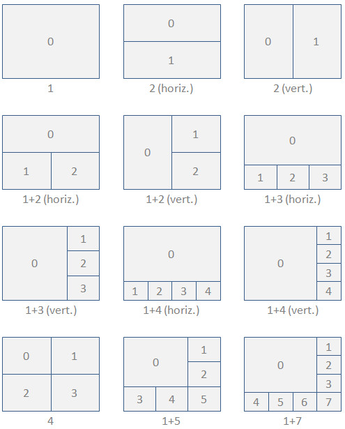
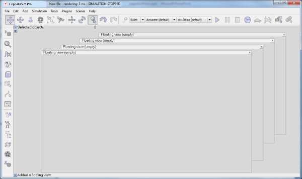

# Pages and views

A page in CoppeliaSim is the main viewing surface of a [scene](scenes.md). It is not directly a view, but can contain one, two, or as many views as needed. A view is what is used to display the image content of a specific [object](objects.md) which has to be a [viewable object](viewableObjects.md). If a view is associated with a [camera object](cameras.md) for instance, then it can display what the camera *sees*. The following figure explains the page, view and viewable object relationship:

*[Page, view and viewable object relationship]*

A view can have a fixed position within a page, or it can have a floating position on the page. Above page, view, and viewable object relationship is illustrated in the following page configuration:

*[Page configuration containing four views. One view is fixed (background view), the other three views are floating]*

Each [scene](scenes.md) in CoppeliaSim has eight freely configurable pages. Individual pages can be accessed (i.e. displayed) through the page selector toolbar button:

 

*[Page selector toolbar button]*

 When a new scene is created, then each of the 8 pages will be pre-configured in a different way. A page can be removed with [Popup menu > Remove Page]. An inexistent page (i.e. removed page) displays a dark-grey surface. A page and a default page configuration with empty views can then be created with [Popup menu > Set-Up Page With...]. Several page configurations are available, as shown in the following figure (numbers indicate view indices):

*[Available page configurations with fixed views]*

The above page configurations allow displaying 1-8 fixed views. Each one of the light-grey surfaces corresponds to an empty view (i.e. unassociated view). At any time, a page can be removed with [Popup menu > Remove Page]. Removing a page will also remove all views that it contains, but will not remove any of the associated objects. On top of an existing page configuration, it is possible to add an unlimited number of floating views with [Popup menu > Add > Floating View]. The following figure shows such an example:

*[Page configuration with four floating views]*

Floating views can be shifted and resized, but do not allow navigation with the left or right mouse button (e.g. camera translations, camera rotations). Double-click a floating view to swap its content with the view index 0. To remove a floating view, simply click its button at its upper right side.

To associate a viewable object with a view, select the object and on the view you wish to associate with it click [Popup menu > View > Associate view with selected camera] or [Popup menu > View > Associate view with selected vision sensor] (the popup menu will automatically adjust its content depending on the last selected object). When a view is created but not yet associated with a viewable object, the [Popup menu > Add > Camera] command will add a camera and directly associate it with the view (i.e. look through it). A given viewable object can be associated with any number of views at the same time.

Alternatively you can also associate a view with a viewable object by activating following popup in a view: [Popup menu > View > View selector...]. This will open the view selector.
