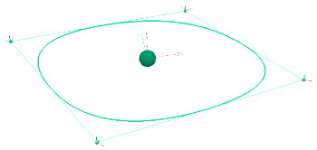
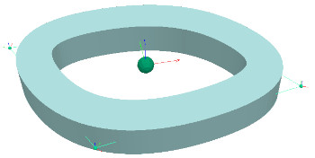
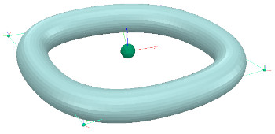

# Paths

A path is a *pseudo* [scene object](objects.md), representing a succession of points with orientation in space: it is rather a [model](models.md) built using [dummies](dummies.md) and a [customization script](customizationScripts.md) that describes its functionality and behavior.



*[Simple path containing 4 control points]*

Paths can be added to the [scene](scenes.md) with [Add > Path]. Refer also to [`sim.scene:createObject`](sim-2/scene_createObject.md). A path is composed of control points that define its curve in space. Control points can be shifted, copy/pasted or deleted.

Path properties are set in its customization script. See also the [Path class](mainObjectTypes.md#Path), [`Path:new`](sim-2/Path_new.md) and [`Path:createShape`](sim-2/Path_createShape.md):



*[Simple path generating an extruded square shape]*



*[Simple path generating an extruded circular shape]*

Path data is stored inside of the path, as a custom data property of type buffer. It can be accessed with:

```python
import sim

# control point data (poses, one column per pose):
ctrlPts = sim.app.unpack(path.customData.pathInfo).ctrlPoints.points

# path data (poses, one column per pose):
pts = sim.app.unpack(path.customData.pathInfo).pathPoints.points
```

```lua
import 'sim-2'

# control point data (poses, one column per pose):
local ctrlPts = sim.app:unpack(path.customData.pathInfo).ctrlPoints.points

# path data (poses, one column per pose):
local pts = sim.app:unpack(path.customData.pathInfo).pathPoints.points
```

To have an object follow a path in position and orientation, you could use the following script:

```lua
import 'sim-2'
import 'simEigen'

function sysCall_init()
    Path = require('Path')

    objectToFollowPath = sim.self:getObject('..')
    pathObj = sim.self:getObject('/Path')
    velocity = 0.04 -- m/s
    posAlongPath = 0
    sim.self:setStepping(true)

    local pathInfo = sim.app:unpack(pathObj.customData.pathInfo)
    local pathPts = pathInfo.pathPoints.points
    local opt = {}
    opt.onlyCtrlPoints = true
    opt.types = {'lin', 'lin', 'lin', 'quat', 'quat', 'quat', 'quat'}
    opt.metric = {1.0, 1.0, 1.0, 0.0, 0.0, 0.0, 0.0}
    opt.closed = pathInfo.opt.closed
    opt.ctrlPoints = {}
    opt.ctrlPoints.duplicateThreshold = 0.0
    opt.ctrlPoints.linearityTolerance = 0.0
    path = Path(pathPts, opt)
    totalLength = path:data().ctrlPoints.pathLength
    -- visualize the actual path being used:
    -- path:createMarkers()
end

function sysCall_thread()
    while true do
        posAlongPath = posAlongPath + velocity * sim.scene.simulation.timeStep
        local pointData = path:getPoint((posAlongPath / totalLength) % 1.0)
        local pose = simEigen.Pose(pointData:data())
        objectToFollowPath:setPose(pose, {relativeToObject = pathObj})
        sim.self:step()
    end
end
```
