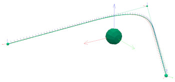

# Paths/trajectories

A path or trajectory is basically just data or a data structure appropriately generated or interpreted. The type of underlying data can be very varied and can represent 1D, 2D or 3D positions, but also orientations, poses, robot configurations/states, etc. For that reason it really depends on the user how that data structure is implemented in code. CoppeliaSim offers the [Path class](apiFunctions.md#methodsAndProperties_Path), meant to create, interpret, visualize and manipulate basic path/trajectory data.

There is however one particular type of path data that is often used and that can also be represented in 3D space: poses, i.e. positions and orientations. CoppeliaSim offers a [path object](paths.md) for this type of data, that can be modified by moving/duplicating/erasing its control points acting as support of the underlying curve:

*[Simple path object, composed of 100 pose data points]*

Refer also to [scene:createObject](sim/scene_createObject.htm).
