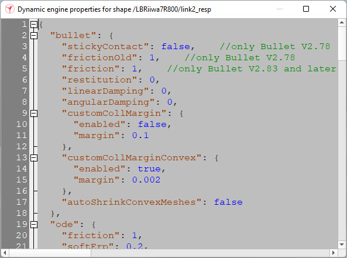
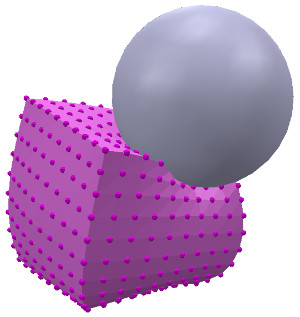
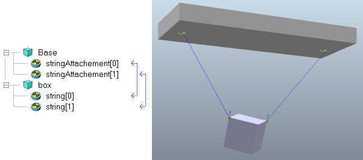

# Physics engine differences

Each [physics engine supported in CoppeliaSim](dynamicsModule.md) operates in a different manner, and each generates slightly or completely different results. Results depend on the engine's specific algorithms and calculation routines, but also on the engine specific properties/parameters that are used. While it would be possible to very roughly abstract some individual properties (e.g. the coefficient of friction for a body), the result would often not be the one expected: there is rarely a one-to-one correspondence between different engine properties/parameters, and for this reason, the user can adjust them on an engine-basis. The default engine properties/parameters have been selected to perform best in most situations, but depending on the task and application, one often has to fine-tune them for stability or realism. This can be done via the Engine properties button (in the [shape dynamics dialog](shapeDynamicsProperties.md), in the [joint dynamics dialog](jointDynamicsProperties.md), or in the [simulation dialog](simulationPropertiesDialog.md)):

*[Engine properties editor, for a shape]*

Refer also to the [dynamics related methods and properties](apiFunctions.md#methodsAndProperties_dynamics). A few engine properties require additional explanation:

- **Realistic masses and inertia matrices**: while the [MuJoCo](dynamicsModule.md#mujoco), [Vortex](dynamicsModule.md#vortex) and [Newton](dynamicsModule.md#newton) engines allow you to use realistic values for masses and inertias, the [Bullet](dynamicsModule.md#bullet) and [ODE](dynamicsModule.md#ode) engines on the other hand often require *mass and inertia balancing* (i.e. keeping mass and inertia differences between connecting shapes relatively small). See also [`shape.dynamics.mass`](sim-2/property_shape_dynamics_mass.htm), [`shape.dynamics.inertiaMatrix`](sim-2/property_shape_dynamics_inertiaMatrix.htm), and [`shape.dynamics.centerOfMass`](sim-2/property_shape_dynamics_centerOfMass.htm).
- **Joints**: the [`joint.dynamics.mujoco.armature`](sim-2/property_joint_dynamics_mujoco_armature.htm) property is maybe one of the more important [MuJoCo](dynamicsModule.md#mujoco) engine specific parameters, and it can have a big impact on how a joint behaves: it adds a rotor inertia (or reflected inertia) to a joint, making the simulation more stable and often increasing physical realism. One should keep in mind that this often requires an increased force or torque that the joint has to deliver.
- **Consecutive joints**: consecutive joints that are dynamically enabled are only supported with the [MuJoCo](dynamicsModule.md#mujoco) engine. With the other engines, auxiliary masses should be inserted between consecutive joints.
- **Joints in velocity, position or spring-damper control mode**: with the [MuJoCo](dynamicsModule.md#mujoco) engine, and when the hierarchy tree (starting at the given joint) contains at least one loop closure constraint, the joint might not behave as expected when in position, velocity or spring-damper control mode. In that case, it is recommended to instead run a custom controller for that joint.
- **Dynamic content modification**: modifying the content of a scene during simulation, such as adding/removing an object, changing the scene hierarchy, or dynamically resetting an object, is handled seamlessly with all engines, except for the [MuJoCo](dynamicsModule.md#mujoco) engine that requires a full restart each time: that operation is relatively slow, but will preserve the state of the simulation at that time (e.g. object poses and velocities). One common and frequent situation where this happens is applications of omnidirectional wheel robots, where a dynamic object reset is required in each simulation step.
- **Non-convex shapes**: non-convex meshes are difficult and slow to simulate in general, and often unstable. For that reason they should be avoided at all costs. Some engines however still support them, while others will revert to using their convex representation for simulation (the [Newton](dynamicsModule.md#newton) and [MuJoCo](dynamicsModule.md#mujoco) engines).
- **Static shapes**: static, respondable shapes that are programmatically moved interact with dynamic, respondable shapes. This interaction includes collision response and friction force transmission. The [MuJoCo](dynamicsModule.md#mujoco) engine however does not transmit friction forces from static shapes when moved, unless the shape is flagged as kinematic via [`shape.kinematic`](sim-2/property_shape_kinematic.htm). In that case, the static shape is represented in MuJoCo as a *mocap* body linked to a dynamic body via a *weld* constraint.
- **Surface velocity**: most engines support body surface velocities, which are often used to simulate a simple conveyor modeled as a cuboid with a surface velocity. This is not possible with the [MuJoCo](dynamicsModule.md#mujoco) engine, which only supports conveyor belts, where each belt element is static and kinematic, and programmatically moved.
- **Soft bodies**: only the [MuJoCo](dynamicsModule.md#mujoco) engine supports soft bodies, including clothes and ropes. Those are generated in CoppeliaSim by adding composite items via [XML injection](simMujoco/simMujoco.htm). Additional constraints and behavior can be achieved also via XML injection, knowing that generated XML files have consistent object naming, based on CoppeliaSim object names and handles: object:getName({mode = 'nameHandle'}). Generated MuJoCo files can be found via [`sim.app.paths.mujoco`](sim-2/property_app_paths_mujoco.htm).

*[Soft body simulation]*

- **Cables/strings and elastics**: only the [MuJoCo](dynamicsModule.md#mujoco) engine supports tendon-like constraints between two shapes. Those are realized via linked [dummies](dummies.md), where the link type is *Dynamics, tendon constraint*. Those tendons can be motorized via a proxy prismatic joint. Other engines will have to revert to modeling a string via two spherical and one prismatic joint, with appropriate auxiliary masses in-between.

*[Strings/elastics]*
