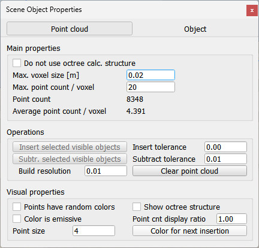

# Point cloud dialog

The point cloud dialog is part of the [scene object dialog](sceneObjectPropertiesDialog.md), which is located at [Tools > Scene object properties]. You can also open the dialog with a double-click on an object icon in the [scene hierarchy](userInterface.md#SceneHierarchy), or with a click on its [toolbar](userInterface.md#toolbars) button:

*[Scene object properties toolbar button]*

In the scene object dialog, click the **Point cloud** button to display the OC tree dialog (the **Point cloud** button only appears if the last selection is a [point cloud](pointClouds.md)). The dialog displays the settings and parameters of the last selected point cloud:

*[Point cloud dialog]*

- **Do not use OC tree calc. structure**: by default, point clouds use an OC tree-like calculation structure for efficient point manipulation. Inserting points and removing points might be slowed down by this structure. If you enable this item, then point inserting will be more efficient, but the point cloud will not be [collidable](collidableObjects.md), [measurable](measurableObjects.md) nor [detectable](detectableObjects.md) anymore, and some other operations might also be limited. You can always toggle this item at a later stage, or via [`sim.setPointCloudOptions`](sim-1/simSetPointCloudOptions.md).
- **Max. voxel size**: the maximum size of the OC tree voxels that will contain points. The smaller the size, the more memory will be used for the OC tree data structure this point cloud is based on. Refer also to [`pointCloud.cellSize`](sim-2/property_pointCloud_cellSize.md).
- **Max. point count / voxel**: the maximum number of points a single OC tree voxel can contain. If more points need to be stored in such a voxel, it will be split into 8 child voxels until the constraint is satisfied. For efficient collision detection, distance calculation and proximity sensor detections, it is recommended to keep about 10-20 points stored in a single voxel. Refer also to [`pointCloud.maxPointsInCell`](sim-2/property_pointCloud_maxPointsInCell.md).
- **Insert selected visible objects**: allows you to insert points based on the selected, visible objects. Only [dummies](dummies.md), [shapes](shapes.md), [OC trees](octrees.md) and [point clouds](pointClouds.md) are taken into account. Select all objects you want to insert, then select the target point cloud object last. Shapes will previously be converted to a temporary OC tree with the specified **build resolution**. The **Insert tolerance** item allows you to avoid having duplicate points, by specifying a minimum distance tolerance used to decide whether the point will be inserted or not. With an insert tolerance > 0.0 the point insertion will be slower. Refer also to [`pointCloud:addFromObjects`](sim-2/pointCloud_addFromObjects.md) and [`pointCloud:addPoints`](sim-2/pointCloud_addPoints.md).
- **Subtract selected visible objects**: allows you to subtract points based on the selected, visible objects. Only [dummies](dummies.md), [OC trees](octrees.md) and [point clouds](pointClouds.md) are taken into account. Select all objects you want to subtract, then select the target point cloud object last. Dummies and point clouds will use a **subtract tolerance** value to identify points to remove. Refer also to [`pointCloud:subtractFromObjects`](sim-2/pointCloud_subtractFromObjects.md) and [`pointCloud:subtractPoints`](sim-2/pointCloud_subtractPoints.md).
- **Clear point cloud**: removes all the points from the point cloud. Refer also to [`pointCloud:clear`](sim-2/pointCloud_clear.md).
- **Points have random colors**: each point will have a random color. Refer also to [`pointCloud.randomColors`](sim-2/property_pointCloud_randomColors.md).
- **Show OC tree structure**: shows the underlying OC tree data structure, mainly for debugging purposes.
- **Color is emissive**: points will be shown in emissive colors.
- **Point cnt display ratio**: point clouds that contain a large number of points might slow down the rendering. By setting a ratio smaller than 1, a smaller amount of points will be displayed for each OC tree voxel that contains points. This has only an impact on the displayed/rendered image. Refer also to [`pointCloud.pointDisplayFraction`](sim-2/property_pointCloud_pointDisplayFraction.md).
- **Point size**: the size of points, in pixels. Refer also to [`pointCloud.pointSize`](sim-2/property_pointCloud_pointSize.md).
- **Color for next insertion**: allows you to select a new color, which will be used for new point insertions.
