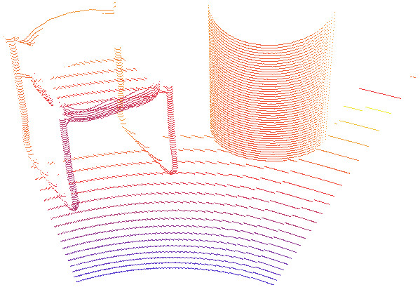

# Point clouds

A point cloud is an instance of the [pointCloud type](mainObjectTypes.md#pointCloud), which in turn derives from the [sceneObject type](mainObjectTypes.md#sceneObject). It acts as an OC tree-based container of points:

*[Point cloud]*

Point clouds are [collidable](collidableObjects.md), [measurable](measurableObjects.md) and [detectable objects](detectableObjects.md). This means that point clouds:

- Can be used in [collision detections](collisionDetection.md) with other collidable objects that are volume based, such as [OC trees](octrees.md).
- Can be used in [minimum distance calculations](distanceCalculation.md) with other measurable objects.
- Can be detected by [proximity sensors](proximitySensors.md).

Refer also to [sceneObject.collidable](sim/property_sceneObject_collidable.htm), [sceneObject.measurable](sim/property_sceneObject_measurable.htm) and [sceneObject.detectable](sim/property_sceneObject_detectable.htm).

Point clouds can be added to the [scene](scenes.md) with [Add > Point cloud], and edited via the [point cloud dialog](pointCloudPropertiesDialog.md). Refer also to [sim.scene:createObject](sim/scene_createObject.htm) and [pointCloud-related methods and properties](apiFunctions.md#methodsAndProperties_pointCloud).

The point cloud calculations (i.e. collision, distance and proximity sensor calculations) available in CoppeliaSim are also available as stand-alone routines via the [Coppelia geometric routines](coppeliaGeometricRoutines.md). See also [sceneObject:checkCollision](sim/sceneObject_checkCollision.htm), [collection:checkCollision](sim/collection_checkCollision.htm), [sceneObject:checkDistance](sim/sceneObject_checkDistance.htm), [collection:checkDistance](sim/collection_checkDistance.htm) and [proximitySensor:checkSensor](sim/proximitySensor_checkSensor.htm).
