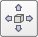
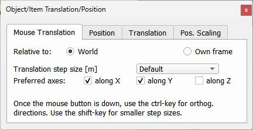
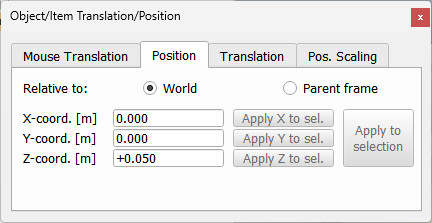
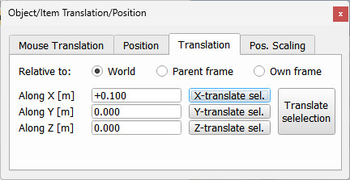
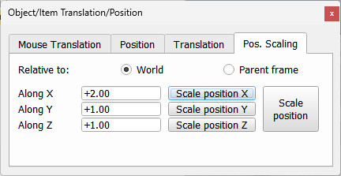

# Position dialog

The position dialog becomes visible when the object translation toolbar button is selected:

*[Object translation toolbar button]*

The dialog has four distinct tabs:

## Mouse Translation

*[Mouse translation tab]*

In this section of the dialog, translation parameters of objects manipulated with the mouse can be set. See also the page on [object movement via the mouse](objectMovement.md).

- **Relative to world/own frame**: indicates that a mouse drag will translate the selected object on a plane or line that is aligned with the absolute reference frame, or aligned with the object's own reference frame.
- **Translation step size**: the step size used when translating the selected object with a mouse drag (see the [user settings dialog](settings.md) for default step sizes). Smaller step sizes can still be used during manipulation by pressing the shift-key **after** the mouse button was pressed down.
- **Preferred axes: along X/ along Y/ along Z**: indicates that a mouse drag allows translating the selected object along preferred axes of the reference frame selected above. Other axes can be used during manipulation by pressing the ctrl-key **after** the mouse button was pressed down.

## Position

*[Position tab]*

In this section of the dialog, precise positioning can be achieved on objects or items.

- **Relative to world/parent frame**: indicates that the coordinates are relative to the absolute reference frame, or relative to the parent reference frame.
- **X-/ Y- / Z-coordinate**: position of the selected object relative to the indicated reference frame (world or parent).

## Translation

*[Translation tab]*

In this section of the dialog, precise object or item translation can be achieved.

- **Relative to world/parent frame/own frame**: indicates that the translation will be relative to the absolute reference frame, relative to the parent reference frame, or relative to the object's own reference frame.
- Translate **along X / Y / Z**: indicates the desired translation amounts along the x-, y- and z-axis of the indicated reference frame (world, parent or own frame).

## Position scaling

*[Position scaling tab]*

In this section of the dialog, precise scaling of object or item's position can be achieved.

- **Relative to world/parent frame**: indicates that the position scaling will be relative to the absolute reference frame, or relative to the parent reference frame.
- Scale **along X / Y / Z**: indicates the desired position scaling along the x-, y- and z-axis of the indicated reference frame (world or parent).
