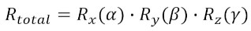
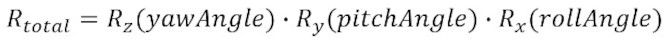
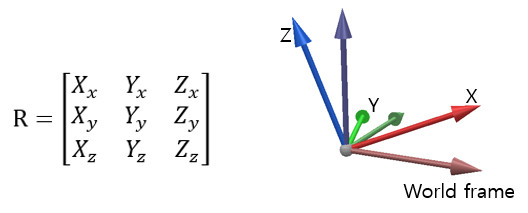
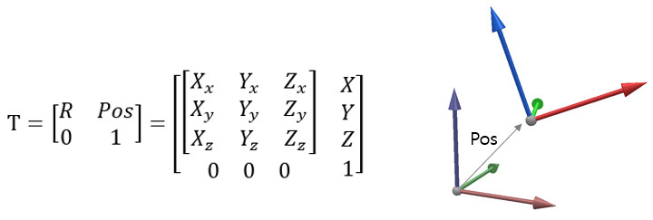

# On positions and orientations

In CoppeliaSim there are many different ways to [get, set, or work with positions & orientations](apiFunctions.md#transformations). The following nomenclature is used throughout this user manual:

- Position: three coordinates (x,y,z), representing a position in 3D space. The position can be absolute (i.e. relative to the world frame), or relative to a specific frame. In CoppeliaSim, positions and position-related values are expressed as a [sim.Vector](simEigen/simEigen.htm#Vector).
- Orientation: an orientation in 3D space that can be specified as *[Euler angles](#euler)*, a *[quaternion](#quaternion)*, or a *[rotation matrix](#rotation)*. The orientation can be absolute (i.e. relative to the world frame), or relative to a specific frame.
- Reference frame: also referred to as simply *transformation* or *frame*, it represents a position and orientation in 3D space. It can be specified as a [pose, a transformation matrix](#pose), or as a position and orientation. A reference frame can be absolute (i.e. relative to the world frame), or relative to another reference frame.

## <a id="euler"></a>Euler angles

The [Euler angles](http://en.wikipedia.org/wiki/Euler_angles) are three angles that describe a rotation, the orientation of a rigid body, or the orientation of a frame. There are twelve different conventions when talking about Euler angles. They can be grouped into **Proper Euler angles**, and **Tait-Bryan angles** where the latter represents rotations about three distinct axes. In CoppeliaSim, **Tait-Bryan angles** *alpha*, *beta* and *gamma* (or (a,b,g)) are used, describing a rotation composed by three elemental rotations:



*[Euler angles convention in CoppeliaSim]*

where Rz, Ry and Rx represent elemental rotations about axes Z, Y and X respectively (in that order), of the **absolute** reference frame.

For a rigid body, or [scene object](objects.md), you can obtain the same transformation if you rotate it in the following order about its **own** reference frame: rotation of *alpha* about own x, followed by a rotation of *beta* about own y, followed by a rotation of *gamma* about own z.

**Yaw-Pitch-Roll** are also **Tait-Bryan angles** describing a rotation composed by three elemental rotations:



*[Yaw-Pitch-Roll rotations]*

where Rx, Ry and Rz represent elemental rotations about axes X, Y and Z respectively (in that order), of the **absolute** reference frame.

Use following to convert between *alpha-beta-gamma* angles and *yaw-pitch-roll* angles:

```lua
-- Lua
local yprAngles = sim.Quaternion:fromeuler(eulerAngles):toypr()
local eulerAngles = sim.Quaternion:fromypr(yprAngles):toeuler()
```

## <a id="quaternion"></a>Quaternions

[Quaternions](https://en.wikipedia.org/wiki/Quaternion) are four values that uniquely describe a rotation, the orientation of a rigid body, or the orientation of a frame. They are superior to Euler angles in several ways (e.g. no gimbal lock), but are more difficult to understand and construct. For that reason they are never used in user interfaces, but preferred when working with orientations in code. In CoppeliaSim, quaternions are expressed as [sim.Quaternion](simEigen/simEigen.htm#Quaternion): they hold (Qx,Qy,Qz,Qw), where (Qx,Qy,Qz) is the rotation axis unit vector multiplied by sin(angle/2), and Qw is cos(angle/2), where angle is the rotation angle. See also following operations:

```lua
-- Lua
local m = sim.Quaternion:torotation(q)
local q = sim.Quaternion:fromrotation(m)
local axis, angle = q:axisangle(q2)
```

## <a id="rotation"></a>Rotation matrices

A [rotation matrix](https://en.wikipedia.org/wiki/Rotation_matrix) is a 3x3 matrix that describes a rotation, the orientation of a rigid body, or the orientation of a frame:



*[Rotation matrix in 3D space]*

In the above matrix, unit vectors (Xx,Xy,Xz), (Yx,Yy,Yz) and (Zx,Zy,Zz) represent the reference frame's axes X, Y and Z respectively. In CoppeliaSim, matrices are expressed as [sim.Matrix](simEigen/simEigen.htm#Matrix). See also following operations:

```lua
-- Lua
local m = sim.Quaternion:torotation(q)
local q = sim.Quaternion:fromrotation(m)
local axis, angle = q:axisangle(q2)
```

## <a id="transformation"></a>Transformation matrices

A [transformation matrix](https://en.wikipedia.org/wiki/Transformation_matrix) is a 4x4 matrix that describes a frame-frame transformation in 3D space. The first 3x3 elements of the matrix represent a [rotation matrix](#rotation):



*[Transformation matrix in 3D space]*

In CoppeliaSim, transformation matrices are expressed as [sim.Matrix](simEigen/simEigen.htm#Matrix). See also following operations:

```lua
-- Lua
local tr = sim.Pose:totransform(p)
local trTransfosed = tr:transposed()
local p = sim.Pose:fromtransform(tr)
```

## <a id="pose"></a>Poses

[Poses](https://en.wikipedia.org/wiki/Pose_(computer_vision)) are values that describe a frame transformation in 3D space. In CoppeliaSim, poses are expressed as [sim.Pose](simEigen/simEigen.htm#Pose): they hold (X,Y,Z,Qx,Qy,Qz,Qw), i.e. a position and quaternion information. See also following operations:

```lua
-- Lua
local p = sim.Pose:fromtransform(tr)
local tr = sim.Pose:totransform(p)
local pos = p.translation
local quaternion = p.rotation
local pInversed = p:inv()
```
