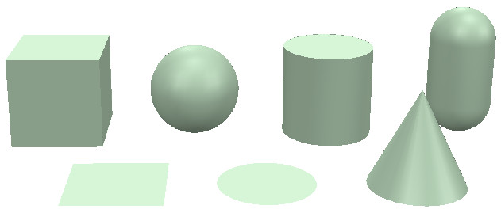
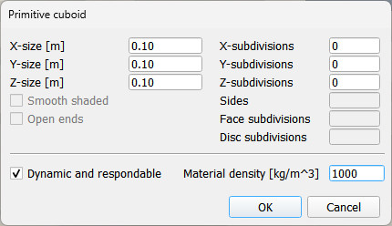
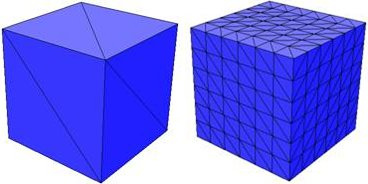

# Primitive shapes

In addition to [importing meshes](importExport.md) from an external file, [shapes](shapes.md) can also directly be created inside CoppeliaSim by selecting [Add > Primitive shape]:

*[Primitive shapes]*

Geometric parameters of the primitive shapes can be adjusted in the primitive shape dialog:

*[Primitive shape dialog]*

- **X- / Y- / Z-size**: size along the world reference frame's x- / y- / z-axis.
- **X- / Y- / Z-Subdivisions**: number of elements along the world reference frame's x- / y- / z-axis
- **Smooth shaded**: whether the shape should appear smooth (Gouraud shading) or sharp.
- **Open ends**: whether the cylinder has open ends.
- **Sides**: number of sides of a cylinder, disc or sphere.
- **Face subdivisions**: number of face subdivisions of a cylinder.
- **Disc subdivisions**: number of disc subdivisions (disc or cylinder)
- **Dynamic and respondable**: if selected, the generated shape will be dynamically enabled, i.e. [dynamic and respondable](designingDynamicSimulations.md#staticAndRespondable). Those properties can be changed at a later time too.
- **Material density**: the density of the material.

The subdivisions and faces properties cannot directly be seen and have no direct effect. The following shows two similar shapes with different subdivision parameters:

*[Two cuboids with different subdivision parameters (as seen in the [triangle edit mode](triangleEditMode.md))]*

Shapes with a higher subdivision count can reflect light in a more differentiated way, depending on the selected renderer. See the [triangle edit mode](triangleEditMode.md) and the **Subdivide largest triangles** option for more details.

Colors and other visual attributes should be adjusted in the [shape dialog](shapeProperties.md). The shape mesh can also be adjusted and edited in the [shape edit modes](shapeEditModes.md), or in the [geometry dialog](geometryDialog.md).

Refer also to [`scene:createObject`](sim-2/scene_createObject.md).
