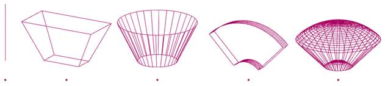
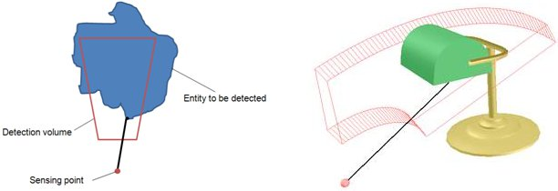

# Proximity sensor types and mode of operation

[Proximity sensors](proximitySensors.md) come in 6 different types and can be customized to a large extent:

- **Ray-type**: the ray-type proximity sensor is ideally suited for very simple modeling of a proximity sensor, or for modeling of a laser range finder. They are the fastest proximity sensors.
- **Randomized ray-type**: the randomized ray-type proximity sensor operates as a ray-type sensor that randomly sweeps a cone volume. It has a similar appearance to the cone-type proximity sensor.
- **Pyramid-type**: the pyramid-type proximity sensor is ideally suited for simple modeling of a proximity sensor with a detection volume that is rectangular. They are very fast.
- **Cylinder-type**: the cylinder-type proximity sensor is ideally suited for simple modeling of a proximity sensor with a detection volume that is revolute. They are very fast.
- **Disk-type**: the disk-type proximity sensor allows precise modeling of a proximity sensor with a revolute-scanning detection volume. Depending on the selected precision and operation mode, they can be a little bit more calculation intensive.
- **Cone-type**: the cone-type proximity sensor allows for the best and most precise modeling of most proximity sensors. Depending on the selected precision and operation mode, they can be a little bit more calculation intensive.

*[Ray-type, pyramid-type, cylinder-type, disk-type and cone- or randomized ray-type proximity sensors]*

Proximity sensors operate in a geometrically exact manner: they perform an exact distance calculation between their sensing point (small sphere) and any [detectable](detectableObjects.md) [entity](entities.md) that interferes with its detection volume (they don't perform a simple collision detection between the sensing volume edges like most other simulation software, but an exact distance calculation within the detection volume). Each proximity sensor will compute the following minimum distance:

Sensing point &lt;-- --> (detectable entity ∩ detection volume)

*[Minimum distance calculation between sensing point and (detectable entity ∩ detection volume)]*

If a proximity sensor detects an object, then a trigger is activated, which will result in a call to the [trigger callback function](triggerCallbackFunctions.md).
