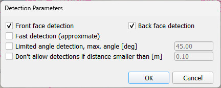
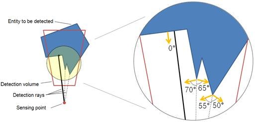
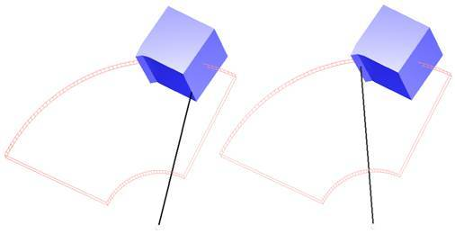
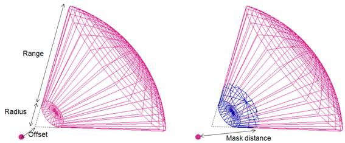

# Proximity sensor detection parameter dialog

The proximity sensor detection parameter dialog is part of the [proximity sensor dialog](proximitySensorPropertiesDialog.md). The dialog displays various detection parameters of the last selected [proximity sensor](proximitySensors.md).

*[Proximity sensor detection parameter dialog]*

- **Front / back face detection**: the user can decide which side of a triangle the sensor will *see* and detect. Front faces appear as blue, back faces appear as red in the [triangle edit mode](triangleEditMode.md). Refer also to [`proximitySensor.frontFaceDetection`](sim-2/property_proximitySensor_frontFaceDetection.htm) and [`proximitySensor.backFaceDetection`](sim-2/property_proximitySensor_backFaceDetection.htm).
- **Fast detection (approximate)**: when selected, the detection process will be faster, but not exact anymore (i.e. the detected point might not be the closest point). Refer also to [`proximitySensor.exactMode`](sim-2/property_proximitySensor_exactMode.htm).
- **Limited angle detection**: when selected, a maximum angle between the detection ray and an object's face normal vector can be specified. This is a useful feature when modeling ultrasonic proximity sensors. Ultrasonic proximity sensors normally cannot *see* surfaces that don't face the sensor enough. When enabled and the maximum angle is small, calculation time can be drastically increased. Refer also to [`proximitySensor.angleThreshold`](sim-2/property_proximitySensor_angleThreshold.htm).

*[Limited angle detection principle. Yellow arrows indicate surface normal vectors. Maximum angle is 30° (for example)]*

*[Two identical proximity sensor configurations. Only one proximity sensor has the limited angle detection turned on (right)]*

- **Don't allow detections if distance smaller than**: some sensors have a minimum detection distance (e.g. ultrasonic sensors) from which the sensor won't be operating anymore (i.e. the object to be detected is too close to the sensor). To model this behavior, you could simply set an offset for the detection volume, but by doing so the sensor will still be able to detect other objects that are located farther away. A real sensor would have its "view field" blocked by the closer object and not detect anything. This can be modeled by indicating a minimum detection distance (a mask distance) that, if undershot, would simply disable detection. Refer also to [`proximitySensor.closeThreshold`](sim-2/property_proximitySensor_closeThreshold.htm).

*[Two proximity sensors, one without mask distance (left), the other with mask distance (right)]*
