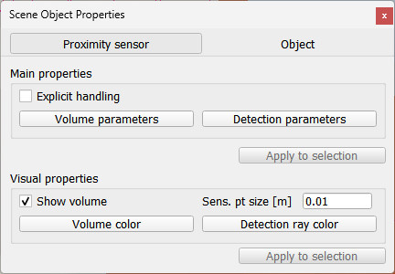

# Proximity sensor dialog

The proximity sensor dialog is part of the [scene object dialog](sceneObjectPropertiesDialog.md), which is located at [Tools > Scene object properties]. You can also open the dialog with a double-click on an object icon in the [scene hierarchy](userInterface.md#SceneHierarchy), or with a click on its [toolbar](userInterface.md#toolbars) button:

*[Scene object properties toolbar button]*

In the scene object dialog, click the **Proximity sensor** button to display the proximity sensor dialog (the **Proximity sensor** button only appears if the last selection is a [proximity sensor](proximitySensors.md)). The dialog displays the settings and parameters of the last selected proximity sensor. If more than one proximity sensor is selected, then some parameters can be copied from the last selected proximity sensor to the other selected proximity sensors (**Apply to selection**-buttons):

*[Proximity sensor dialog]*

- **Explicit handling**: indicates whether the sensor should be explicitly handled. If checked, the sensor does not calculate a proximity distance, unless explicitly requested via e.g. [`proximitySensor:handleSensor`](sim-2/proximitySensor_handleSensor.md) or [`proximitySensor:checkSensor`](sim-2/proximitySensor_checkSensor.md). Refer also to the section on [explicit and non-explicit calls](explicitHandling.md).
- **Volume parameters**: Toggles the [proximity sensor volume dialog](proximitySensorVolumeDialog.md). That dialog allows you to customize a proximity sensor's detection volume.
- **Detection parameters**: opens the [proximity sensor detection parameter dialog](proximitySensorDetectionParameterDialog.md). That dialog allows you to customize various detection parameters.
- **Show volume**: displays or hides the detection volume. Refer also to [`proximitySensor.showVolume`](sim-2/property_proximitySensor_showVolume.md).
- **Sensing point size**: the size of the sensing point. This has no effect on calculations (the sensing point, even if displayed big, is always considered as a point). Refer also to [`proximitySensor.pointSize`](sim-2/property_proximitySensor_pointSize.md).
- **Volume color**: allows adjusting the color of the sensor's volume.
- **Detection ray color**: allows adjusting the color of the sensor's detection ray.
