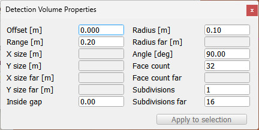
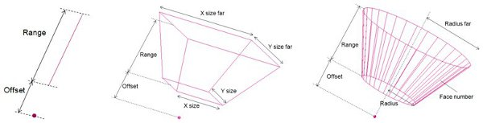
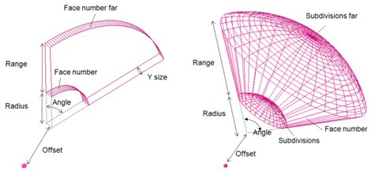
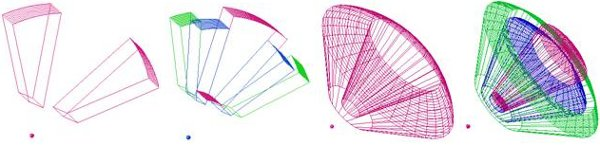

# Proximity sensor volume dialog

The proximity sensor volume dialog is part of the [proximity sensor dialog](proximitySensorPropertiesDialog.md). The dialog displays the volume settings and parameters of the last selected [proximity sensor](proximitySensors.md). If no object is selected, the dialog is inactive. If more than one proximity sensor is selected, then some parameters can be copied from the last selected proximity sensor to the other selected proximity sensors (**Apply to selection**-buttons):

*[Proximity sensor volume dialog]*

The six types of the volume of a proximity sensor (ray, randomized ray, pyramid, cylinder, disc and cone) are defined via several parameters:

*[Ray, pyramid and cylinder-type detection volume parameters]*

*[Disk and cone-type detection volume parameters]*

- **Face count**, **face count far**, **subdivisions** and **subdivisions far** can be used to describe the detection volume with more or less precision. More precision also implies longer calculation times.
- **Inside gap**: parameter only available for the disc- and cone-type proximity sensors. Its value can vary between 0 and 1 and represents the amount of volume (proportionally) to remove. This feature can be used to create very sophisticated detection volumes by combining several sensors:

*[Inside gap functionality and its application]*

Refer also to the [proximitySensor properties](apiFunctions.md#methodsAndProperties_proximitySensor).
