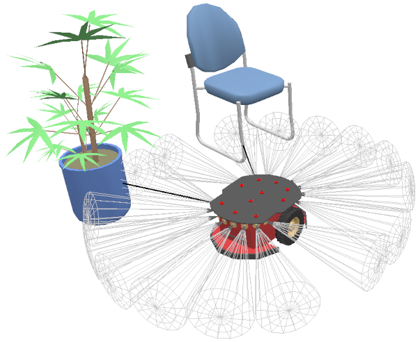

# Proximity sensors

CoppeliaSim offers a very powerful and efficient way to simulate proximity sensors: a proximity sensor is an instance of the [proximitySensor type](mainObjectTypes.md#proximitySensor), which in turn derives from the [sceneObject type](mainObjectTypes.md#sceneObject). It detects [detectable](detectableObjects.md) [entities](entities.md). The following figure illustrates a simulation that uses proximity sensors:

*[Mobile robot using proximity sensors]*

Proximity sensors are added to the [scene](scenes.md) with [Add > Proximity sensor]. Refer also to [`sim.scene:createObject`](sim-2/scene_createObject.md) and [proximitySensor-related methods and properties](apiFunctions.md#methodsAndProperties_proximitySensor).

The proximity sensor detection routines used by the proximity sensors are also available as stand-alone routines via the [Coppelia geometric routines](coppeliaGeometricRoutines.md). Refer also to [`proximitySensor:checkSensor`](sim-2/proximitySensor_checkSensor.md).
