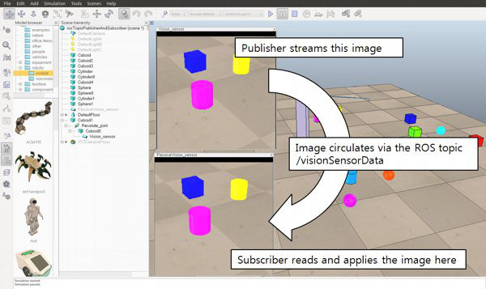
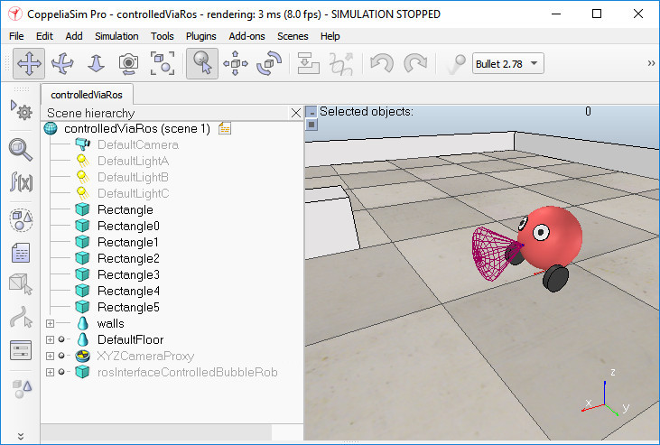

# ROS tutorial

This tutorial will try to explain in a simple way how you can manage to have CoppeliaSim *ROS enabled*, based on [ROS Melodic](http://wiki.ros.org/melodic) and [Catkin build](http://catkin-tools.readthedocs.io/en/latest/installing.html).

First of all you should make sure that you have gone through the [official ROS tutorials](http://www.ros.org/wiki/ROS/Tutorials), at least the beginner section, and that you have installed the [Catkin tools](http://catkin-tools.readthedocs.io/en/latest/installing.html). Then, we assume that you have the latest Ubuntu running, that ROS is installed, and that the workspace folders are set. Here also refer to the [official documentation regarding the ROS installation](http://wiki.ros.org/melodic/Installation/Ubuntu).

The general ROS functionality in CoppeliaSim is supported via the [ROS Interface](rosInterf.md) (*libsimROS.so*). The Linux distribution should include that file already compiled in *CoppeliaSim/compiledROSPlugins*, but it first needs to be copied to *CoppeliaSim/*, otherwise it won't be loaded. You might, however, experience plugin load problems, depending on your system specificities: make sure to always inspect the terminal window of CoppeliaSim for details about plugin load operations. The ROS plugin is loaded with:

```lua
--lua

simROS = require('simROS')
```

The load operation will only be successful if roscore is running at that time. Make sure to source the ROS environment prior to running CoppeliaSim.

If the plugin cannot be loaded, then you should recompile it yourself. It is open source and can be modified as much as needed to support a specific feature or to extend its functionality. If specific messages/services/etc. need to be supported, make sure to edit files located in *simROS/meta/*, prior to recompilation. There are 2 packages:

- [simROS](https://github.com/CoppeliaRobotics/simROS): this package is the [ROS Interface](rosInterf.md) that will be compiled to a ".so" file, and that is used by CoppeliaSim.
- [ros_bubble_rob](https://github.com/CoppeliaRobotics/ros_bubble_rob): this is the package of a very simple robot controller that connects to CoppeliaSim via the [ROS Interface](rosInterf.md). This node will be in charge of controlling the red robot in the demo scene *controlTypeExamples/controlledViaRos.ttt*

Above packages should be copied to your *catkin_ws/src* folder. Make sure that ROS is aware of those packages, i.e. that you can switch to the above package folders with:

```
$ roscd sim_ros_interface
$ roscd ros_bubble_rob
```

To build the packages, navigate to the *catkin_ws* folder and type:

```
$ export COPPELIASIM_ROOT_DIR=~/path/to/coppeliaSim/folder
$ catkin build --cmake-args -DCMAKE_BUILD_TYPE=Release
```

Note for Ubuntu 20.04: due to a bug in python-catkin-tools you need to use catkin_make instead of catkin build.

That's it! The packages should have been generated and compiled to a library. Copy the devel/lib/libsimROS.so file to the CoppeliaSim installation folder. The plugin is now ready to be used!

Now open a terminal and start the ROS master with:

```
$ roscore
```

Open another terminal, move to the CoppeliaSim installation folder, start CoppeliaSim and load the ROS plugin with the above Lua code. Upon successful ROS Interface load, checking the available nodes gives this:

```
$ rosnode list
/rosout
/sim_ros_interface
```

In an empty CoppeliaSim scene, select an object, then attach a non-threaded [simulation script](simulationScripts.md) to it with [Add > Script object > simulation script > Non threaded > Lua/Python]. Open the [script editor](scriptEditor.md) for that script and replace the content with the following:

```lua
--lua

function subscriber_callback(msg)
    -- This is the subscriber callback function
    sim.app:logInfo('subscriber receiver following Float32: ' .. msg.data)
end

function getTransformStamped(object, name, relToName)
    -- This function retrieves the stamped transform for a specific object
    local t = sim.app.systemTime
    local p = object.worldPosition
    local q = object.worldQuaternion
    return {
        header = {
            stamp = t,
            frame_id = relToName
        },
        child_frame_id = name,
        transform = {
            translation = {x = p[1], y = p[2], z = p[3]},
            rotation = {x = q[1], y = q[2], z = q[3], w = q[4]}
        }
    }
end

function sysCall_init()
    sim = require('sim-2')
    simROS = require('simROS')

    -- The simulation script initialization
    object = sim.self:getObject('..')
    objectName = object:getName({mode = 'nameHandle'})

    -- Prepare the float32 publisher and subscriber (we subscribe to the topic we advertise):
    publisher = simROS.advertise('/simulationTime', 'std_msgs/Float32')
    subscriber = simROS.subscribe('/simulationTime', 'std_msgs/Float32', 'subscriber_callback')
end

function sysCall_actuation()
    -- Send an updated simulation time message, and send the transform of the object attached to this script:
    simROS.publish(publisher, {data = sim.scene.simulation.time})
    simROS.sendTransform(getTransformStamped(object, objectName, 'world'))
    -- To send several transforms at once, use simROS.sendTransforms instead
end

function sysCall_cleanup()
    -- Following not really needed in a simulation script (i.e. automatically shut down at simulation end):
    simROS.shutdownPublisher(publisher)
    simROS.shutdownSubscriber(subscriber)
end
```

Above script publishes the simulation time, and subscribes to it at the same time. It also publishes the transform of the object the script is attached to. You should be able to see the simulation time topic with:

```
$ rostopic list
```

To see the message content, you can type:

```
$ rostopic echo /simulationTime
```

Now load the demo scene *messaging/rosInterfaceTopicPublisherAndSubscriber.ttt*, and run the simulation. The code in the [simulation script](simulationScripts.md) attached to *Vision_sensor* enables a publisher to stream the vision sensor's image, and also enables a subscriber to listen to that same stream. The subscriber applies the read data to the passive vision sensor, which is only used as a data container. So CoppeliaSim is streaming data, while listening to the same data. This is what is happening:



*[Image publisher and image subscriber demo]*

Try experimenting a little bit with the code. You can also visualize the image that CoppeliaSim streams with the following command:

```
$ rosrun image_view image_view image:=/image
```

Had you been streaming simpler data, then you could also have visualized it with:

```
$ rostopic echo /image
```

Now stop the simulation and load the demo scene *controlTypeExamples/controlledViaRos.ttt*, and run the simulation. The robot is simplistic, and also behaves in a simplistic way for simplification purposes. It is controlled via the [ROS Interface](rosInterf.md):



*[External client application controlling the robot via ROS]*

The simulation script attached to the robot, and running in a non-threaded fashion, is in charge of the following:

- Determine some objects (e.g. motor joints and proximity sensor)
- Launch motor speed subscribers
- Launch a sensor publisher and a simulation time publisher
- Finally launch a client application. The application is called with some topic names as arguments, so that it will know which topics to listen to and to subscribe to. The client application (*rosBubbleRob*) is then taking over control of the robot via ROS.

While simulation is running, copy and paste the robot a few times. Notice that every copy is directly operational and independent.

Now stop the simulation and open a new scene, then drag the following model into it: *Models/tools/rosInterface helper tool.ttm*. This model consists of a single [customization script](customizationScripts.md) that offers the following topic publishers and subscribers:

- *startSimulation* topic: can be used to start a simulation by publishing on this topic a *std_msgs::Bool* message.
- *pauseSimulation* topic: can be used to pause a simulation by publishing on this topic a *std_msgs::Bool* message.
- *stopSimulation* topic: can be used to stop a simulation by publishing on this topic a *std_msgs::Bool* message.
- *enableSyncMode* topic: by publishing a *std_msgs::Bool* message on this topic, you can enable/disable the [stepping mode](simulation.md#stepped).
- *triggerNextStep* topic: by publishing a *std_msgs::Bool* message on this topic, you can trigger the next simulation step, while in the [stepping mode](simulation.md#stepped).
- *simulationStepDone* topic: a message of type *std_msgs::Bool* will be published at the end of each simulation step.
- *simulationState* topic: messages of type *std_msgs::Int32* will be published on a regular basis. *0* Indicates that the simulation is stopped, *1* that it is running and *2* that it is paused.
- *simulationTime* topic: messages of type *std_msgs::Float32* will be published on a regular basis, indicating the current simulation time.

Have a look at the content of the customization script, which can be fully customized for various purposes. Try generating topic messages from the command line, for instance:

```
$ rostopic pub /startSimulation std_msgs/Bool true --once
$ rostopic pub /pauseSimulation std_msgs/Bool true --once
$ rostopic pub /stopSimulation std_msgs/Bool true --once
$ rostopic pub /enableSyncMode std_msgs/Bool true --once
$ rostopic pub /startSimulation std_msgs/Bool true --once
$ rostopic pub /triggerNextStep std_msgs/Bool true --once
$ rostopic pub /triggerNextStep std_msgs/Bool true --once
$ rostopic pub /triggerNextStep std_msgs/Bool true --once
$ rostopic pub /stopSimulation std_msgs/Bool true --once
```

To display the current simulation time, you could type:

```
$ rostopic echo /simulationTime
```

Finally, make sure to have a look at the [remote API functionality](remoteApiOverview.md) in CoppeliaSim: it allows for remote function execution and fast data streaming back and forth, and it is quite simple to use, lightweight and cross-platform. The remote API functionality is available for 7 different languages and can be an interesting alternative to ROS in some cases.
