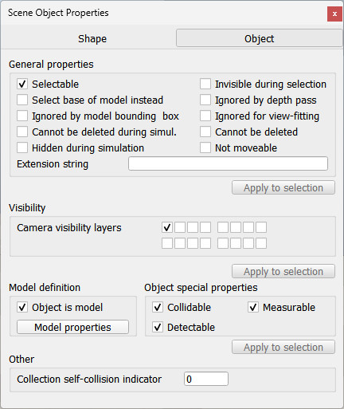
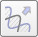
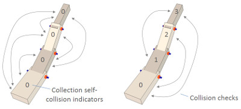

# Scene object dialog

The scene object dialog displays properties related to [scene objects](objects.md). It is located at [Tools > Scene object properties], but can also be opened with a double-click on a scene object icon in the [scene hierarchy](userInterface.md#SceneHierarchy), or with a click on the related [toolbar](userInterface.md#toolbars) button:

*[Scene object properties toolbar button]*

The dialog is context sensitive and its content mainly depends on the current selection state. The displayed properties are divided into 2 distinct parts:

- **The object-type specific part** shows properties related to a particular scene object type, e.g. [shape properties for a shape](shapeProperties.md), [joint properties for a joint](jointProperties.md).
- **The common part** shows properties common to all scene object types:

*[Scene object dialog, displaying common properties]*

- **Selectable**: indicates whether the object can be selected in the scene. Objects can always be selected in the [scene hierarchy](userInterface.md#SceneHierarchy). Refer also to [`sceneObject.selected`](sim-2/property_sceneObject_selected.md) and [`sim.scene.selection`](sim-2/property_scene_selection.md).
- **Invisible during selection**: when enabled, then the object will be invisible for the selection process (i.e. you will be able to select *through* the object).
- **Ignored by depth pass**: when enabled, then the object will be ignored during the depth rendering pass. The depth rendering pass is used to correctly position the red sphere for camera movements.
- **Select base of model instead**: if enabled, then selecting the object in the scene will select its first parented object marked as **object is model base** instead (see further down). This property is convenient when protecting a model from faulty manipulations, allowing it to be manipulated as a single entity together with other objects. Refer to the [section on models](models.md) and also to [`sceneObject.selectModel`](sim-2/property_sceneObject_selectModel.md).
- **Ignored by model bounding box**: when selected, and the object is part of a [model](models.md), then the model bounding box (i.e. model selection bounding box) will not encompass that object. This is useful for invisible objects that might make the model bounding box appear too big. This property has no functional effect. Refer also to [`sceneObject.model.notInParentBB`](sim-2/property_sceneObject_model_notInParentBB.md).
- **Ignored for view-fitting**: objects with this item selected will not be taken into account when fitting a scene to a view while no object is selected. Usually floors and similar will be tagged as such. Refer also to the [view fitting toolbar button](userInterface.md) and to [`sceneObject.ignoreViewFitting`](sim-2/property_sceneObject_ignoreViewFitting.md).
- **Cannot be deleted during simul.**: when enabled, then the object will ignore a deletion operation when a simulation is running (deletion will however still work when triggered via code). Refer also to [`sceneObject.cannotDeleteInSim`](sim-2/property_sceneObject_cannotDeleteInSim.md).
- **Cannot be deleted**: when enabled, then the object will ignore a deletion operation (deletion will however still work when triggered via code). Refer also to the [`sceneObject.cannotDelete`](sim-2/property_sceneObject_cannotDelete.md) property.
- **Hidden during simulation**: when enabled, then the object is hidden during simulation.
- **Not moveable**: when enabled, then the object cannot be moved with the mouse. Refer also to [`sceneObject.mov.rotNoSim`](sim-2/property_sceneObject_mov_rotNoSim.md), [`sceneObject.mov.translNoSim`](sim-2/property_sceneObject_mov_translNoSim.md), [`sceneObject.mov.rotInSim`](sim-2/property_sceneObject_mov_rotInSim.md) and [`sceneObject.mov.translInSim`](sim-2/property_sceneObject_mov_translInSim.md).
-  **Extension string**: a string that describes additional object properties, mainly used by extension plugins.
- **Camera visibility layers**: each object in CoppeliaSim can be assigned to one or several visibility layers. If there is at least one visibility layer that matches the [layer selection dialog](layerSelectionDialog.md) layers, then the object will be visible when seen from a camera. By default, a [shape](shapes.md) is assigned to the first layer, a [joint](joints.md) to the second layer, a [dummy](dummies.md) to the third layer, etc. Refer also to [`sceneObject.layer`](sim-2/property_sceneObject_layer.md).
- **Object is model base**: indicates whether the object should act as the base of a [model](models.md). An object flagged as *base of model* has special properties (e.g. copying the object will also automatically copy its whole hierarchy tree). Refer also to [`sceneObject.modelBase`](sim-2/property_sceneObject_modelBase.md). Additionally, when such an object is selected, the selection bounding box is displayed as thick stippled lines, encompassing the whole model. Refer also to the **select base of model instead** item above. Additionally, a model will share the same identifier with all of its copies or clones. A model can then transfer its DNA (i.e. share an instance of itself) to all of its clones, via the transfer DNA [toolbar](userInterface.md#toolbars) button (refer also to [`sceneObject.dna`](sim-2/property_sceneObject_dna.md)). Imagine having 100 identical robots in your scene that you want to modify in a similar way: simply modify one of them, select it, then click the transfer DNA toolbar button.

*[DNA transfer toolbar button]*

- **Model properties**: allows opening the [model dialog](modelDialog.md). Refer also to [`sceneObject.model.notCollidable`](sim-2/property_sceneObject_model_notCollidable.md), [`sceneObject.model.notDetectable`](sim-2/property_sceneObject_model_notDetectable.md), [`sceneObject.model.notMeasurable`](sim-2/property_sceneObject_model_notMeasurable.md), [`sceneObject.model.notDynamic`](sim-2/property_sceneObject_model_notDynamic.md), [`sceneObject.model.notRespondable`](sim-2/property_sceneObject_model_notRespondable.md), [`sceneObject.model.notVisible`](sim-2/property_sceneObject_model_notVisible.md), [`sceneObject.model.scriptsNotActive`](sim-2/property_sceneObject_model_scriptsNotActive.md) and [`sceneObject.model.notInParentBB`](sim-2/property_sceneObject_model_notInParentBB.md).
- **Collidable**: allows enabling or disabling [collision detection](collisionDetection.md) capability for the selected [collidable object](collidableObjects.md). See also [`sceneObject.collidable`](sim-2/property_sceneObject_collidable.md).
- **Measurable**: allows enabling or disabling [minimum distance calculation](distanceCalculation.md) capability for the selected [measurable object](measurableObjects.md). See also [`sceneObject.measurable`](sim-2/property_sceneObject_measurable.md).
- **Detectable**: allows enabling or disabling [proximity sensor](proximitySensors.md) detection capability for the selected [detectable object](detectableObjects.md). See also [`sceneObject.detectable`](sim-2/property_sceneObject_detectable.md).
- **Collection self-collision indicator**: when performing collision (or minimum distance) calculations between two identical collections, CoppeliaSim will normally check all collection items against all other items in that collection (see also [`sceneObject.collectionSelfCollisionIndicator`](sim-2/property_sceneObject_collectionSelfCollisionIndicator.md)). In some situations, such as a kinematic chain, one doesn't want to check consecutive links, since they might be constantly colliding at the interface. In that case, you can use the collection self-collision indicator: two items of the same collection will not be checked against each other if their indicator difference is exactly 1, 10, 100, 1000, 10000 or 100000, as can be seen on the following figure:

*[Collection self-collision indicators]*
