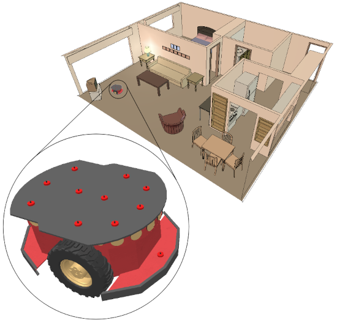

# Scenes and models

[Scenes](scenes.md) and [models](models.md) are CoppeliaSim's main simulation elements. A model is a sub-element of a scene, clearly marked as a model. A scene may contain any number of models. The following figure illustrates the scene-model relationship:

*[Scene and model]*

Both scenes and models may contain one or several [scene objects](objects.md). Additionally, a scene also contains the following elements:

- [The environment](environment.md)
- [The main script](mainScript.md)
- [Pages and views](pagesAndViews.md)

Scenes are saved as *\*.ttt* files, and models are saved as *\*.ttm* files. Both file types can be opened by dragging them from the explorer window and dropping them into the CoppeliaSim application. They can also be opened with a double-click. Refer also to [`sim.app:loadScene`](sim-2/app_loadScene.md), [`sim.scene:remove`](sim-2/scene_remove.md), [`sim.scene:loadModel`](sim-2/scene_loadModel.md) and [`sceneObject:removeModel`](sim-2/sceneObject_removeModel.md).
