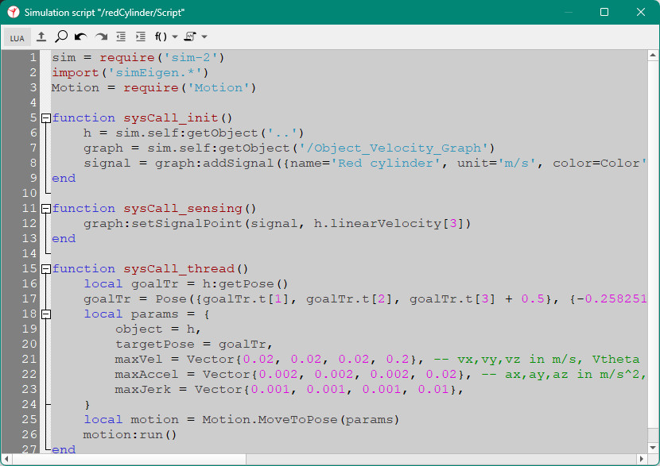

# Script editor

The script editor allows editing [simulation-](simulationScripts.md) and [customization scripts](customizationScripts.md) in CoppeliaSim. It is opened by double-clicking a [script object](scriptObjects.md) in the [scene hierarchy](userInterface.md#SceneHierarchy).

*[Script editor]*

An external script editor can also be specified by editing *[usrset.txt](commandLine.md#settingsFile)* and restarting CoppeliaSim.
