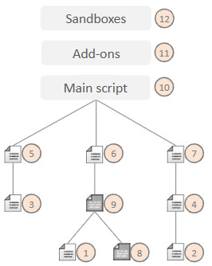

# Script execution precedence

[Script callback functions](scripts.md) are not executed in a random order: script location and type have an influence on when (in relation to others) a script is executed or called:

Execution precedence is first and foremost based on location: a script object always has higher priority than its ancestors (e.g. parent, grand-parent) and thus will be called before. In case of two sibling script objects, precedence is given by the order they appear in the scene hierarchy, unless they have a different priority flag, in which case that flag decides the precedence. See the [script dialog](scriptPropertiesDialog.md) for details.

Execution precedence is next decided by the script type, from first to last executed: [simulation script,](simulationScripts.md) [customization script](customizationScripts.md), [add-on](addOns.md), and finally the [sandboxes](sandboxScript.md).

*[Example scene with script execution precedence]*

A simple rule to remember is: the *more important* or *persistent* a script is, the later it will be called. There are exceptions to this, depending on the callback type: e.g. the [contact](contactCallbackScript.md)- and the [dynamics callback](dynCallbackFunctions.md) are executed in reverse order (within a given script type). Additionally, when the caller expects a return value, the call chain is interrupted as soon as the first return value is received.
