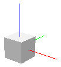

# Script objects

A script object is an instance of the [scriptObject type](mainObjectTypes.md#scriptObject), which in turn derives from the [sceneObject type](mainObjectTypes.md#sceneObject). It wraps an instance of the [script type](mainObjectTypes.md#script) (that holds all scripting functionality). It has no direct role as a scene object in a scene, except for handling specific parts of a model via code. The following figure shows a script object:

*[Script object (most of the time hidden)]*

Script objects come in two flavors and wrap two types of [scripts](scripts.md):

- [Simulation scripts](simulationScripts.md) hold code that handles a particular function in a simulation. They run only when simulation is running.
- [Customization scripts](customizationScripts.md) hold code that handles a particular customization aspect in a scene or model. They run as soon as the containing scene or model was loaded.

A double-click on a script object in the scene hierarchy opens the [script dialog](scriptPropertiesDialog.md) and the [script editor](scriptEditor.md).

Script objects can be added to the [scene](scenes.md) with [Add > Script object]. Refer also to [sim.scene:createObject](sim/scene_createObject.htm), [scriptObject.script](sim/property_scriptObject_script.htm), [scriptObject-related methods and properties](apiFunctions.md#methodsAndProperties_scriptObject), and [script-related methods and properties](apiFunctions.md#methodsAndProperties_script).
