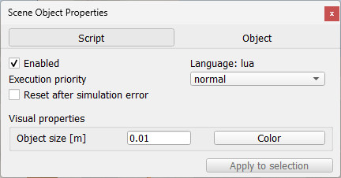

# Script dialog

The script dialog is part of the [scene object dialog](sceneObjectPropertiesDialog.md), which is located at [Tools > Scene object properties]. You can also open the dialog with a double-click on an object icon in the [scene hierarchy](userInterface.md#SceneHierarchy), or with a click on its [toolbar](userInterface.md#toolbars) button:

*[Scene object properties toolbar button]*

In the scene object dialog, click the **Script** button to display the script dialog (the **Script** button only appears if the last selection is a [script object](scriptObjects.md)). The dialog displays the settings and parameters of the last selected script. If more than one script is selected, then some parameters can be copied from the last selected script to the other selected scripts (**Apply to selection**-buttons)

*[Script dialog]*

- **Enabled**: the enable state of the script. Refer also to [`script.enabled`](sim-2/property_script_enabled.md).
- **Language**: the script language. Refer also to [`script.language`](sim-2/property_script_language.md).
- **Execution priority**: the execution priority relates only to same-type scripts, and only to scripts that are siblings in the scene hierarchy. More details can be found [here](scriptExecution.md). Refer also to [`script.execPriority`](sim-2/property_script_execPriority.md).
- **Reset after simulation error**: when enabled, a customization script that is in an error state will be reset at the end of a simulation. Refer also to [`script.restartOnError`](sim-2/property_script_restartOnError.md).
- **Object size**: size of the 3D representation of the script object. This parameter has only a visual effect, and no functional meaning. Refer also to [`scriptObject.size`](sim-2/property_scriptObject_size.md).
- **Color**: allows adjusting a script object's color
