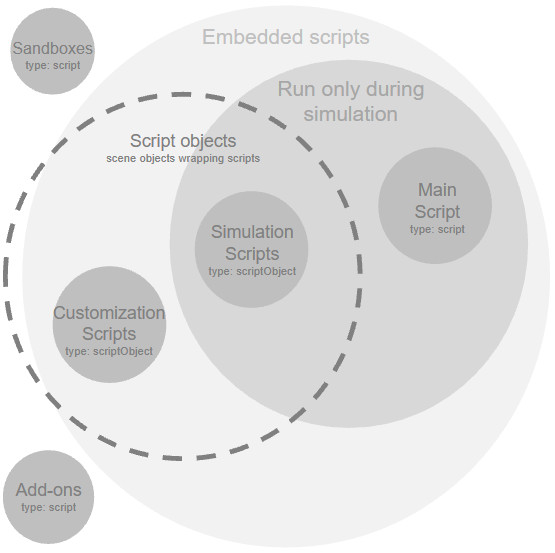

# Scripts

CoppeliaSim is a highly customizable simulator: almost every step of a [simulation](simulation.md) is user-defined. Additionally, the simulator itself can also be customized to a large extent. This flexibility is allowed through an integrated script interpreter ([Lua](http://www.lua.org)) and an external script interpreter ([Python](http://www.python.org)). Both operate in almost the same fashion, [except for small differences](luaPythonDifferences.md). For more information on Lua, refer to the [Lua crash course](luaCrashCourse.md) section and the [online documentation](http://www.lua.org).

*[Lua and Python logo]*

CoppeliaSim extends Lua and Python by adding specific methods and properties (e.g. [`sceneObject.pose`](sim-2/property_sceneObject_pose.htm)). For a list of all CoppeliaSim specific API methods and properties, refer to the [regular API](apiFunctions.md). New, customized API functions can also be registered from a [plugin](plugins.md). See also the [properties and methods related to scripts](apiFunctions.md#methodsAndProperties_script).

Several types of scripts are supported in CoppeliaSim: [the sandboxes](sandboxScript.md), [add-ons](addOns.md), and [embedded scripts](embeddedScripts.md) (themselves composed of a [main script](mainScript.md), [simulation scripts](simulationScripts.md) and [customization scripts](customizationScripts.md)). An embedded script is a script that is embedded in a [scene](scenes.md) (or [model](models.md)), i.e. a script that is part of the scene and that is saved and loaded together with the rest of the scene (or model). On the other hand, the sandboxes and add-ons are not associated with any specific scene, model or object, and will run across all scenes in a similar way. A script is of the [script type](mainObjectTypes.md#script): the sandboxes, the add-ons and the main script are (naked) scripts, while simulation and customization scripts are particular in that they are [scene objects](objects.md) wrapping a script:

*[script types]*

Scripts are invoked via [callback functions](callbackFunctions.md) by CoppeliaSim, and follow a [specific execution order](scriptExecution.md). They can [run threaded or non-threaded](threadedAndNonThreadedCode.md).

Note: CoppeliaSim scripts may be published under any license.
