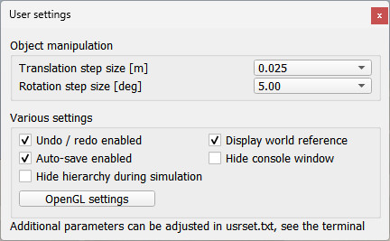
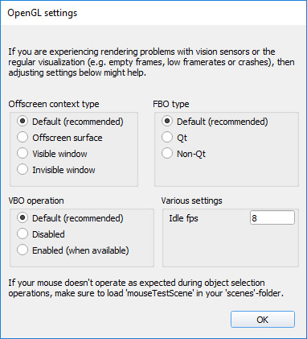

# User settings

Some values and settings in CoppeliaSim are not dependent on a [scene](scenes.md) or [model](models.md), but rather dependent on the user. The user settings dialog (which partially reflects the content of the [user settings file](commandLine.md#settingsFile)) can be accessed with [Tools > Settings] or by clicking following toolbar button:

*[Settings toolbar button]*

*[User settings dialog]*

- **Translation step size**: the linear step size used when translating [objects](objects.md) in the [object manipulation mode](objectMovement.md). It is recommended to keep a value of 5 cm. Objects can be assigned specific step sizes in the [coordinate and transformation dialog](coordinateDialog.md).
- **Rotation step size**: the angular step size used when rotating [objects](objects.md) in the [object manipulation mode](objectMovement.md). Objects can be assigned specific step sizes in the [coordinate and transformation dialog](coordinateDialog.md).
- **Undo/redo enabled**: enables or disables the undo/redo functionality. That functionality operates by serializing (saving) the entire scene to memory every time a change was registered. Only differences with previous undo points are memorized so as to use little memory. This is a very efficient and fail-safe undo/redo that is also supported from [plugins](plugins.md) or the [main client application](coppeliaSimLibrary.md), and that is permitted only because CoppeliaSim's serialization routines are very fast. There are however times when either the computer is really old or the scene content extremely large (e.g. very detailed cad data) where this method slows down the whole application. In that case, simply disable the undo/redo functionality.
- **Display world reference**: displays a small world reference frame in the lower left hand side of a [camera](cameras.md) view. As everywhere in CoppeliaSim, the red, green and blue arrows correspond to the x-, y-, and z-axis respectively.
- **Auto-save enabled**: when auto-save is enabled, each opened scene will be saved on a regular basis. In case of a crash, the auto-saved scenes can be restored. The auto-save delay can be adjusted in the file system/usrset.txt.
- **Hide console window**: allows hiding or showing the [console window](userInterface.md#ConsoleWindow). By default, the console window is hidden. On Mac, this item is not available (the standard output can be viewed in the system console (Applications/Utilities/Console)).
- **Hide hierarchy during simul.**: automatically hides the scene hierarchy when simulation is running.
- **OpenGL settings**: opens a dialog that allows you to adjust most settings related to OpenGL:

## OpenGL settings

*[OpenGL settings dialog]*

- **Offscreen context type**: the type of the offscreen rendering contexts. Default are invisible windows.
- **FBO type**: the type of the frame buffer objects. Default are Qt-based FBOs on Mac, and Non-Qt-based FBOs on Windows and Linux.
- **VBO operation**: whether Vertex Buffer Objects are used. The **default** option uses VBOs.
- **Idle fps**: the number of frames per second when idle.
