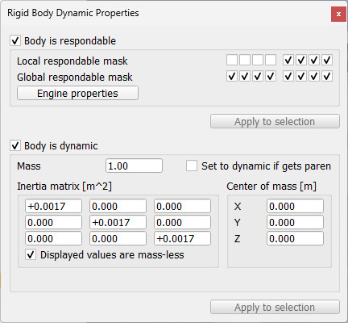

# Shape dynamics dialog

The shape dynamics dialog is part of the [shape dialog](shapeProperties.md). The dialog displays the dynamics settings and parameters of the last selected [shape](shapes.md). If no object is selected, the dialog is inactive. If more than one shape is selected, then some parameters can be copied from the last selected shape to the other selected shapes (**Apply to selection**-buttons):

*[Shape dynamics dialog]*

- **Body is respondable**: if enabled, then the shape produces a collision reaction with other respondable shapes, however only if the respective respondable masks overlap (see the item below). See also [`shape.dynamics.respondable`](sim-2/property_shape_dynamics_respondable.htm) and the [designing dynamic simulation](designingDynamicSimulations.md) section for more details.
- **Respondable mask**: indicates when a collision response is generated (above respondable item needs however to be enabled). The mask is composed by two 8-bit values, local and global. If two colliding shapes share any of their parents (direct or indirect), then the local masks are used, otherwise the global masks are used. If two shapes' *AND*-combined masks (local or global) are different from zero, then a collision response is generated. See also [`shape.dynamics.respondableMask`](sim-2/property_shape_dynamics_respondableMask.htm).
- **Engine properties**: each physics engine has specific parameters related to shapes. Make sure to read the respective engine documentation to achieve best parameter settings. See also the [shape-related methods and properties](apiFunctions.md#methodsAndProperties_shape).
- **Body is dynamic**: when enabled, then the shape's pose is influenced in a [dynamics simulation](dynamicsModule.md). See [`shape.dynamics.dynamic`](sim-2/property_shape_dynamics_dynamic.htm) and the [designing dynamic simulation](designingDynamicSimulations.md) section for more details.
- **Mass**: the mass of the shape. Selected shapes can have their masses easily computed ([Edit > Shape mass and inertia > compute from uniform density...]) or scaled ([Edit > Shape mass and inertia > scale mass...]). See also [`shape.dynamics.mass`](sim-2/property_shape_dynamics_mass.htm) and [`shape.dynamics:computeInertia`](sim-2/shape_dynamics_computeInertia.htm).
- **Set to dynamic if gets parent**: when enabled and the shape is attached to another object, then the shape is automatically made dynamic. This is useful for model bases that should be static when on their own, but dynamic when combined with another model/object (e.g. a robotic manipulator that operates on its own usually has its base static, but when attached to a vehicle, then the base should become dynamic). See also [`shape.dynamics.setToDynamicWithParent`](sim-2/property_shape_dynamics_setToDynamicWithParent.htm).
- **Inertia matrix**: the inertia matrix. Shown values are mass-less by default (i.e. divided by the mass of the shape). The matrix is expressed relative to the shape reference frame. Selected shapes can have their inertia matrix easily computed ([Edit > Shape mass and inertia > compute from uniform density...]) or scaled ([Edit > Shape mass and inertia > scale inertia...]). See also [`shape.dynamics.inertiaMatrix`](sim-2/property_shape_dynamics_inertiaMatrix.htm), [`shape.dynamics.mass`](sim-2/property_shape_dynamics_mass.htm) and [`shape.dynamics:computeInertia`](sim-2/shape_dynamics_computeInertia.htm).
- **Center of mass**: the position of the center of mass, relative to the shape reference frame. See also [`shape.dynamics.centerOfMass`](sim-2/property_shape_dynamics_centerOfMass.htm).
