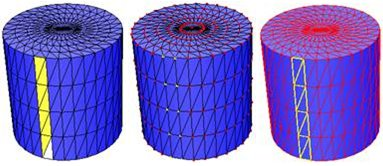

# Shape edit modes

The best option when specific [shapes](shapes.md) are needed in CoppeliaSim is to draw them in a CAD application (e.g. AutoCAD, 3D Studio Max) and then [import](importExport.md) them. When an external CAD application is not available, or when only simple shapes are required, the user can create [primitive shapes](primitiveShapes.md) and then customize the created shape in one of the 3 supported shape edit modes in CoppeliaSim:

- [Triangle edit mode](triangleEditMode.md): in this mode, individual triangles composing the shape are visible and can be manipulated or extracted.
- [Vertex edit mode](vertexEditMode.md): in this mode, individual vertices composing the shape are visible and can be manipulated or extracted.
- [Edge edit mode](edgeEditMode.md): in this mode, individual edges composing the shape are visible and can be manipulated or extracted.

*[Triangle, vertex and edge edit modes]*

[Primitive shapes](shapes.md) are converted to regular shapes before entering one of the above edit modes.

A compound shape cannot directly be edited. It will first have to be ungrouped. Or you can edit its composing element's visual parameters via the [edit mode for compound shapes](groupedShapeEditMode.md).

The different edit modes are accessed with a click on the appropriate toolbar button:

*[Shape edit mode toolbar button]*

Make sure you have a shape object selected before entering the shape edit mode. During shape edition, [objects](objects.md) cannot be selected and simulation cannot be started. Once edition is finished, click on the shape edit mode toolbar button to quit the edit mode. When applying changes to a shape, CoppeliaSim will make sure the modified shape is consistent and remove unused vertices and merge vertices that are close to each other, etc. The exact behavior can be set in the **Vertices/triangles verification settings** in the [user settings dialog](settings.md).

You can switch from one edit mode to another, and this allows you to achieve special operations. As an example, if you want to select and remove all triangles of the upper face of a cylinder, instead of individually selecting them in the [triangle edit mode](triangleEditMode.md), perform a shift-selection of all upper vertices in the [vertex edit mode](vertexEditMode.md), then switch to the triangle edit mode, then press the delete-key.
