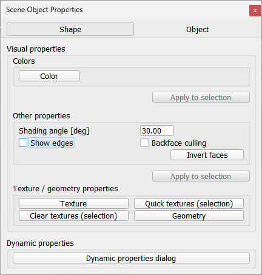

# Shape dialog

The shape dialog is part of the [scene object dialog](sceneObjectPropertiesDialog.md), which is located at [Tools > Scene object properties]. You can also open the dialog with a double-click on an object icon in the [scene hierarchy](userInterface.md#SceneHierarchy), or with a click on its [toolbar](userInterface.md#toolbars) button:

*[Scene object properties toolbar button]*

In the scene object dialog, click the **Shape** button to display the shape dialog (the **Shape** button only appears if the last selection is a [shape](shapes.md)). The dialog displays the settings and parameters of the last selected shape. If more than one shape is selected, then some parameters can be copied from the last selected shape to the other selected shapes (**Apply to selection**-buttons):

*[Shape dialog]*

- **Color**: allows editing the colors of the shape.
- **Shading angle**: the shading angle is the angle from which individual faces are distinguished. This only affects the visual appearance of a shape. A small angle makes a shape appear sharp, with many edges; a large angle makes a shape appear smooth and with fewer edges. Refer also to [`mesh.shadingAngle`](sim-2/property_mesh_shadingAngle.htm).
- **Show edges**: displays edges in black. Refer also to [`mesh.showEdges`](sim-2/property_mesh_showEdges.htm).
- **Backface culling**: each triangle composing a shape has an inside and an outside face. When Backface culling is enabled, then inside faces won't be displayed. This is a useful parameter for closed shapes and for shapes that are transparent. Refer also to [`mesh.culling`](sim-2/property_mesh_culling.htm).
- **Invert faces**: this flips all triangles. Inside faces become outside faces and vice versa. Convex shapes will become non-convex, except for primitive shapes.
- **Texture**: opens the [texture dialog](textureDialog.md) for the selected shape. When a shape is associated with a texture, it will be displayed in a textured way.
- **Quick textures (selection)**: applies a cubic mapped texture to all selected shapes. This is especially useful with seamless textures used as "dirt", to make objects look more realistic.
- **Clear textures (selection)**: removes the texture from all selected shapes.
- **Geometry**: opens the [shape geometry dialog](geometryDialog.md) for the selected shape. It allows you to adjust various parameters of the mesh. Refer also to [`mesh.vertices`](sim-2/property_mesh_vertices.htm) and [`mesh.indices`](sim-2/property_mesh_indices.htm).
- **Dynamic properties dialog**: toggles the [shape dynamics dialog](shapeDynamicsProperties.md). The shape dynamics dialog allows you to adjust a shape's dynamics properties.

Some of the above parameters are only available for simple shapes. When a compound shape is selected, then you can edit its visual attributes by switching to the shape edit mode for compound shapes. You can of course also ungroup it to individually edit its components.
