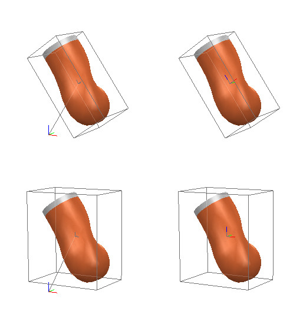

# Shape reference frame and bounding box

A [shape](shapes.md) has a reference frame and a bounding box, as does every [object](objects.md). The shape reference frame however can be relocated, and its bounding box can be modified, without affecting the shape's other properties.

The reference frame of selected shapes can be moved in two different ways, via [Edit > Shape reference frame]:

- **Relocate to world origin**: the reference frame moves to the origin of the world
- **Relocate to mesh center**: the reference frame moves to the center of the bounding box

The shape's inertia properties are unaffected when its reference frame moves; the inertia matrix and center of mass will however be expressed relative to the new reference frame.

The bounding box of selected shapes can be modified in two different ways, via [Edit > Shape bounding box]:

- **Align with world**: the bounding box will align with the reference frame of the world
- **Align with mesh**: the bounding box will be chosen so as to minimize its volume

*[Possible reference frame locations and bounding box orientations for a shape]*

Note that the orientation of the bounding box does not need to be the same as the orientation of the reference frame.

Refer also to [`shape:relocateFrame`](sim-2/shape_relocateFrame.md), [`shape:alignBoundingBox`](sim-2/shape_alignBoundingBox.md) and [`sceneObject:scale`](sim-2/sceneObject_scale.md).
