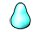
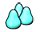
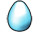
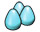
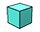
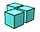
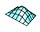
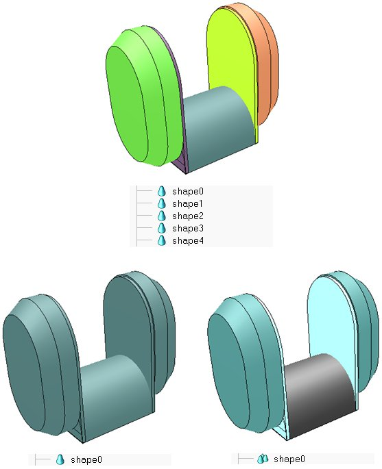

# Shapes

A shape is an instance of the [shape type](mainObjectTypes.md#shape), which in turn derives from the [sceneObject type](mainObjectTypes.md#sceneObject). A shape holds one or more instances of the [mesh type](mainObjectTypes.md#mesh) (set of triangular faces). Shapes can be [imported/exported](importExport.md), [edited](shapeEditModes.md), and come in four different sub-types:

-  **Simple shapes** are not convex nor primitive, and have one set of visual attributes. They are not optimized nor recommended for [dynamics collision response calculation](dynamicsModule.md) (since slow and unstable).
-  **Compound shapes** are combinations of simple shapes that can have several sets of visual attributes. They are not optimized nor recommended for dynamics collision response calculation (since slow and unstable).
-  **Convex shapes** are convex but not primitive, and have one set of visual attributes. They are optimized for dynamics collision response calculation (but primitive shapes are recommended).
-  **Compound convex shapes** are combinations of convex shapes that can have several sets of visual attributes. They are optimized for dynamics collision response calculation (but primitive compound shapes are recommended).
-  **Primitive shapes** are primitives (cuboid, cylinder, sphere, etc.), and have one set of visual attributes. They are best suited for dynamics collision response calculation, since they perform fast and are stable. See the [dynamics](dynamicsModule.md) section for more information.
-  **Primitive compound shapes** are combinations of primitive shapes that can have several sets of visual attributes. They are best suited for dynamics collision response calculation, since they perform fast and are stable. See the [dynamics](dynamicsModule.md) section for more information.
-  **Heightfield shapes** represent terrains as regular grids, where only the heights change. They have one set of visual attributes and can sometimes also be considered as primitive shapes: they are usually also optimized for dynamics collision response calculation.

By default, all imported shapes are simple shapes. Two or more shapes or compound shapes can however be grouped/ungrouped with [Edit > Shape grouping/merging > group/ungroup]. Simple shapes can also be merged/divided with [Edit > Shape grouping/merging > merge/divide]. Refer also to the [model tutorial](buildingAModelTutorial.md), which illustrates how to correctly import and prepare shapes for a simulation model. See also [`scene:groupShapes`](sim-2/scene_groupShapes.htm), [`shape:ungroup`](sim-2/shape_ungroup.htm), [`scene:mergeShapes`](sim-2/scene_mergeShapes.htm) and [`shape:divide`](sim-2/shape_divide.htm)

Primitive shapes are mainly functional shapes. They are most of the time only used by the physics engine that performs much better and faster on them than on non-primitive shapes (e.g. random or convex meshes). For that reason, primitive shapes are often hidden in an invisible layer (e.g. layer 9). Refer to the [layer selection dialog](layerSelectionDialog.md) and the section on [how to design dynamic simulations](designingDynamicSimulations.md) for more information. See also [`sceneObject.layer`](sim-2/property_sceneObject_layer.htm)

*[(a) 5 shapes (e.g. after import), (b) 1 shape (after merging), (c) 1 compound shape (composed of 5 simple shapes)]*

Primitive shapes can also be grouped, the resulting compound shape will however only be primitive if all of its composing elements are also primitives. Merging primitive shapes will result in a non-primitive shape.

Shapes are [collidable](collidableObjects.md), [measurable](measurableObjects.md) and [detectable](detectableObjects.md) objects. This means that shapes:

- Can be used in [collision detections](collisionDetection.md) against other collidable objects.
- Can be used in [minimum distance calculations](distanceCalculation.md) with other measurable objects.
- Can be detected by [proximity sensors](proximitySensors.md).

The collidable, measurable and detectable properties of a shape can be altered in the [scene object common properties](sceneObjectPropertiesDialog.md#common). Additionally, those properties can be overridden if the shape is part of a [model](models.md) which overrides them. Refer to the [model dialog](modelDialog.md) for more information. Refer also to [`sceneObject.collidable`](sim-2/property_sceneObject_collidable.htm), [`sceneObject.measurable`](sim-2/property_sceneObject_measurable.htm) and [`sceneObject.detectable`](sim-2/property_sceneObject_detectable.htm).

The shape calculations (i.e. collision, distance and proximity sensor calculations) available in CoppeliaSim are also available as stand-alone routines via the [Coppelia geometric routines](coppeliaGeometricRoutines.md). See also [`sceneObject:checkCollision`](sim-2/sceneObject_checkCollision.htm), [`collection:checkCollision`](sim-2/collection_checkCollision.htm), [`sceneObject:checkDistance`](sim-2/sceneObject_checkDistance.htm), [`collection:checkDistance`](sim-2/collection_checkDistance.htm) and [`proximitySensor:checkSensor`](sim-2/proximitySensor_checkSensor.htm).
