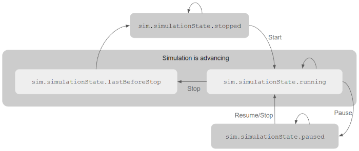
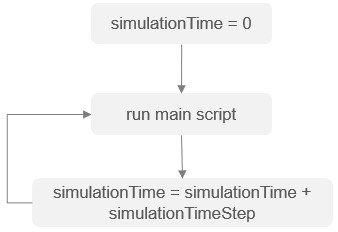
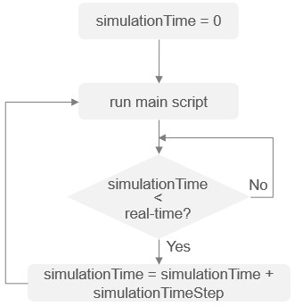
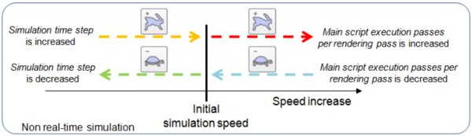
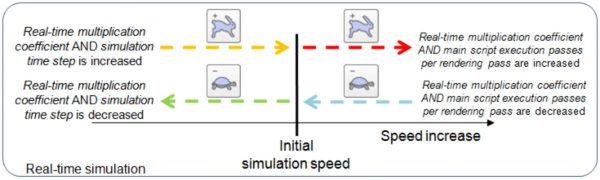
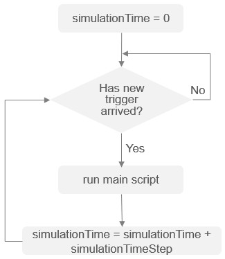

# Simulation

A simulation in CoppeliaSim can be started, paused and stopped with [Simulation > Start/Pause/Stop simulation] or through the related toolbar buttons:


*[Simulation start/pause/stop toolbar buttons]*

<a id="states"></a>Internally, the simulator uses additional intermediate states to correctly inform [scripts](scripts.md) or programs about what will happen next. The following state diagram illustrates the simulator's internal states:



*[Simulation state diagram]*

Refer also to [`scene.simulation:start`](sim-2/scene_simulation_start.md), [`scene.simulation:pause`](sim-2/scene_simulation_pause.md) and [`scene.simulation:stop`](sim-2/scene_simulation_stop.md).

## <a id="simulationLoop"></a>Simulation loop

The simulator operates by advancing the simulation time at constant time steps. The following figure illustrates the main simulation loop:



*[Main simulation loop]*

<a id="realTime"></a>Real-time simulation is supported by trying to keep the simulation time synchronized with the real time:



*[Real-time simulation loop]*

## <a id="simulationSpeed"></a>Simulation speed

In non real-time simulations, the simulation speed (i.e. the perceived speed) is mainly dependent on two factors: the simulation time step and the number of simulation steps for one rendering pass (see the [simulation dialog](simulationPropertiesDialog.md) for more details). In the case of a real-time simulation, the simulation speed mainly depends on the real-time multiplication coefficient, but also to a certain degree on the simulation time step (too small a simulation time step might not be compatible with the real-time character of a simulation because of the limited calculation power of the computer). During simulation, the simulation speed can be adjusted with the following toolbar buttons:


*[Simulation speed adjustment toolbar buttons]*

The simulation speed is adjusted in such a way that the initial simulation time step is never increased (because this might have as consequence the breaking of a mechanism for example). The following two figures illustrate the simulation speed adjustment mechanisms:



*[Simulation speed adjustment mechanism for **non real-time simulations**]*



*[Simulation speed adjustment mechanism for **real-time simulations**]*

Refer also to [`scene.simulation.speedModifier`](sim-2/property_scene_simulation_speedModifier.md).

By default, each simulation cycle is composed by the following **sequential** operations:

- Executing the [main script](mainScript.md)
- Rendering the scene

## <a id="stepped"></a><a id="stepping"></a>stepping mode

By default, CoppeliaSim executes a simulation by running one simulation step after another, automatically. There are however many situations where it is important to be able to manually trigger each simulation step, e.g. to inspect each simulation step individually, or to synchronize CoppeliaSim with an external application. There is such a mechanism, which is the stepping mode (or synchronous mode):



*[stepping simulation mode]*

From within CoppeliaSim, a stepping simulation can easily be implemented via the *sysCall_beforeMainScript* [callback function](callbackFunctions.md). From an external application, there is usually a dedicated function to enable the stepping mode, and then to trigger each individual step. The following illustrates the stepping mode from a Python ZeroMQ remote API client:

```python
import time
from coppeliasim_zmqremoteapi_client import RemoteAPIClient

client = RemoteAPIClient()
sim = client.getObject('sim')

sim.setStepping(True)

sim.startSimulation()
while (t := sim.getSimulationTime()) < 3:
    s = f'Simulation time: {t:.2f} [s]'
    print(s)
    sim.step()
sim.stopSimulation()
```
