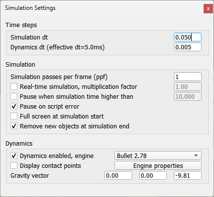

# Simulation dialog

The simulation dialog can be accessed with [Simulation > Simulation settings] or by clicking the following toolbar button:

*[Simulation toolbar button]*

*[Simulation settings dialog]*

- **Simulation dt**: the [simulation](simulation.md) time step. Each time the [main script](mainScript.md) is executed, the simulation time is incremented by the *simulation dt*. It is highly recommended to keep a default *simulation dt* of 50ms. Keep in mind that the *simulation dt* cannot be smaller than the *dynamics dt* (see below). Refer also to [`scene.simulation.timeStep`](sim-2/property_scene_simulation_timeStep.md).
- **Dynamics dt**: the time step used by the physics engine. Using large time steps results in faster but less accurate simulations. Small time steps on the other hand will lead to more precise simulations, but will take more time. It is highly recommended to keep a default *dynamics dt* of 5ms. Combined with a default *simulation dt* of 50ms, this results in 10 dynamics calculation steps per [simulation step](simulation.md#simulationLoop). Refer also to [`scene.dynamics.stepSize`](sim-2/property_scene_dynamics_stepSize.md).
- **Simulation passes per frame (ppf)**: the number of simulation steps for one rendering pass. A value of 10 would mean that the main script is executed 10 times (10 simulation steps) before the screen is refreshed. Refer also to [`scene.simulation.stepsPerRendering`](sim-2/property_scene_simulation_stepsPerRendering.md).
- **Real-time simulation, multiplication factor**: if selected, then the simulation time will be clamped to real-time (when possible). A multiplication factor of X would clamp the simulation time to 10\* real-time. Refer also to [`scene.simulation.realtime`](sim-2/property_scene_simulation_realtime.md) and [`scene.simulation.realtimeModifier`](sim-2/property_scene_simulation_realtimeModifier.md).
- **Pause when simulation time higher than**: allows specifying a simulation time at which the simulation will be paused (e.g. to be able to analyze some results at a specific simulation time). Refer also to [`scene.simulation.pauseAtTime`](sim-2/property_scene_simulation_pauseAtTime.md) and [`scene.simulation.timeToPause`](sim-2/property_scene_simulation_timeToPause.md).
- **Pause on script error**: if enabled, then a simulation will be paused when a [script](scripts.md) error occurs in an embedded script. Refer also to [`scene.simulation.pauseAtError`](sim-2/property_scene_simulation_pauseAtError.md).
- **Full screen at simulation start**: if enabled, then simulation starts in full screen mode. Be aware that in full screen mode, dialogs and messages won't appear or won't be visible, and only the left mouse button will be active. For that reason that mode is only recommended once a scene is properly configured and final. Full screen mode can be left with the esc-key.
- **Dynamics enabled**: enables or disables the [physics engine](dynamicsModule.md). **Engine**: allows you to select a physics engine. Each engine has specific strengths and weaknesses. A [simulation](simulation.md) running fine with one engine doesn't always mean that it will also run fine with the other engines. Refer also to [`scene.dynamics.enabled`](sim-2/property_scene_dynamics_enabled.md).
- **Display contact points**: shows or hides contact points computed by the physics engine. Refer also to [`scene.dynamics.showContactPoints`](sim-2/property_scene_dynamics_showContactPoints.md).
- **Engine properties**: each engine has specific parameters that can be set globally. Make sure to read the respective engine documentation to achieve best parameter settings.
- **Gravity vector**: the amplitude and direction of a constant force applied to all non-static shapes (e.g. gravity). Refer also to [`scene.dynamics.gravity`](sim-2/property_scene_dynamics_gravity.md).
- **Remove new objects**: when selected, then scene objects added during a simulation will be removed at the end of the simulation. Refer also to [`scene.simulation.removeNewObjects`](sim-2/property_scene_simulation_removeNewObjects.md).
