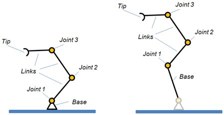
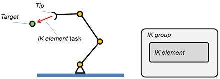
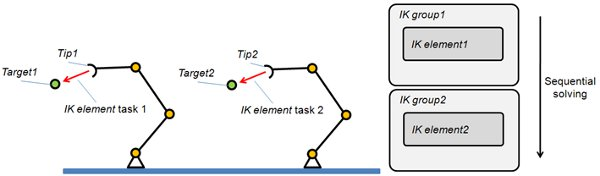
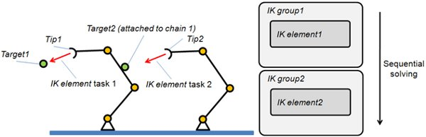
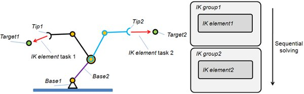
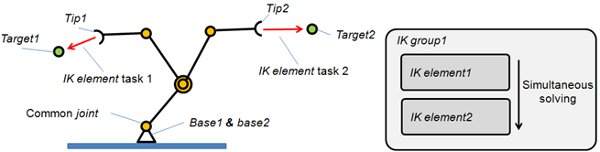
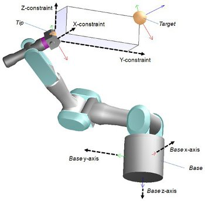

# Solving Inverse/Forward Kinematics Tasks

CoppeliaSim solves inverse and forward kinematics tasks using [IK elements](apiFunctions.md#methodsAndProperties_IKElement) and [IK groups](apiFunctions.md#methodsAndProperties_IKGroup). It is important to have a thorough understanding of these concepts to fully utilize the kinematics functionality. Sample scenes related to IK and FK can be found in the folder scenes/kinematics.

An IK task is defined by an IK group, which comprises one or more IK elements:

- **IK element**: An IK element represents a simple kinematic chain, consisting of at least one joint. The chain is defined by a base, a tip indicating the end-effector, and a target for the tip to follow. The IK element describes a naked Jacobian, with rows representing constraints and columns representing degrees of freedom. It is comprised of the following components:
- A base, which represents the start of the kinematic chain
- Several links (any object except joints), including passive joints treated as rigid joints (joints with a fixed linear/angular position)
- Several joints
- A tip, which is typically the last object in the kinematic chain and often the end-effector. The tip object must be linked to a target object (see below)
- A target representing the desired tip position and/or orientation. The target object must be linked to the tip object (see above)
- **IK group**: An IK group contains one or more IK elements. To solve the kinematics of a simple kinematic chain, an IK group containing one IK element is needed. The IK group sets the overall solving properties, such as the solver, number of iterations, etc. The Jacobian obtained by horizontally stacking the Jacobians of its IK elements is described by the IK group.

To facilitate debugging IK functionality, you can enable display of a debug overlay that represents the IK world content, via [Tools > Visualize IK world].

The following figures illustrate two kinematic chains as described by IK elements: The two IK elements perceive the two chains in a similar way (the very first joint of the second example is ignored by the IK element):

*[Two kinematic chains, each represented by an IK element]*

The goal of an IK element (i.e., solving an IK element) is to have the target followed by the tip (i.e., having tip and target overlap, given certain constraints and tolerances), by computing the appropriate joint values for the kinematic chain:

*[IK element and corresponding model of the IK solving task]*

In the 2D example shown, various constraints can be specified for the tip-target pair. These constraints include:

- **X positional constraint**: The tip will follow the target exclusively along the X-axis. As a result, the kinematic chain will have three degrees of freedom, making it appear redundant for this task.
- **X/Y positional constraints**: The tip will only follow the target in its position. The kinematic chain will still appear redundant for this task.
- **X/Y positional + orientation constraints**: The tip will follow the target both in position and orientation. This will result in the kinematic chain not appearing redundant anymore for this task.

It is important to note that even for the simplest IK task, an IK element is solved through the resolution of the encompassing IK group. Two separate kinematic chains are handled in a similar fashion, with two IK groups needed in this case (each IK group must contain one IK element for each kinematic chain). When both tasks are distinct, the solving order of the two IK groups is not relevant:

*[Two distinct IK chains and corresponding model of the IK solving tasks]*

However, if the target of the second chain is attached to a mobile part of the first kinematic chain, as shown in the figure, the solving order becomes relevant and IK group 1 should be solved first. This is because the solving result will displace target 2, as demonstrated in the figure:

*[Two distinct, but dependent IK chains, and corresponding model of the IK solving tasks]*

In the case where one IK element is built on top of another IK element and does not share any common joints, the solving order is also important. As demonstrated in the figure, solving IK element 1 will displace the common object, while solving IK element 2 will not. In this case, IK group 1 must be solved before IK group 2:

*[Two IK chains sharing one common link but no common joints and corresponding model of the IK solving tasks]*

When two or more kinematic chains share common joints, a simultaneous solving method is often required, as sequential solving does not work in most cases. To solve several IK elements simultaneously, group them into a single IK group. This is demonstrated in the figure:

*[Two IK chains sharing one common joint and corresponding model of the IK solving task]*

Positional constraints are specified relative to the base's reference frame by default, as demonstrated in the figure:

*[Positional constraints for a kinematic chain]*

However, it is possible to select any reference frame for the positional constraints. Orientational constraints can be full (alpha-beta-gamma, with 3 degrees of freedom), partial 3D (alpha-beta, with 2 degrees of freedom, where only the z-axes of tip and target are overlapping), partial 2D (gamma, with 1 degree of freedom), or turned off completely.

It is crucial to verify that individual IK elements are not overconstrained, to avoid strange behavior. When operating close to a singularity, or when overconstrained IK elements cannot be avoided, a damped resolution method may help, although it will slow down calculations.

It is also possible to solve IK elements simultaneously while respecting a prioritization hierarchy (via the null-space projection method), or to link two or more joints via dependency constraints to achieve complex behavior.
