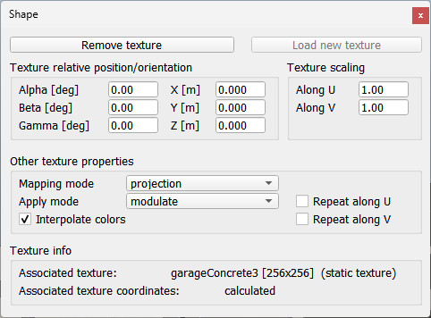
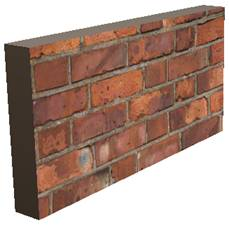
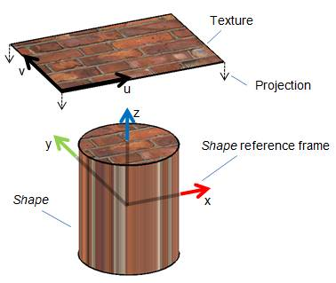
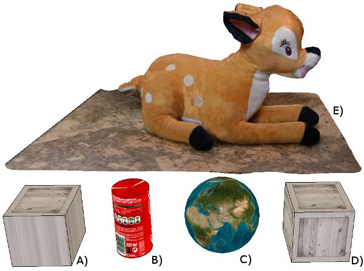
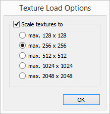

# Texture dialog

The texture dialog allows you to view and modify properties related to a texture attached to a [shape](shapes.md). It is accessed by clicking the **Set texture**-item in the [shape dialog](shapeProperties.md):

*[Texture dialog]*

A texture is a bitmap image that can be applied to surfaces to make them look *more real*. Imagine applying a brick texture to a rectangular surface to make it look like a brick wall. The following figure illustrates a textured surface:

*[Textured surface]*

The default way CoppeliaSim applies textures to a shape is by projecting it onto the shape's x/y plane as shown in the following figure:

*[Default texture projection method]*

The following 5 texture mapping methods are supported:

- **Projection** **mapping**: the texture is simply projected onto the X-Y plane of the object (see here above). Texture coordinates will be calculated.
- **Cylindrical mapping**: the texture is wrapped around the object's Z axis. Texture coordinates will be calculated.
- **Spherical mapping**: the texture is spherically mapped onto the object. Texture coordinates will be calculated.
- **Box mapping**: the texture is applied to all 6 faces of a box-like object. Texture coordinates will be calculated.
- **Imported texture coordinates**: specific texture coordinates can be imported at the same time as the mesh is [imported](importExport.md), via the OBJ or DAE file format.

The following figure illustrates the 5 mapping methods:

*[Texture mapping methods: A) projection, B) cylindrical, C) spherical, D) box, E) imported texture coordinates]*

When loading a new texture, the following dialog will open:

*[Texture scaling dialog]*

It is recommended to keep the default settings, to keep compatibility with older graphic cards high (when **Scale textures to** is checked, all textures will anyway be resized to a power of 2), and file sizes low.

Once a texture is in memory, it can be scaled, shifted and rotated before the actual mapping takes place, to obtain the desired visual appearance.

Static textures can be loaded by clicking the **Load new texture** button. The following file formats are currently supported:

- JPEG
- PNG
- TGA
- BMP
- TIFF
- GIF

Instead of loading textures from file, you can also select already loaded static textures. Just click the **Select texture from existing textures** button. Note that dynamic textures will only be properly displayed during simulation (and also only if the related vision sensor is properly handled).

Refer also to [properties/methods related to meshes](apiFunctions.md#methodsAndProperties_mesh) and [properties/methods related to textureData](apiFunctions.md#methodsAndProperties_textureData).
