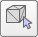
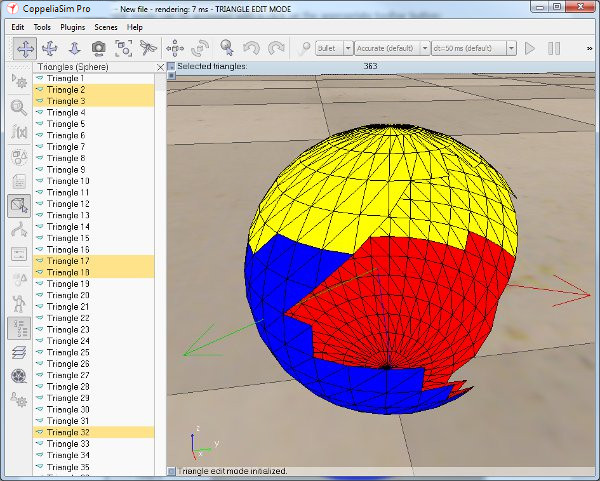
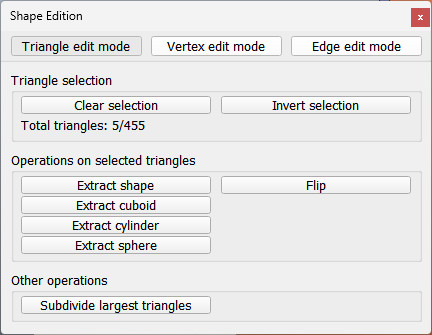
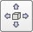
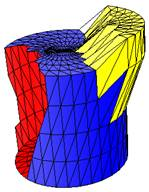

# Triangle edit mode

The triangle edit mode can be accessed with a click on the appropriate toolbar button:

*[Shape edit mode toolbar button]*

The above toolbar button is only active if a [shape](shapes.md) is selected. If the last selected shape is not a simple shape, but a compound shape, the [edit mode for compound shapes](groupedShapeEditMode.md) will be activated instead. In the triangle edit mode all triangles composing the shape are individually displayed. A triangle has two faces, the front face and the back face. The front face is displayed in blue while the back face is displayed in red. When selecting triangles (using the same procedure as for selecting [objects](objects.md)), they will appear in yellow and the last selected triangle in white. Shortcut copy/cut/paste/delete is supported (ctrl-c, ctrl-x, ctrl-v, delete). Selection can be cleared with the esc-key, with the deselect toolbar button, or by ctrl-clicking onto an empty area of the [scene](scenes.md). A shift-selection will select all triangles under the selection area, also hidden triangles (if you wish to only select visible triangles via a shift-selection, hold down the ctrl-key in addition to the shift-key). In the triangle edit mode, the portion of the window that normally displays the [scene hierarchy](userInterface.md#SceneHierarchy) is used to display the triangles of the shape being edited as a list. Items in the list can be selected with the mouse as for objects in the hierarchy window.

*[Triangle edit mode]*

After entering the triangle edit mode, the edit menu items ([Menu bar > Edit]) will become specific to the triangle edit mode, and the following dialog will be displayed:

*[Triangle edit mode dialog]*

- **Triangle / Vertex / Edge edit mode**: the currently activated edit mode. The user can switch from one edit mode to the others via these buttons (the selected items will be preserved).
- **Clear selection**: clears the selection of triangles.
- **Invert selection**: inverts the selection state of triangles.
- **Extract shape**: will create a shape based on currently selected triangles. The shape will be added to the scene but might not be visible (the shape in edit mode and the newly created shape coincide in pose, or the first visibility layer is disabled). The triangle selection will remain.
- **Extract cuboid**: will create a rectangular primitive shape based on currently selected triangles (will orient the new cuboid in the same way as the minimum bounding box encompassing the selected triangles). The triangle selection will remain. This operation is useful when a complex mesh shape needs to be modeled in a simplified way to allow [efficient dynamics simulation](designingDynamicSimulations.md) for instance.
- **Extract cylinder**: will create a cylindrical primitive shape based on currently selected triangles (will orient the new cylinder in the same way as the minimum bounding box encompassing the selected triangles). The triangle selection will remain. This operation is useful when a complex mesh shape needs to be modeled in a simplified way to allow [efficient dynamics simulation](designingDynamicSimulations.md) for instance.
- **Extract sphere**: will create a spherical primitive shape based on currently selected triangles (will orient the new sphere in the same way as the minimum bounding box encompassing the selected triangles). The triangle selection will remain. This operation is useful when a complex mesh shape needs to be modeled in a simplified way to allow [efficient dynamics simulation](designingDynamicSimulations.md) for instance.
- **Flip**: flips the selected triangles' side (from red to blue and from blue to red).
- **Subdivide largest triangles**: this will divide large triangles. Unless you want to reduce triangle sizes to obtain a more differentiated illumination of large surfaces, it is not recommended to reduce triangle sizes (unless you know exactly what you are doing). Instead, you can adjust the triangle size for the calculation structures globally (in the [environment dialog](environmentPropertiesDialog.md)).

Triangles can be directly translated with the mouse, using the toolbar's object/item translation button to translate the selected triangle(s) in a plane perpendicular to the view direction:

*[Object/item translation toolbar button]*

*[Shape in triangle edit mode]*
