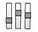
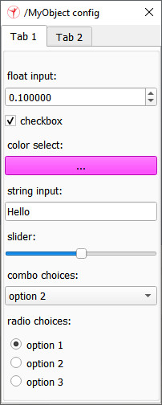

# User config callback functions

A [customization script](customizationScripts.md) that includes a user config callback function (which is one of many [system callback functions](callbackFunctions.md#systemCallbacks)), displays a configuration dialog icon in the scene hierarchy:



*[Configuration dialog icon]*

For convenience, the icon is also displayed for the customization script's parent. When double-clicked, the user config callback function is triggered. This can be used as a convenient way of displaying a [custom user interface](customUserInterfaces.md), that is specific to the [object](objects.md)/[model](models.md) the customization script refers to. User data can be read and written as customData, e.g. sceneObject.customData.myData = sim.app:pack(...).

```lua
--lua

function sysCall_init()
    sim = require('sim-2')
    simUI = require('simUI')
    model = sim.self:getObject('..')
end

function sysCall_userConfig()
    local xml = [[<ui title="Robot" closeable="true" modal="true" layout="form" on-close="customUiClosed">
            <label text="Max. velocity:" />
            <edit id="1" value="-" on-editing-finished="velocityChanged"/>
            <label text="Max. acceleration:" />
            <edit id="2" value="-" on-editing-finished="accelerationChanged"/>
    </ui>]]
    local ui = simUI.create(xml)
    local data = readData()
    simUI.setEditValue(ui, 1, tostring(data.maxVel))
    simUI.setEditValue(ui, 2, tostring(data.maxAccel))
end

function customUiClosed(ui)
    simUI.destroy(ui)
end

function velocityChanged(ui, id, val)
    local data = readData()
    val = tonumber(val)
    if val then
        if val < 0.1 then
            val = 0.1
        end
        if val > 0.5 then
            val = 0.5 
        end
        data.maxVel = val
    end
    simUI.setEditValue(ui, id, tostring(data.maxVel))
    writeData(data)
end

function accelerationChanged(ui, id, val)
    local data = readData()
    val = tonumber(val)
    if val then
        if val < 0.01 then
            val = 0.01
        end
        if val > 0.2 then
            val = 0.2 
        end
        data.maxAccel = val
    end
    simUI.setEditValue(ui, id, tostring(data.maxAccel))
    writeData(data)
end

function readData()
    local data = model.customData.robotParams
    if data then
        data = sim.app:unpack(data)
    else
        data = {maxVel = 0.2, maxAccel = 0.05}
    end
    return data
end

function writeData(data)
    model.customData.robotParams = sim.app:pack(data)
end
```

You may also use the *configUI* module for quicker set-up of a custom configuration dialog, that will also automatically write custom data to objects:



*[Custom configuration dialog based on *configUI* module]*

```lua
--lua

sim = require('sim-2')
require('configUi')

function sysCall_init()
    object = sim.self:getObject('..')
    local schema = {
        floatInput = {
            default = 0.1,
            maximum = 4,
            minimum = 0.05,
            name = "float input",
            type = "float",
            ui = {
                control = "spinbox",
                tab = "Tab 1", order = 1, col = 1
            },
        },
        intInput = {
            default = 1,
            maximum = 10,
            minimum = 0,
            name = "int input",
            type = "int",
            ui = {
                control = "spinbox",
                tab = "Tab 1", order = 2, col = 2
            },
        },
        checkbox1 = {
            type = 'bool',
            name = 'checkbox1',
            default = true,
            ui = {tab = "Tab 1", order = 3, col = 1},
        },
        checkbox2 = {
            type = 'bool',
            name = 'checkbox2',
            default = false,
            ui = {tab = "Tab 1", order = 4, col = 2},
        },
        colorselect = {
            type = 'color',
            name = 'color select',
            default = {1, 0, 1},
            ui = {tab = "Tab 2", order = 5, col = 1},
        },
        stringInput = {
            default = "Hello",
            name = "string input",
            type = "string",
            ui = {tab = "Tab 2", order = 6, col = 2},
        },
        floatSlider = {
            default = 0.5,
            maximum = 1,
            minimum = 0,
            name = "float slider",
            type = "float",
            ui = {
                control = "slider",
                tab = "Tab 2", order = 7, col = 1
            },
        },
        intSlider = {
            default = 1,
            maximum = 10,
            minimum = 0,
            name = "int slider",
            type = "int",
            ui = {
                control = "slider",
                tab = "Tab 2", order = 8, col = 2
            },
        },
        choices1 = {
            default = 2,
            choices = {"option 1", "option 2", "option 3"},
            name = "combo choices",
            type = "choices",
            ui = {
                control = "combo",
                tab = "Tab 3", order = 9, col = 1
            },
        },
        choices2 = {
            default = 1,
            choices = {"option 1", "option 2", "option 3"},
            name = "radio choices",
            type = "choices",
            ui = {
                control = "radio",
                tab = "Tab 3", order = 10, col = 1
            },
        },
    }
    object:setBufferProperty('customData.__schema__', sim.app:pack(schema, {compatibility = 'sim-1'}))
    configUi = ConfigUI('myModelType', nil, modificationCallback)
    configUi.getObjectCallback = function() return object.handle end
end

function modificationCallback(config)
    local txt = "Object '" .. object:getName({mode = 'printPath'}) .. "' just changed.\nNew parameters are:"
    print(txt)
    print(config)
end
```
