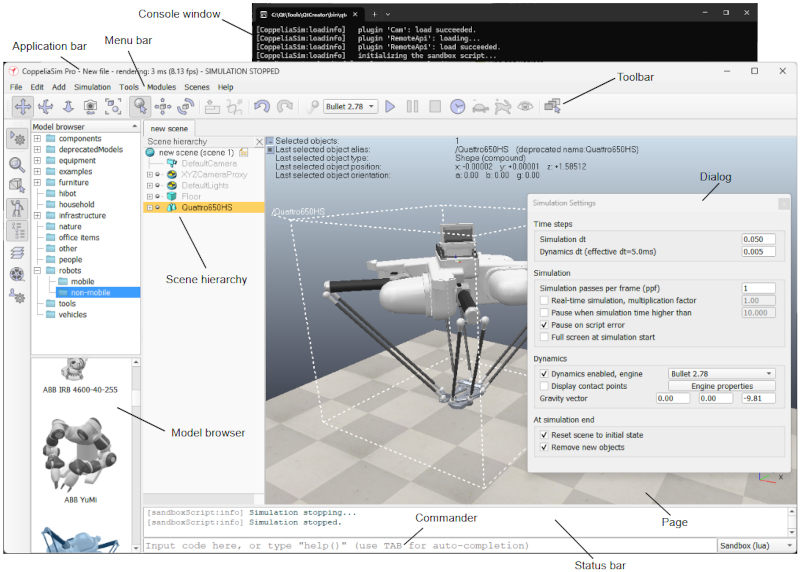
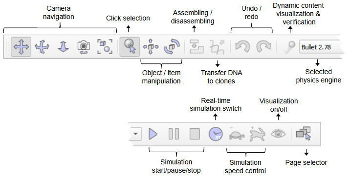
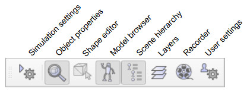
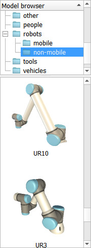
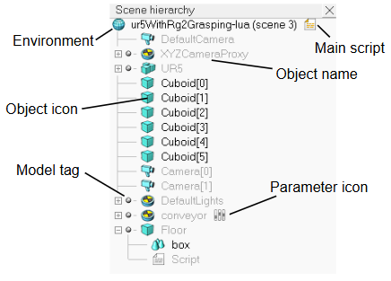

# User interface

The CoppeliaSim application (an instance of the [sim.app type](mainObjectTypes.md#app)) is composed of several elements:

- **A console window or terminal**: depending on the platform and how CoppeliaSim is started, a console or terminal is visible: it displays various secondary information and errors. The console window is not interactive except when launching CoppeliaSim in headless mode.
- **An application window** used to display, edit, simulate and interact with a scene. The left and right mouse buttons, the mouse wheel as well as the keyboard have specific functions when activated in the application window. Within the application window the functions of the input devices (mouse and keyboard) may vary depending on context or activation location.
- **Several dialogs** allowing the user to edit and interact with a scene. Each dialog groups a set of related functions, or functions that apply to the same target object. A dialog's content might be context sensitive (e.g. dependent on the object selection state).

The following illustrates a typical view of the CoppeliaSim application:

*[User interface elements]*

When CoppeliaSim is launched, it initializes one default [scene](scenes.md). The user is free to open several scenes in parallel. Each scene shares the application window and the dialogs with the other scenes, but only one is visible at a given time: the current scene (an instance of the [sim.scene type](mainObjectTypes.md#scene)).

In the following section, a brief description is given of the application window's elements. For details about dialogs, refer to the related pages in this reference manual.

- **The application bar** indicates the filename of the scene that is currently being displayed, the time used for one rendering pass (one display pass), etc. The application bar, as well as any surface within the application window, can also be used to drag-and-drop CoppeliaSim related files into the scene. Supported files include *\*.ttt* files (CoppeliaSim scene files) and *\*.ttm* files (CoppeliaSim model files).
- **The menu bar** allows accessing almost all functionalities of the simulator. Most of the time, the items in the menu bar activate a dialog. Most functions in the menu bar can also be accessed through a popup menu, a double-click on an icon in the scene hierarchy view, or through a click of a toolbar button.
- **The toolbars** present functions that are often accessed (e.g. changing the navigation mode, selecting another page). Some toolbar functions can also be accessed through the menu bar or popup menu. Both toolbars can be docked and undocked:

*[Toolbar 1]*

*[Toolbar 2]*

- **The model browser** offers model selection and drag-and-drop into the scene functionality:

*[Model browser]*

- **The scene hierarchy** displays all scene objects in a scene, organized in a tree-like hierarchy. Individual items can be expanded or collapsed, and double-clicking an icon opens the related property dialog. Double-clicking an object name allows editing it. Objects in the scene hierarchy can be dragged and dropped onto another object, to create a parent-child relationship.

*[Scene hierarchy]*

-  **The status bar** displays information related to performed operations, commands, but also error messages from scripts. See also [`sim.app:logInfo`](sim-2/app_logInfo.md), [`sim.app:logWarn`](sim-2/app_logWarn.md) and [`sim.app:logError`](sim-2/app_logError.md).
-  **The commander** is a read-eval-print loop that adds a text input to the CoppeliaSim status bar, allowing you to enter and execute Python or Lua code on the fly, like in a terminal. The code can be run in [the sandboxes](sandboxScript.md), or any other active script in CoppeliaSim.
- **Popup menus** appear after a right mouse button click. Each surface within the application window (e.g. scene hierarchy view, page, view) may trigger a different popup menu (context-sensitive). The content of popup menus may also change depending on the current simulation state.
