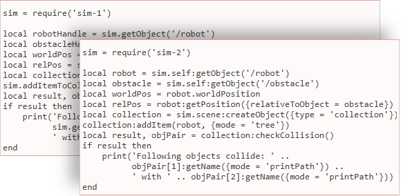
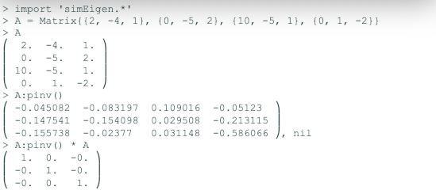
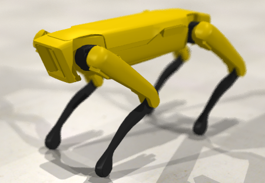
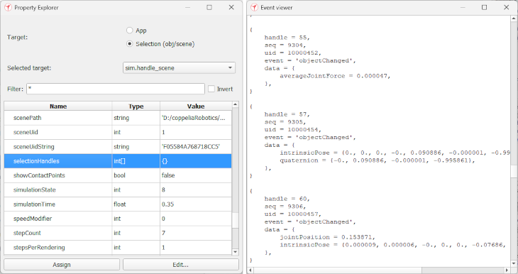
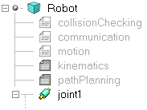
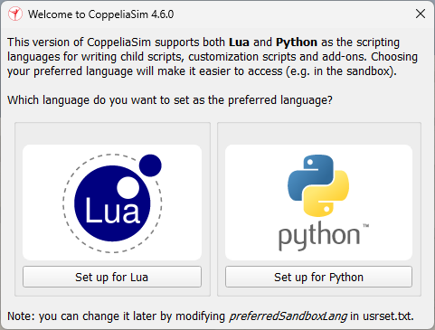
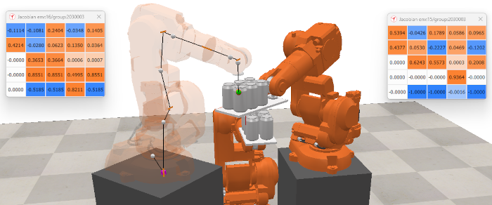

# CoppeliaSim version history

CoppeliaSim versions are indicated as follows:

```
Version X.Y.Z (rev. W)
```

Where:

```
X identifies a special release (once every couple of years)
Y.Z identifies a regular release
W identifies a revision number (mainly for bug fixes)
```

Version history:

## <a id="coppeliaSim4.11.0"></a>CoppeliaSim V4.11.0 (&lt;MONTH> &lt;DAY>th &lt;YEAR>)



*[sim-2]*

- Fixed several bugs. Thanks to Hannes Weixler, Jeffrey Song and Matt Pearson for noticing them or helping to resolve them
- Introduced [sim-2](sim2Overview.md), an object-oriented version of the API, entirely based on properties and methods. sim-1 and sim-2 can be mixed in the same code
- A new Python wrapper (pythonWrapper-3), supporting the object-oriented approach in sim-2, is now used by default. Older sim-1 scripts must explicitly request their wrapper with the '#luaExec wrapper = "pythonWrapper-2"' directive (automatically added for script objects. Python add-ons need to be manually adjusted).
- Switched to Lua 5.4
- Added [markers](markers.md), intended to replace [drawing objects](dataVisualizationAndOutput.md#augmentingScene)
- Improved the OpenGL3 plugin, which now renders also in true headless mode. Markers, point clouds and oc-trees are also rendered
- Added a new rendering mode: OpenGL3 color-coded, that renders objects (shapes and markers) as with a flat, color-coded color (can be used to detect visible objects). Refer to [sim.renderMode](apiConstants.md#renderMode)
- Improved the Pov-Ray plugin, which now also renders markers, point clouds and oc-trees.
- Improved the GLTF plugin, which now also renders markers, point clouds and oc-trees.
- Improved the simGeom and coppeliaGeometricRoutines: operates faster and now uses RGBA instead of RGB: make sure to adjust your c/c++ code if using the coppeliaGeometricRoutines source code.
- Support for old, global namespace Lua API (e.g. simGetObjectPosition instead of sim.getObjectPosition), deprecated since V-REP 3.5, has been dropped
- Support for old threaded simulation scripts (non-coroutine based threads, indicated via a blue script icon), deprecated since CoppeliaSim V4.2, has been dropped
- Support for the legacy remote API, deprecated since CoppeliaSim V4.3, has been dropped
- Mesh properties mesh.vertices, mesh.normals and mesh.textureCoordinates are now per-vertex and column-major data (instead of previously per-triangle-corner and row-major data). Old code relying on these will break and should be adjusted accordingly
- Simplified the [simulation state machine](simulation.md#states) by dropping support for the following simulation states: sim.simulation_advancing_firstafterstop, sim.simulation_advancing_lastbeforepause, sim.simulation_advancing_firstafterpause and sim.simulation_advancing_abouttostop
- Added [`simPushMatrixOntoStack`](sim/simPushMatrixOntoStack_cpp.htm) and [`simGetStackMatrix`](sim/simGetStackMatrix_cpp.htm) API functions
- checkargs.lua: backwards incompatible change: if you used option `default=NIL`, it should be changed to `default_nil=true`
- simUI now tries to keep windows inside screen's visible area (i.e. in `simUI.create()` and `simUI.setPosition()`). Old behavior can be invoked with `keep-in-visible-area="false"` XML attribute of &lt;ui> element, or by passing `keepInVisibleArea=false` (last arg) to `simUI.setPosition(...)`.

## <a id="coppeliaSim4.10.0"></a>CoppeliaSim V4.10.0 (May 14th 2025)



*[Matrix operations in CoppeliaSim's statusbar using the Eigen plugin]*

- Fixed several bugs. Thanks to Philippe Juhel and Ziwen Zhao for noticing them or helping to resolve them
- Set MuJoCo default *armature* value to 0.0 to avoid confusion (was mistakenly set to 2.0 in V4.9 rev.0, and changed to 0.0 in V4.9 rev.6): the user is in charge of appropriately adjusting that value for simulation stability
- Added the sysCall_afterLoad [callback function](callbackFunctions.md) (called after a scene was loaded)
- Added a [plugin for MIDI I/O](simMIDI/simMIDI.htm)
- Added a [plugin for events filtering](simEvents/simEvents.htm) that can be used to setup advanced filtering, e.g.:
  ```lua
  sim = require 'sim'
  simEvents = require 'simEvents'

  function callback(data)
      print('callback', data)
  end

  function sysCall_init()
      dummy = sim.getObject('/dummy')
      probeHandle = simEvents.addProbe('callback', {'and',
          {'event', 'objectChanged'},
          {'handles', {dummy}},
          {'or',
              {'has', 'collapsed'},      -- filter on field presence
              {'eq',  'selected', true}, -- filter on field value
          },
      })
  end
  ```
- The [WebSockets plugin](simWS/simWS.htm) now supports both client and server operation
- Added a very fast linear algebra library for vector and math operations implemented in the [Eigen plugin](simEigen/simEigen.htm) based on the popular [Eigen](https://eigen.tuxfamily.org/) C++ library
- Added demo scene inverseDynamics.ttt, which features a serial manipulator controlled in various ways via inverse dynamics
- Improved the demo scene *motorControllerExamples.ttt*, illustrating a better custom controller (force, velocity or position)

## <a id="coppeliaSim4.9.0"></a>CoppeliaSim V4.9.0 (January 10th 2025)



*[Spot model in CoppeliaSim V4.9]*

- Fixed several bugs. Thanks to Jonatas Teixeira, Juan José Quiroz Omaña, Cheng Zhou, Congjun Ma, *Riften*, Wilbert Pumacay and github user MoonNarga for noticing them or helping to resolve them
- Upgraded to MuJoCo V3.2.6, delivering a significant 2-10x simulation speed boost with notably faster scene rebuilds. Introduced [`shape.dynamics.mujoco.adhesion`](sim-2/property_shape_dynamics_mujoco_adhesion.htm) and [simMujoco.addFlexcomp()](simMujoco/simMujoco.htm#simMujoco.addFlexcomp) for *grid*-type *flexcomp* implementation, while deprecating previous *composite* types (*rope*, *cube*, *cylinder*, and *ellipsoid*) due to uncertain future support from MuJoCo. Simulation parameters were refined by switching to the new *implicitfast* integrator as the default. A new demo scene illustrates MuJoCo specific functionality: *scenes/mujoco/demoScene.ttt*
- [`simGetStackTableInfo`](sim/simGetStackTableInfo_cpp.htm)(stackHandle, 0) now also returns a value >= 0 when the item at the top of the stack is a string or a [buffer](buffers.md), which might require code adjustments in some cases. In a similar way, [`simGetStackUInt8Table`](sim/simGetStackUInt8Table_cpp.htm), [`simGetStackInt32Table, simGetStackInt64Table`](sim/simGetStackInt64Table_cpp.htm), [`simGetStackFloatTable`](sim/simGetStackFloatTable_cpp.htm), [`simGetStackDoubleTable`](sim/simGetStackDoubleTable_cpp.htm) and [`simUnfoldStackTable`](sim/simUnfoldStackTable_cpp.htm) now can also operate on a string or a buffer. It is recommended to always first verify the type of a stack item with [`simGetStackItemType`](sim/simGetStackItemType_cpp.htm), before using [`simGetStackTableInfo`](sim/simGetStackTableInfo_cpp.htm) or [`simGetStackStringType`](sim/simGetStackStringType_cpp.htm)
- Added a simple example scene: *scenes/spot.ttt*
- Improved the property explorer add-on [Modules > Developer tools > Property explorer]
- simStubsGen supports vector3d and quaternion types

## <a id="coppeliaSim4.8.0"></a>CoppeliaSim V4.8.0 (October 31st 2024)



*[Property explorer and event viewer in V4.8]*

- Fixed several bugs. Thanks to Daniel Schiller, Matteo Nini, Philippe Juhel, Jeffrey W. Herrmann, Juan José Quiroz Omaña, Sinan Barut, Javier Lopez and github user mfrigerio17 for noticing them or helping to resolve them
- All internal variables or states can now be handled as [properties](properties.md): those can be queried or modified via [dedicated API functions](apiFunctions.md#properties). Additionally, most properties, when modified, [trigger an event](meansOfCommunication.md#events) that can be listened to. [Signals](properties.md#signals), [custom data](properties.md#customData), [engines parameters](properties.md#engines) and [named parameters](properties.md#namedParams) have been integrated into the properties framework
- Added a property explorer add-on, allowing you to inspect and modify all known properties: [Modules > Developer tools > Property explorer]
- Events, forwarded to all [sysCall_event callback functions](meansOfCommunication.md#events), now use a different message protocol. Older code relying on events should be adjusted appropriately
- Added [`sim.systemSemaphore`](sim-1/simSystemSemaphore.htm)
- Added [app properties](apiFunctions.md#app) processId and processCnt
- Integrated the time-optimal path parametrization ([TOPPRA](https://github.com/hungpham2511/toppra)) functionality: no need for a specific TOPPRA-service Docker container anymore, see [`sim.generateTimeOptimalTrajectory`](sim-1/simGenerateTimeOptimalTrajectory.htm)
- Added a demo scene: *scenes/pathPlanning/simpleManipulatorPathPlanning.ttt*
- Added [`sim.scheduleExecution`](sim-1/simScheduleExecution.htm) and [`sim.cancelScheduledExecution`](sim-1/simCancelScheduledExecution.htm)

## <a id="coppeliaSim4.7.0"></a>CoppeliaSim V4.7.0 (June 14th 2024)



*[New scene objects: script objects]*

- Fixed several bugs. Thanks to Clélie Demey, Fumio Ozaki, Javier Quintana, Sebastian Serna, Alexis Hou, Pranav A. Bhounsule, Jian Qi, Vishwas Jain, Barca David, Sasha Koryakin, Louis Munier, Fatih Kocyigit, Clément Moulin-Frier, Markus Voelk, Marco Frigerio, Fabio Massimo Proietti, Michael Leslie, Cheng Zhou, Ben Figg, Caio Conti Guidote Ribeiro and Christopher Blum for noticing them or helping to resolve them
- *Child scripts* have been renamed to *simulation scripts*
- [Simulation scripts and customization scripts are now scene objects on their own](newScriptObjects.md). This can however lead to [potential compatibility issues](compatibility.md#scriptObjects). Added [`sim.createScript`](sim-1/simCreateScript.htm)
- Introduced *[buffers](buffers.md)* to be able to clearly differentiate binary data. This can however lead to [potential compatibility issues](compatibility.md#buffers)
- When a deprecated function is used, a short warning message is output once, for the related script. Verbosity of those messages can be adjusted by setting the [user settings](commandLine.md#settingsFile) parameter *notifyDeprecated* to 0 (no notification), 1 (simple notification, default) or 2 (exhaustive notification)
- Enhancements have been made to the convex hull, convex decomposition, and mesh decimation features. In addition to the existing HACD and V-HACD algorithms, the new CoACD algorithm is now available as an alternative. These functionalities are now accessible through add-ons and have been relocated to [Menu bar > Modules > Geometry / Mesh]
- Added [`script.restartOnError`](sim-2/property_script_restartOnError.htm), allowing you to e.g. trigger an add-on restart on error
- Improved command line option parsing. Option "-s" is not allowed anymore: use "-s0" instead.
- User models located in *&lt;userSettingsDir>/userContent/models/&lt;category>/* and *&lt;userSettingsDir>/overlay/&lt;repoName>/models/&lt;category>/* are automatically overlayed to the model browser
- Better and unified code editor coloring
- Improved [`sim.getReferencedHandles`](sim-1/simGetReferencedHandles.htm) and [`sim.setReferencedHandles`](sim-1/simSetReferencedHandles.htm), which can now also store referenced handles under a specific tag
- Added [`sim.getObjectHierarchyOrder`](sim-1/simGetObjectHierarchyOrder.htm), [`sim.setObjectHierarchyOrder`](sim-1/simSetObjectHierarchyOrder.htm), as well as a possibility to move a scene object up/down among its siblings, via the hierarchy context menu
- Python scripts can now use a specific Python version/installation via *pythonExecutable* (as a [luaExec command](luaPythonDifferences.md#luaExec))
- Introduced a better method to [assemble items](assembly.md)
- The way [`sim.moveToConfig`](sim-1/simMoveToConfig.htm) and [`sim.moveToPose`](sim-1/simMoveToPose.htm) are called has been simplified while remaining backward compatible. Additionally, for non-threaded situations, you can now call the related component functions [`sim.moveToConfig_init`](sim-1/simMoveToConfig_init.htm), [`sim.moveToConfig_step`](sim-1/simMoveToConfig_step.htm), [`sim.moveToConfig_cleanup`](sim-1/simMoveToConfig_cleanup.htm), [`sim.moveToPose_init`](sim-1/simMoveToPose_init.htm), [`sim.moveToPose_step`](sim-1/simMoveToPose_step.htm) and [`sim.moveToPose_cleanup`](sim-1/simMoveToPose_cleanup.htm). See *scenes/trajectoryAndMotion/basicTrajectoryGeneration.ttt* to get a quick overview
- Improved the [GLTF exporter](importExport.md#gltf): transparency and backface culling are now taken into account
- [`sim.removeObjects`](sim-1/simRemoveObjects.htm) and [`sim.removeModel`](sim-1/simRemoveModel.htm) can now operate in a delayed fashion
- MuJoCo XML files are now saved to the directory indicated via [`sim.app.paths.mujoco`](sim-2/property_app_paths_mujoco.htm)
- Added an object tracking example scene using numpy and OpenCV: *scenes/vision/objectTracking.ttt*
- Added 2 AWS Robomaker scenes
- IGL plugin new functions: simIGL.adaptiveUpsample, simIGL.rayTest
- New add-ons: Distribute objects uniformly, Make objects same appearance, Subdivide largest triangles
- [simUI.fileDialog](simUI/simUI.htm#fileDialog) now returns an empty list when the user cancels the operation (and not a list with an empty string, like it was in the past).

## <a id="coppeliaSim4.6.0"></a>CoppeliaSim V4.6.0 (October 21st 2023)



*[Preferred language selection in CoppeliaSim V4.6]*

- Fixed several bugs. Thanks to Samuel Cavalcanti, Elia Cereda, Keith Siilats, Pardeep Singh Panesar, Zichun Xu, Belal Elsayed and github user mfrigerio17 for noticing them or helping to resolve them
- Support for Python has been greatly improved. Embedded scripts now use a new Python wrapper by default: pythonWrapperV2.lua, and the ZeroMQ remote API has been updated. This makes Python code more reactive, faster and easier to program. [Differences with Lua scripts](luaPythonDifferences.md) Have been further reduced to a minimum. Reentrancy is not a problem anymore. Many demo scenes now have a Python version.
- The CoppeliaSim library itself can now also easily be [loaded and called synchronously from a Python script](coppeliaSimLibrary.md#pythonClient), thus allowing increased speed, flexibility and fine-grained control of the simulation loop.
- Switched to a new [plugin](plugins.md) architecture, allowing API versioning. New plugins now need to be loaded explicitly, via the *require* directive (e.g. as in simIK = require('simIK')), or via the [`loadPlugin`](sim/loadPlugin.htm) API function. New plugins can be loaded and unloaded ([`unloadPlugin`](sim/unloadPlugin.htm)) as often as required. Older scripts are supported via an implicit require mechanism.
- sim.setThreadAutomaticSwitch is deprecated in favor of [`sim.setStepping`](sim-1/simSetStepping.htm)
- sim.switchThread is deprecated in favor of [`sim.step`](sim-1/simStep.htm)
- CoppeliaSim's read-eval-print-loop functionality (via the commander plugin) now allows switching between a Python or a Lua interpreter.
- CoppeliaSim's read-eval-print-loop functionality (via the commander plugin) now works also in headless mode, with line editing, history and TAB-completion, via the replxx library.
- [Command-line](commandLine.md) option -H now loads the headless version of the CoppeliaSim library.
- Added [callback function](callbackFunctions.md) *sysCall_thread* for Lua too, which is an alternate, convenience function, for creating and handling the main coroutine via code.
- Added [callback function](callbackFunctions.md) *sysCall_selChange* that is triggered when selection changes
- *execUnsafe* is true, *execUnsafeExt* is false and *executeUnsafe* is ignored, by default in *usrset.txt*
- Improved the Referenced Handles Explorer add-on
- Improved the Joint Tool add-on
- Added markdown format support in the 'text-browser' widget of the UI plugin.
- Switched to Qt5.15.2 on Ubuntu

## <a id="coppeliaSim4.5.1"></a><a id="coppeliaSim4.5.0"></a>CoppeliaSim V4.5.1 (March 29th 2023)



*[IK and Jacobian visual debugging in CoppeliaSim V4.5.1]*

- Fixed several bugs. Thanks to Andrey Voronkov, Vitalii Kudinov, Mathias Thor and Yong Jiang for noticing them or helping to resolve them
- Reworked the [kinematics functionality](kinematics.md), which now allows you to handle kinematic tasks in a much more flexible manner. This includes a callback function to inspect/modify/compute the Jacobian, when calling [simIK.handleGroups](simIK/simIK.htm#simIK.handleGroups), null-space projection support, or the new function [simIK.computeJacobian](simIK/simIK.htm#simIK.computeJacobian) which allows you to compute the Jacobian for any configuration of any kinematic chain
- Inverse kinematics worlds can now easily be debugged by adding a visual overlay [Tools > Visualize IK world]. Individual IK group debugging can also be enabled via an optional *debug* flag in [simIK.handleGroups](simIK/simIK.htm#simIK.handleGroups). A demo scene illustrating this was added: *scenes/kinematics/simpleExamples/10-visuallyDebuggingIkGroups.ttt*
- Added a scene illustrating the null-space projection method with the kinematics functionality: *scenes/kinematics/simpleExamples/9-prioritizedGroupsAndNullSpaceProjection.ttt*
- CoppeliaSim now systematically uses double precision floating point values for the core library, and most plugins. The C API interface is now also in double precision, but you can revert to single precision via the *SIM_INTERFACE_SINGLE* define
- A [shape's reference frame](shapeReferenceFrames.md) can now be relocated while keeping the mesh in place. The reference frame of an imported shape will always be located at the world origin by default. Added [`sim.relocateShapeFrame`](sim-1/simRelocateShapeFrame.htm) and [`sim.aligneShapeBB`](sim-1/simAlignShapeBB.htm)
- Better rendering of reference frames and bounding boxes
- Better rendering of manipulation overlays
- Better rendering of numbers in the dialogs
- Improved the [URDF importer and exporter](importExport.md#urdf), making it more flexible and robust
- Improved the convex hull, convex decomposition and mesh decimation functionality, making it operate also on grouped shapes, while keeping the visual and dynamic properties of the original
- Added an option to specify a callback function for [simMujoco.composite](simMujoco/simMujoco.htm#simMujoco.composite) and [simMujoco.injectXML](simMujoco/simMujoco.htm#simMujoco.injectXML): this allows you to dynamically react to a MuJoCo world rebuild event. This is demonstrated in the demo scene: *scenes/mujoco/compositeAndOtherCallbacks.ttt*
- Added [simMujoco.removeXML](simMujoco/simMujoco.htm#simMujoco.removeXML), that allows you to remove any previous XML injection or composite.
- Added [`sim.getScriptFunctions`](sim-1/simGetScriptFunctions.htm), a wrapper function allowing you to easily call functions of another script
- Fixed and improved the Denavit-Hartenberg add-ons
- Rust is now also supported with the [ZeroMQ remote API](zmqRemoteApiOverview.md). The binding is courtesy of Samuel Cavalcanti
- Added a model for ArUco markers *Models/other/aruco marker.ttm* and a scene demonstrating detection of markers from a vision sensor: *scenes/otherScenes/arucoMarkerDetection.ttt*
- Added a scene illustrating the IGL plugin: *scenes/iglDemo.ttt*
- New Lua API functions: sim.getLoadedPlugins, sim.getObjectAliasRelative, sim.getScriptFunctions, sim.addReferencedHandle, sim.removeReferencedObjects, sim.visitTree. Various improvements to the Lua standard library
- Reorganized the *Modules* menu (i.e. add-ons)
- New add-ons: Find midpoint, Measure distance/direction, Translate to align vertex, Mesh convex hull, Mesh intersection, Mesh union, Mesh difference, Mesh symmetric difference, Mesh subdivision, Joint tool, Event viewer, Broadcast message viewer.
- New [LDraw plugin and add-on](importExport.md#ldraw) to import ldr/mpd models.
- OMPL plugin new functions: simOMPL.createStateSpaceForJoint, simOMPL.setStateSpaceForJoints
- Commander plugin: introduced some convenience automatic vars: H, SEL, SEL1, and a function ("apropos") to look up API functions/constants.
- IM plugin new functions: simIM.writeToTexture, simIM.getFormat, simIM.getMarkerDictionary, simIM.drawMarker, simIM.detectMarkers
- IGL plugin new functions: simIGL.getMesh, simIGL.randomPointsOnMesh, simIGL.sweptVolume, simIGL.exactGeodesic, simIGL.upsample, simIGL.closestFacet, simIGL.uniqueEdgeMap, simIGL.meshBooleanShape, simIGL.centroid, simIGL.barycenter, simIGL.convexHull, simIGL.convexHullShape, simIGL.tetrahedralize, simIGL.intersectWithHalfSpace, simIGL.volume
- Eigen plugin new functions: simEigen.pinv
- matrix.lua: new Matrix methods: flip, repmat, print, svd, pinv
- Some improvements and new functions in the CustomUI plugin.
- Minor improvements to the QML plugin.
- Code Editor: UI and usability improvements.
- URLDrop: new function simURLDrop.openURL.

## <a id="coppeliaSim4.4.0"></a>CoppeliaSim V4.4.0 (September 22nd 2022)

- Fixed several bugs. Thanks to Pranav A. Bhounsule, Amirhossein Afkhami Ardekani, Roman Horshkov, Volker Kühn, Artem Shishkin, Mathias Thor and Davide Scorza for noticing them or helping to resolve them
- Added a new physics engine to CoppeliaSim: [MuJoCo](dynamicsModule.md#mujoco). This adds a state-of-the-art physics engine to CoppeliaSim, enabling new features such as cables, [soft body simulation](physicsEngineDifferences.md#softBody), etc. Added a demo scene illustrating some of MuJoCo's features: *scenes/mujocoSpecific.ttt*
- [`sim.ruckigPos`](sim-1/simRuckigPos.htm), [`sim.ruckigVel`](sim-1/simRuckigVel.htm), [`sim.moveToConfig`](sim-1/simMoveToConfig.htm) and [`sim.moveToPose`](sim-1/simMoveToPose.htm) can now also be used for non-symmetric velocity/acceleration profiles, via the [sim.ruckig_minvel](apiConstants.md#ruckigFunctions) and [sim.ruckig_minaccel](apiConstants.md#ruckigFunctions) flags
- The [ZeroMQ remote API](zmqRemoteApiOverview.md) is now supported in the following languages: Python, C++, Matlab, Octave, Lua, Java and Rust
- Merged the dynamics dialog with the [simulation dialog](simulationPropertiesDialog.md), and simplified the way custom time steps can be specified
- Improved and simplified the [script execution/call precedence](scriptExecution.md)
- Capsule primitives are now also supported
- Support for ROS2 Humble Hawksbill was added
- Kinematic joints can now also be directly driven via [`sim.setJointTargetPosition`](sim-1/simSetJointTargetPosition.htm) and [`sim.setJointTargetVelocity`](sim-1/simSetJointTargetVelocity.htm), using maximum velocity, acceleration and jerk constraints, for a specific motion profile
- Dynamic joints now have distinct and more clearly defined [control modes](jointDynamicsProperties.md): *free*, *force/torque*, *velocity*, *position*, *spring* and *custom*.
- The Rust ZeroMQ remote API is courtesy of Samuel Cavalcanti
- Added [`sim.broadcastMsg`](sim-1/simBroadcastMsg.htm), which allows you to easily broadcast a message to all scripts
- Added a point sampler add-on, that allows you to extract 3D positions and normal vectors from the mouse cursor
- Added a scene demonstrating texture modification to simulate a vehicle's trace: scenes/mobileRobotVisualTraces.ttt
- Added a model of the ABB YuMi: *Models/robots/non-mobile/ABB YuMi.ttm*
- Added a model of the Mirobot: *Models/robots/non-mobile/Mirobot.ttm*
- Added a model of a generic tray: *Models/equipment/generic tray.ttm*
- Added a model of a generic external wall: *Models/infrastructure/walls/external wall.ttm*
- Added a model of a generic soft body: *Models/other/soft body.ttm*
- Added a scene illustrating gears (or joint dependencies) with MuJoCo and Vortex: *scenes/gears.ttt*

## <a id="coppeliaSim4.3.0"></a>CoppeliaSim V4.3.0 (January 27th 2022)

- Fixed several bugs. Thanks to Nathan Kocherhans, René Simon, Yongdong Wang, Andrés Faíña, Eric Rohmer, Davide Scorza, Jovan Sumarac, Luigi Ascione, Cameron Kabacinski, Rui Li, Patrick Grüner, Andrés Faíña, Michal Mareš, Kat Styles Wood, David Paulius and Alex Wuqi Zhang for noticing them or helping to resolve them.
- Python is now also supported next to Lua, as a programming language for [CoppeliaSim scripts](scripts.md). Both operate in almost the same fashion, [except for small differences](luaPythonDifferences.md). See also the example scenes *scenes/simplePythonExample.ttt*, *scenes/controlTypeExamples/controlledViaScript.ttt* and *scenes/trajectoryAndMotion/ruckigOnlineTrajectoryGeneratorExample-pythonAndLua.ttt*
- Objects are now identified via a path and an *alias*, instead of a unique object name, as was the case in previous versions: this allows for a safer and more flexible [object access](accessingSceneObjects.md), by specifying absolute or relative paths, e.g. [`sim.getObject`](sim-1/simGetObject.htm)("./descendentObject"). This also means that object aliases (i.e. formerly *names*), do not need to be unique anymore. See also [`sim.getObjectAlias`](sim-1/simGetObjectAlias.htm) and [`sim.setObjectAlias`](sim-1/simSetObjectAlias.htm).
- Added a plugin wrapping the [Ruckig Online Trajectory Generation library](https://github.com/pantor/ruckig#readme), courtesy of Lars Berscheid. It acts as a drop-in replacement for the [Reflexxes Motion Library](http://www.reflexxes.com) type 4, and thus also offers the jerk limitation functionality. Functionality is available via [`sim.ruckigPos`](sim-1/simRuckigPos.htm), [`sim.ruckigVel`](sim-1/simRuckigVel.htm), [`sim.ruckigStep`](sim-1/simRuckigStep.htm) and [`sim.ruckigRemove`](sim-1/simRuckigRemove.htm).
- Added a [WebSocket interface plugin](meansOfCommunication.md#ws).
- Added a [remote API based on ZeroMQ](zmqRemoteApiOverview.md), currently however only fully implemented in Python and C++. Compared to the legacy remote API, it is very easy to use, lightweight, and supports the exact same API functions that are available via [scripts](scripts.md): this includes all [regular API functions](apiFunctions.md) (i.e. sim.\* -type functions), but also all API functions provided by [plugins](plugins.md) (e.g. simOMPL.\*, simUI.\*, simIK.\*)
- Added several new callback functions: [sysCall_event](callbackFunctions.md) and [sysCall_ext](callbackFunctions.md). sysCall_event in particular allows you to keep track of most changes happening in a CoppeliaSim scene, and allows you to easily implement external renderers, etc. See also next item.
- Added a [web-browser based front-end](externalFrontEnd.md).
- Added [`sim.registerScriptFuncHook`](sim-1/simRegisterScriptFuncHook.htm), which allows you to set up function hooks to be executed before or after a specific function, namely also (system) [callback functions](callbackFunctions.md).
- Object's *renderable* flags are now ignored by [vision sensors](visionSensors.md): instead, vision sensors will render objects in the same way as do [cameras](cameras.md), by only taking into account their visibility state: this ends some confusion, but can lead in some situations to a different behavior and result. Flexibility is however still guaranteed, with the ability to use a [collection](collections.md) as renderable entity, which can override object's visibility states.
- Added an [add-on](addOns.md) that allows you to record animations from any selected object/model: *Animation capture*
- Added [`sim.generateTextShape`](sim-1/simGenerateTextShape.htm) and an add-on that allows you to generate and edit 3D text: *3D text generator*. The add-on is courtesy of *Mechatronics Ninja*
- Added an add-on that can import floor-plan images to 3D shapes: *[Floor plan importer](importExport.md#misc)*.
- Added an add-on that allows you to quickly check for self-collisions, collisions with the environment, or collisions between two entities: *Collision check*.
- Added an add-on that allows you to quickly measure distances between an entity and the environment, or between two entities: *Distance check*.
- Added a URDF export add-on: *URDF exporter*.
- Added a model of the Franka Emika gripper, courtesy of Alexander Oliva
- Added [`sim.moduleEntry`](sim-1/simModuleEntry.htm) that allows you to handle menu entries in the *Modules* tab. When selected, the corresponding script will have its [sysCall_moduleEntry](callbackFunctions.md) callback function triggered.
- Added [`sim.getShapeBB`](sim-1/simGetShapeBB.htm) and [`sim.setShapeBB`](sim-1/simSetShapeBB.htm) to be able to scale shapes more conveniently
- Added the possibility to transform/distort [vision sensor](visionSensors.md) images via a function using pixel remapping: [simVision.distort](simVision/simVision.htm#simVision.distort). See also the related demo scene in *scenes/vision/imageProcessingDemo2.ttt*
- Added an example model of a Stewart platform: *Models/robots/non-mobile/Stewart platform.ttm*
- Added an example scene of IK and obstacle avoidance: *Scenes/kinematics/obstacleAvoidanceAndIk.ttt*
- Added an example scene of a mobile robot doing path planning: *Scenes/pathPlanning/mobileRobotPathPlanning.ttt*
- Added a scene that illustrates the relationship of [CoppeliaSim's Euler angles convention (alpha-beta-gamma)](positionOrientationTransformation.md#euler) and the yaw-pitch-roll Euler angles convention: *Scenes/eulerAngles.ttt*
- Added an example scene illustrating IK movement via the [remote API](remoteApiOverview.md): *scenes/messaging/ikMovementViaRemoteApi.ttt*. Related Python scripts can be found in *programming/zmqRemoteApi/clients/python/* and in *programming/remoteApiBindings/python/python/*
- Added a simple button-click action tool: *Models/tools/button action tool.ttm*
- Added a [Qt QML plugin](customUIPlugin.md#qml).
- Added an [IGL plugin](simIGL/simIGL.htm), for boolean operations on shapes.
- Added a [subprocess plugin](simSubprocess/simSubprocess.htm), for launching and handling subprocesses.

## <a id="coppeliaSim4.2.0"></a>CoppeliaSim V4.2.0 (April 6th 2021)

- Fixed several bugs. Thanks to Adrian Schoisengeier, Mathias Thor, Francisco Marin, Nikita Aigner, Charles Han, Shai Levy, Bobovsky Zdenko, Salvatore Sessa, Jakob Ambsdorf, Hayato Amaike, and Kevin Thomas for noticing them or helping to resolve them.
- [All script types](scripts.md) now support [threaded or non-threaded operation](threadedAndNonThreadedCode.md). Threaded operation is handled via coroutines that are preemptively interrupted by CoppeliaSim. Except for its code, there is no difference anymore between a threaded and non-threaded script. Old threaded simulation scripts are still supported for backward compatibility, but CoppeliaSim will try to automatically convert them. If this is not desired, adjust value *keepOldThreadedScripts* in *system/usrset.txt*.
- Switched from Lua 5.1 to Lua 5.3. Backward compatibility should normally be maintained, except maybe for old Lua modules you might be using. If this is the case, update those modules to their Lua 5.3 counterparts. Read also about the [language incompatibilities introduced in Lua 5.2](http://www.lua.org/manual/5.2/manual.html#8), and the [language incompatibilities introduced in Lua 5.3](http://www.lua.org/manual/5.3/manual.html#8). Additional backward compatibility code can be communicated to us and added to *lua/sim.lua.*
- The [ROS2 interface](ros2Interface.md) is now also supported on Windows.
- Since this release, static IK groups (i.e. created via the GUI) are deprecated in favor of [dynamically created IK groups](kinematicsPlugin.md), which offer much more flexibility. Read more about the [kinematics functionality here](kinematics.md).
- Added the convenience function [simIK.addElementFromScene](simIK/simIK.htm#simIK.addElementFromScene) allowing you to quickly generate an IK element from a kinematic chain in the scene
- Added [simIK.duplicateEnvironment](simIK/simIK.htm#simIK.duplicateEnvironment): useful when operating on an IK environment while leaving the original environment unchanged. Added [simIK.save](simIK/simIK.htm#simIK.save).
- Kinematic example scenes in folder *kinematics* have been reworked and simplified.
- Added [simIK.generatePath](simIK/simIK.htm#simIK.generatePath) and a related demo scene: *scenes/kinematics/ikPathGeneration.ttt*
- Rewrote the [inverse kinematics tutorial](inverseKinematicsTutorial.md).
- Rewrote and reorganized large parts of the user manual.
- Since this release, static collections (i.e. created via the GUI) are deprecated in favor of dynamically created collections, with [new API functions](apiFunctions.md#collections). This results in much more flexibility. Read more about [collections here](collections.md).
- Since this release, static collision objects (i.e. created via the GUI) are deprecated in favor of [`sim.checkCollision`](sim-1/simCheckCollision.htm). Read more about [collision detection here](collisionDetection.md).
- Since this release, static distance objects (i.e. created via the GUI) are deprecated in favor of [`sim.checkDistance`](sim-1/simCheckDistance.htm). Read more about [distance calculation here](distanceCalculation.md).
- Since this release, graph streams and curves created via the GUI are deprecated in favor of streams/curves created and manipulated via [new API functions](apiFunctions.md#graphs). This allows a much more flexible and precise control of graphs. Read more about [graphs here](graphs.md).
- Since this release, path objects are implemented in a generic manner, via pseudo path objects. This allows much more flexibility. Read more about [paths here](paths.md), and have a look at the simple example scene *scenes/movingAlongAPath.ttt*.
- Added a [CoppeliaSim linear algebra library](https://github.com/CoppeliaRobotics/lua/blob/master/matrix.md).
- Added a [ZeroMQ interface plugin](meansOfCommunication.md#zmq).
- Added new conveyor models, allowing you to easily create conveyor systems of any size/shape. See models in *Models/equipment/conveyors*.
- [`sim.getShapeMassAndInertia`](sim-1/simGetShapeMassAndInertia.htm) and [`sim.setShapeMassAndInertia`](sim-1/simSetShapeMassAndInertia.htm) are deprecated, and replaced by [`sim.getShapeMass`](sim-1/simGetShapeMass.htm), [`sim.setShapeMass`](sim-1/simSetShapeMass.htm), [`sim.getShapeInertia`](sim-1/simGetShapeInertia.htm) and [`sim.setShapeInertia`](sim-1/simSetShapeInertia.htm).
- Added a new demo scene illustrating smooth movement profiles in forward and inverse kinematics mode: *kinematics/smoothMovementsInFkAndIk.ttt*
- Updated the [OMPL plugin](pathAndMotionPlanningModules.md) to use the OMPL library version 1.5.0
- Added several [path-related API functions](apiFunctions.md#paths), including [`sim.generateTimeOptimalTrajectory`](sim-1/simGenerateTimeOptimalTrajectory.htm) that allows you to generate time optimal trajectories (i.e. trajectories that respect velocity and acceleration constraints), based on the [TOPP-RA library](https://hungpham2511.github.io/toppra/). A demo scene related to that can be found in *scenes/trajectoryAndMotion/pathToTrajectory.ttt*.
- Added a SVG widget for the [CustomUI](customUIPlugin.md) plugin. Content can be loaded from file, from XML string, or embedded in the UI XML.
- [`sim.rmlMoveToJointPositions`](sim-1/simRMLMoveToJointPositions.htm) and [`sim.rmlMoveToPosition`](sim-1/simRMLMoveToPosition.htm) are deprecated in favor of [`sim.moveToConfig`](sim-1/simMoveToConfig.htm) and [`sim.moveToPose`](sim-1/simMoveToPose.htm), which feature a callback mechanism for maximum flexibility.
- Added the following API functions: [`sim.isDynamicallyEnabled`](sim-1/simIsDynamicallyEnabled.htm), [`sim.getJointDependency`](sim-1/simGetJointDependency.htm), [`sim.changeEntityColor`](sim-1/simChangeEntityColor.htm) and [`sim.restoreEntityColor`](sim-1/simRestoreEntityColor.htm).
- The following Docker image is available for running CoppeliaSim in a container: [docker-image-coppeliasim](https://github.com/CoppeliaRobotics/docker-image-coppeliasim)
- The default scene will now pause simulation when a script error is raised.
- The Windows installer/uninstaller can now silently operate by invoking it with the following command-line arguments: */silent /hide /[silent]=true*

## <a id="coppeliaSim4.1.0"></a>CoppeliaSim V4.1.0 (July 21st 2020)

- Fixed several bugs. Thanks to Jakub Turaj, Rieky Barady, Jian Ye, Jaime Boal, Mathias Thor, Pável Axel Mc Campos Peña, Filipe Rocha, Patrick Gruener, Thomas Wilmotte, Lorenzo Romanini, Pablo Bustos, Sonny Tarbouriech, Johan Relefors, Adrian Schoisengeier, Arturs Paugurs, Wei Wei, David Page, Ayush Patel, Aleksander Sil and Cameron Kabacinski for noticing them or helping to resolve them.
- Ubuntu20.04 support
- Switched to Qt5.15.0 and VC2019 on Windows.
- [CoppeliaSim's kinematics functionality](kinematics.md) (i.e. forward and inverse kinematics) is [now also available via Lua scripting](kinematicsPlugin.md): this means that instead of creating and handling kinematics tasks via the GUI, you can also entirely create and handle them programmatically in a very flexible manner. Two example scenes illustrate this: *scenes/kinematics/8-computingJointAnglesForRandomPoses.ttt* and *scenes/kinematics/9-programmaticallySettingUpIk.ttt*
- CoppeliaSim's [collision detection](collisionDetection.md) and [minimum distance calculation](distanceCalculation.md) functionality on [shapes](shapes.md), [OC-Trees](octrees.md) and [point-clouds](pointClouds.md) is [now also available via Lua scripting](geometricPlugin.md): you can now also perform the same kind of calculations without the need of creating any scene object or modifying the scene content. This is illustrated in the following example scene: *scenes/sceneObjectIndependentGeometricCalculationExample.ttt*
- [ROS2 Interface](ros2Interface.md) plugin for ROS2 Foxy Fitzroy, supports topics, services, actions, params, TF2 broadcast and image transport.
- GLTF plugin can export static scenes and animations in the GLTF 2.0 format. The functionality is available via the add-on menu, or via [related API functions](simGLTF/simGLTF.htm).
- URL Drop plugin allows loading scene from remote locations via drag and drop (e.g. drop an URL from a browser's window).
- The verbosity level (console, status bar and simple dialogs) can now be adjusted from the [command line](commandLine.md) with the *-v*, *-w* and *-x* arguments. To output messages, plugins should now use [`simAddLog`](sim/simAddLog.htm) and scripts [`sim.addLog`](sim-1/simAddLog.htm).
- An optional Lua script string may be executed via the [command line](commandLine.md) with the -c argument.
- Added an example scene illustrating simple motor controllers: *scenes/motorControllerExamples.ttt*
- Added an example scene illustrating how to apply inverse kinematics to dynamically enabled models/manipulators: *scenes/kinematics/10-applyingIkToDynamicallyEnabledModels.ttt*
- Added an example scene illustrating simple usage of the Reflexxes Motion Library: *scenes/reflexxesMotionLibraryExamples.ttt*
- Added [`sim.setJointTargetForce`](sim-1/simSetJointTargetForce.htm) and [`sim.getJointTargetForce`](sim-1/simGetJointTargetForce.htm). *sim.setJointForce* Is now deprecated.
- The true headless CoppeliaSim library is also shipped (i.e. *coppeliaSimLibHeadless.dll* or similar). This is in addition to the headless mode supported via the *-h* [command line](commandLine.md) option, which simply suppresses all GUI elements of the regular CoppeliaSim library.
- Fixed a few shape export problems (i.e. normals and/or textures)
- A [Simulink-CoppeliaSim communication plugin](https://github.com/santdiego/simExtSimulink) is now available, courtesy of Diego Daniel Santiago.
- Many [CoppeliaSim video tutorials](https://www.youtube.com/user/leoarmestoangel/videos) courtesy of Leopoldo Armesto.

## <a id="coppeliaSim4.0.0"></a>CoppeliaSim V4.0.0 (November 26th 2019)

- We discontinued development of V-REP. Instead, we focus our efforts on CoppeliaSim. CoppeliaSim is 100% compatible with V-REP (i.e. it is a fork of the V-REP project). It runs faster and has more features than V-REP. Of course, Coppelia Robotics will handle V-REP support and licenses in a perfectly interchangeable manner with CoppeliaSim support and licenses.
- Fixed several bugs. Thanks to Mark Hartenstein, Stephen James, Simon Birrell, Sahil Sharma, Adrian Schoisengeier, Rémi Lux, Kilian Freitag, Maël Hörz and Eric Rohmer for noticing them or helping to resolve them.
- Completely rewrote the calculation routines handling collision detections, minimum distance calculations, proximity sensor simulations, OC trees and point clouds. A significant speed increase could be achieved. The routines are now grouped in the [geometric plugin](https://github.com/CoppeliaRobotics/simGeom). The core of the geometric plugin is the [Coppelia geometric routines](coppeliaGeometricRoutines.md), available for stand-alone applications.
- You can now import and export [XML files](xmlFormat.md).
- You can now from within the [script editor](scriptEditor.md) open the API documentation for the function/constant under the mouse pointer, via the context menu.
- Switched to Qt5.12.5 on all 3 platforms.
- Added support for ROS 2 via [ROS2Interface](ros2Interface.md). See the *compiledRosPlugins* folder, and the [ROS2 Interface source code](https://github.com/CoppeliaRobotics/simROS2.git). Have also a look at [ROS 2 API](simROS2/simROS2.htm) and the [ROS 2 tutorial](ros2Tutorial.md).
- Vision sensor filters are no longer supported. They are replaced by [vision callback functions](visionCallbackFunctions.md), which allow for a much more flexible operation. Old scenes are automatically updated. A demo scene illustrating the new way to handle image processing was added: *imageProcessingDemo.ttt*.
- Added [trigger callback functions](triggerCallbackFunctions.md) for vision sensors, proximity sensors, and force/torque sensors.
- Added [user config callback functions](userConfigCallbackFunctions.md), which allow implementing custom behavior upon double-clicking user parameter icons.
- Added an [add-on](addOns.md) for exporting scene content as [glTF](https://en.wikipedia.org/wiki/GlTF) data: simAddOnGLTFExporter.lua
- The [simOpenGL3 renderer](https://github.com/coppeliaRobotics/simOpenGL3) can now also be selected as renderer for [cameras](cameras.md), during simulation.
- Added the model of the Franka Emika Panda robot, courtesy of Alexander Oliva, Marco Cognetti and Claudio Gaz.
- CoppeliaSim simulations can be exported to Blender via Boris Bogaerts' [CoppeliaSim-Blender-Tools](https://github.com/BorisBogaerts/V-REP-Blender-Tools).
- [RLBench](https://github.com/stepjam/RLBench) is an ambitious large-scale benchmark and learning environment designed to facilitate research in a number of vision-guided manipulation research areas, including: reinforcement learning, imitation learning, multi-task learning, geometric computer vision, and in particular, few-shot learning. RLBench, built around [PyRep](PyRep.md) and CoppeliaSim, is created by Stephen James.
- Added a model of the [Niryo One robot](https://niryo.com/product/niryo-one/).

## <a id="3.6.2"></a>V-REP V3.6.2 (June 26th 2019)

- Fixed several bugs. Thanks to Jacob Smith, Mohsen Moradi Dalvand, Simon Birrell, Mathias Thor, Jedrzej Orbik and Liu Dong for noticing them or helping to resolve them.
- [PyRep](PyRep.md), built on top of V-REP and courtesy of Stephen James (Imperial College London), is a Python toolkit for robot learning research. Compared to the remote client approach, it displays great speed improvements since remote procedure calls or synchronization are not required. This makes PyRep the perfect solution for learning algorithms in the areas of reinforcement learning, imitation learning, state estimation, mapping, and computer vision.
- V-REP now also offers shadows support with [vision sensors](visionSensors.md), when rendering via the [simOpenGL3 plugin](https://github.com/coppeliaRobotics/simOpenGL3), courtesy of Stephen James (Imperial College London). See also the updated *rendererDemo.ttt* scene.
- [The sandbox](sandboxScript.md) is now loaded from *system/sndbxscpt.txt* at start-up, and can contain similar callback functions as [add-ons](addOns.md).
- Named [command-line](commandLine.md) arguments are now supported via the *-G* option. Those can be queried (e.g. by plugins) via [properties named parameters](properties.md#namedParams)

## <a id="3.6.1"></a>V-REP V3.6.1 (March 15th 2019)

- Fixed several bugs. Thanks to Julian Mayer and Boris Bogaerts for noticing them or helping to resolve them.
- Switched to Qt5.12.1 on all 3 platforms
- Added API functions [`simApplyTexture`](sim/simApplyTexture_cpp.htm), [`sim.setJointDependency`](sim-1/simSetJointDependency.htm) and [`sim.getStackTraceback`](sim-1/simGetStackTraceback.htm).
- The shape import/export functionality is now handled by a V-REP Plugin ([simAssimp](https://github.com/CoppeliaRobotics/simAssimp)), based on the [Assimp library](http://www.assimp.org/). See [here](simAssimp/simAssimp.htm) for the new API functions.
- URDF and SDF files are now loaded with textures (if present)

## <a id="3.6.0"></a>V-REP V3.6.0 (February 15th 2019)

- Fixed several bugs. Thanks to Leon Masopust, Michael Tong, Zhengxing Yang, Lenka Pitonakova, Thomas Gurriet, Hervé Frezza-Buet, Justus Rijke, Stefan Müller, Julien Lechalupe, Tristan Gahler, Robert Peck, William Jones, Benjamin Erdemann, Ulrich Viereck, Joachim Haensel and Justus Rijke for noticing them or helping to resolve them.
- [Script execution/calling order](scriptExecution.md) has been adjusted, for a more consistent and overall logical behavior. This may have an impact on how a simulation runs in certain situations.
- [Dynamics callback functions](dynCallbackFunctions.md) have been implemented and are supported in [simulation scripts](simulationScripts.md) and [customization scripts](customizationScripts.md).
- Added a system callback function for [customization scripts](customizationScripts.md) and [add-ons](addOns.md) that allows you, during simulation, to control the execution of the [main script](mainScript.md): sysCall_beforeMainScript. This is useful to easily implement step-by-step simulation, or to easily synchronize the simulation with an external application.
- The commander now has dynamic variable completion, history, explicitly prints any variable, etc. Type *help()* for details.
- The Open Mesh plugin for V-REP now uses the latest OpenMesh library (V6.3) on all 3 platforms
- Added a [MessagePack](https://msgpack.org/index.html) module for Lua: [lua-MessagePack](http://fperrad.github.io/lua-MessagePack/), courtesy of Francois Perrad.
- Added a [MessagePack](https://msgpack.org/index.html) encoder/decoder for C/C++: [msgpack-c](https://github.com/msgpack/msgpack-c/), courtesy of Takatoshi Kondo and several others.
- Added a [MessagePack](https://msgpack.org/index.html) encoder/decoder for Matlab: [matlab-msgpack](https://github.com/bastibe/matlab-msgpack/), courtesy of Bastian Bechtold.
- Added a [MessagePack](https://msgpack.org/index.html) encoder/decoder for Java: [msgpack-java](https://github.com/msgpack/msgpack-java/), courtesy of Sadayuki Furuhashi and several others.
- Added a [CBOR](http://cbor.io/) encoder/decoder for Lua: [Lua-CBOR](https://www.zash.se/lua-cbor.html), courtesy of Kim Alvefur.
- The [script editor](scriptEditor.md) functionality is now provided via a plugin: [simCodeEditor](https://github.com/CoppeliaRobotics/simCodeEditor). It allows you to easily search/replace, do/undo, jump to specific functions, restart a script, offers non-modal customization script edition, etc. Code included via the *require* directive can automatically be opened and modified via the popup menu. You can temporarily revert to the old script editor functionality by adjusting variable *useOldCodeEditor* in file *system/usrset.txt*.
- Added [`sim.textEditorOpen`](sim-1/simTextEditorOpen.htm), [`sim.textEditorClose`](sim-1/simTextEditorClose.htm), [`sim.textEditorShow`](sim-1/simTextEditorShow.htm) and [`sim.textEditorGetInfo`](sim-1/simTextEditorGetInfo.htm)
- A VR interface for V-REP was developed by Boris Bogaerts. It can visualize any V-REP scene in steamVR (openVR) compatible VR devices and return user manipulations to V-REP. Installer files are available [here](https://github.com/BorisBogaerts/V-REP-VR-Interface) (no compilation required, windows only). Instructions on how to use the interface are provided [here](https://www.youtube.com/watch?v=_GXVdgihVgQ).
- A ROS-enabled e-puck, courtesy of Andrei Florea and Catalin Buiu, was added to the model library. More details can be found [here](https://github.com/andrei91ro/epuck_vrep_ros).

## <a id="3.5.0"></a>V-REP V3.5.0 (February 6th 2018)

- Fixed several bugs. Thanks to Steffen Hemer, Fangyi Zhang, virgile Daugé, Riccardo Spica, Filipe Rocha, Jacob Huesman, Matthew Veres, Robert Lang and Florian Golemo for noticing them or helping to resolve them.
- Switched to Qt 5.9.0 LTS on all platforms.
- From within a script, *print()* now prints to the status bar, instead of the console. This can be reverted with *print=printToConsole*. *Printf*() is now also supported. Both *print* and printf will now also print the content of tables.
- Added a commander plugin (read-eval-print loop), that adds a text input to the V-REP status bar, which allows entering and executing Lua code on the fly, like in a terminal. The code can be run in the [sandbox](sandboxScript.md), or any other active script in V-REP
- Moved all the source code items related to V-REP to [github](https://github.com/CoppeliaRobotics).
- Switched to a cleaner way of calling script code, by using predefined functions (e.g. *sysCall_init*, *sysCall_actuation*). Scripts should now contain nothing else than functions anymore. The old way of calling scripts is however still supported for the sake of backward compatibility (but make sure not to mix both methods).
- New [joint callback functions](jointCallbackFunctions.md) have been implemented and are supported in [simulation scripts](simulationScripts.md) and [customization scripts](customizationScripts.md). The old joint control callback script functionality should not be used anymore and is not accessible anymore via the GUI, but is still operational (you can temporarily make it accessible again via *enableOldJointCallbackScriptEdition* in *system/usrset.txt*)
- A new [contact callback function](contactCallbackFunction.md) has been implemented and is supported in [simulation scripts](simulationScripts.md) and [customization scripts](customizationScripts.md). The old contact callback script functionality should not be used anymore and is not accessible anymore via the GUI, but is still operational (you can temporarily make it accessible again via *enableOldCustomContactHandlingEdition* in *system/usrset.txt*)
- New widgets and API functions were added to the [custom UI](customUIPlugin.md).
- Updated the content of v-repNotepad++.zip, which contains all V-REP-related calltips and syntax highlighting keywords for Notepad++.
- Added [`sim.getShapeViz`](sim-1/simGetShapeViz.htm), that allows you to retrieve a shape's mesh and texture information
- Added a tool that allows you to step through a simulation by triggering each individual simulation step. Can also be used instead of the remote API or ROS synchronous mode. The tool is located in *Models/tools/simulation stepper tool.ttm*.
- Added a vision sensor model that extracts 3D positions from blob detections: *Models/components/sensors/Blob to 3D position.ttm*.
- Added a [plugin](simICP/simICP.htm) that wraps the [LibICP](http://www.cvlibs.net/software/libicp/) (Library for Iterative Closest Point Matching, by Andreas Geiger)
- Added a [plugin](simIM/simIM.htm) that wraps the [OpenCV](https://opencv.org/) library, offering basic image processing and drawing functionality
- Broke compatibility of the *simExtSurfaceReconstruction_reconstruct* API function, which was replaced with [simSurfRec.reconstruct_scale_space](simSurfRec/simSurfRec.htm#reconstruct_scale_space).
- Added support for shared memory communication in the legacy emote API. The code is courtesy of Benjamin Navarro. By specifying a negative port number, shared memory will be used instead of socket communication.
- Added following API functions: [`sim.executeScriptString`](sim-1/simExecuteScriptString.htm), [`sim.getApiFunc`](sim-1/simGetApiFunc.htm), [`sim.getApiInfo`](sim-1/simGetApiInfo.htm), [`sim.setPluginInfo`](sim-1/simSetPluginInfo.htm) and [`sim.getPluginInfo`](sim-1/simGetPluginInfo.htm).
- A [Lanelet](https://www.mrt.kit.edu/software/libLanelet/libLanelet.html) plugin for V-REP was developed by Cándido Otero, available [here](https://github.com/omcandido/v_repExtLanelets).
- *Modern Robotics: Mechanics, Planning, and Control*, a new textbook by Prof. Kevin M. Lynch and Prof. Frank C. Park is available for free download [here](http://hades.mech.northwestern.edu/index.php/Modern_Robotics), and also available for purchase as a hardback copy. Several V-REP examples and scenes are available [here](http://hades.mech.northwestern.edu/index.php/V-REP_Introduction).

## <a id="3.4.0"></a>V-REP V3.4.0 (April 6th 2017)

- Fixed several bugs. Thanks to Sven Schweigler, Nicola Battilani, Mark Edmonds, Benno Timmermann, Cándido Otero Moreira, Graeme Neff Wilson, Justin Yim, Allen Zhu, Leo Koppel, Ravi Prakash Joshi, Sina Radmard, Sai Vemprala, James Barger, Gonzalo Casas, Metehan Doyran, Arif Rahman and Jason Cachrane for noticing them or helping to resolve them.
- For the Windows version of V-REP, switched to Qt 5.6.2, MSVC2015 and 64bit. Make sure to uninstall previous V-REP versions explicitly in folders *program files (x86)/V-REP3/V-REP_PRO*, *program files (x86)/V-REP3/V-REP_PRO_EDU* and *program files (x86)/V-REP3/V-REP_PLAYER*: execute *V-REP_\*_Setup_\*.exe* in those folders. Then remove folder *program files (x86)/V-REP3*. Prior to that you should back up an existing license key.
- The [Vortex plugin](dynamicsModule.md#vortex) is now based on the free version of the Vortex engine: [Vortex Studio](https://www.cm-labs.com/vortex-studio/). The user will however have to download/install Vortex Studio, and [register with CM Labs](https://www.cm-labs.com/cm-labs-university/), to enable the vortex plugin for V-REP.
- The Vortex plugin now has the multithreading option turned off by default, since this provides better stability and faster simulation speeds for typical V-REP scenes.
- Reworked the [position dialog](positionDialog.md) and the [orientation dialog](orientationDialog.md).
- Added various API functions: [`sim.transformBuffer`](sim-1/simTransformBuffer.htm).
- Added a reconfigurable model of the Ragnar robot: *Models/robots/non-mobile/ragnar.brm*
- Added a new [command line option](commandLine.md) allowing you to disable specific GUI items.
- Material properties (used by the physics engines) are not shared among shapes anymore, since this led to confusions and apparently strange behaviors, and *material pollution*. Now, every shape has its own set of material properties. Material properties can be copied from another shape, or set to a predefined type
- [Custom UIs](customUIPlugin.md) can now display plots, be modal, etc. A few bugs have also been fixed.
- 2D visualization of newly added [graph objects](graphs.md) is now based on the [custom UI](customUIPlugin.md) plot functionality.
- Added following API functions to the [ROS Interface](rosInterf.md): [simROS.getTime](simROS/simROS.htm#getTime), [simROS.hasParam](simROS/simROS.htm#hasParam), [simROS.searchParam](simROS/simROS.htm#searchParam), [simROS.deleteParam](simROS/simROS.htm#deleteParam), [simROS.getParamBool](simROS/simROS.htm#getParamBool), [simROS.setParamBool](simROS/simROS.htm#setParamBool), [simROS.getParamInt](simROS/simROS.htm#getParamInt), [simROS.setParamInt](simROS/simROS.htm#setParamInt), [simROS.getParamDouble](simROS/simROS.htm#getParamDouble), [simROS.setParamDouble](simROS/simROS.htm#setParamDouble), [simROS.getParamString](simROS/simROS.htm#getParamString), [simROS.setParamString](simROS/simROS.htm#setParamString).
- Added an improved version of the playback tool: *Models/tools/playback tool.ttm*: it operates faster, requires less memory, and uses the [custom UI plugin](customUIPlugin.md).
- Added an API function, based on the [CGAL library](http://www.cgal.org/), that allows you to extract a shape from a point cloud: [simSurfRec.reconstruct_scale_space](simSurfRec/simSurfRec.htm#reconstruct_scale_space). A model using that function is available here: *Models/tools/surface reconstruction.ttm*
- Added a model allowing you to import a point cloud from a *\*.xyz* file format: *Models/tools/point cloud importer.ttm*
- Added an option to record the desktop, including overlapping dialogs, instead of only the simulation window in the [video recorder](aviRecorder.md).
- The Reflexxes Motion Library type 4 plugin (RML4 plugin) is no longer distributed. Instead, a RML2 plugin is distributed. This means that jerk limitation is no longer supported. The former RML4 plugin is however still functional (i.e. *simExtRML4.dll*/*libsimExtRML4.so*/*libsimExtRML4.dylib*): simply replace or place it alongside the RML2 plugin in the V-REP main folder.
- The OpenGl-based custom UI edition capability was removed, since that functionality is not as flexible and elegant as the [Qt-based custom UIs](customUIPlugin.md). OpenGl-based custom UIs will however still be functional, and you can enable edition capability again with variable *enableOpenGlBasedCustomUiEditor* in file *system/usrset.txt*.
- Added a simulation model of the UR3 robot: *Models/robots/non-mobile/UR3.ttm*.
- CoppeliaSim Edu / V-REP PRO EDU can now read scene and model files from *XReality*. CoppeliaSim Pro / V-REP PRO can now read/write scene and model files from/for *XReality*.
- Added following two API functions: [`sim.setReferencedHandles`](sim-1/simSetReferencedHandles.htm) and [`sim.getReferencedHandles`](sim-1/simGetReferencedHandles.htm).
- Added a model of *Marty the Robot* (in *Models/robots/mobile/*), courtesy of *Sandy Enoch* of [Robotical Ltd.](http://robotical.io/) and *Alejandro Bordallo*. *Marty* Is designed to work with the official ROS Marty stack.
- A swarm controller for the teleoperation of robot swarms in a V-REP based simulation environment, courtesy of the robotics and control systems laboratory of the Sapientia Hungarian University of Transylvania, is available [here](https://github.com/TARC-Sapientia/SwarmController).
- Added a [JSON](http://www.json.org/) module for Lua: [dkjson](http://dkolf.de/src/dkjson-lua.fsl/home), courtesy of David Heiko Kolf.

## <a id="3.3.2"></a>V-REP V3.3.2 (August 29th 2016)

- Fixed several bugs. Thanks to Hao Wang, Robert Lang, Riccardo Spica, Matias Nitsche, Sven Knüppel, Ndivhuwo Makondo, Yu Zhang, Paul Santiago Tumbaco Casa, DeKita G. Moon, Rodrigo Moreno Garcia, Federico Ferri and Arjun Narayanan for noticing them or helping to resolve them.
- Improved the point cloud functionality. You can now specify a minimum distance tolerance which is used to avoid duplicate points. The tolerance can be specified in the [point cloud dialog](pointCloudPropertiesDialog.md), or via [`sim.insertPointsIntoPointCloud`](sim-1/simInsertPointsIntoPointCloud.htm) or [`sim.insertObjectIntoPointCloud`](sim-1/simInsertObjectIntoPointCloud.htm).
- Added a simulation model of the Sawyer robot: *models/robots/non-mobile/Sawyer.ttm*. The original CAD data is courtesy of Rethink Robotics.
- Added an infinite floor model, that allows you to mimic an infinite floor: *Models/infrastructure/floors/infiniteFloor.ttm*.
- Added the paths *&lt;currentScenePath>* and *&lt;V-REPInstallationPath/lua>* to the Lua path variable of all scripts.
- Improved the [custom UI plugin](customUIPlugin.md): widgets can now be enabled/disabled, and event messages suppressed when setting a widget value. An *editing finished* event can now also be generated for edit boxes.
- Added a G-code interpreter that can be found in *lua/gcode.lua*. A demo scene was also added: *Scenes/gCode.ttt*.
- Added several new API functions: [`sim.openTextEditor`](sim-1/simOpenTextEditor_cpp.htm), [`sim.packTable`](sim-1/simPackTable.htm) and [`sim.unpackTable`](sim-1/simUnpackTable.htm).
- Added a first version of a [SDF format importer plugin](importExport.md), courtesy of Federico Ferri.
- An SDL2 library plugin, courtesy of Tobias Benz, is available [here](https://github.com/To-be-b/simExtSDL2).

## <a id="3.3.1"></a>V-REP V3.3.1 (May 17th 2016)

- Fixed several bugs. Thanks to Ahmed Yacine, Korolyov Alexei, Graeme Neff Wilson, Daniel Angelov, Scott Hissam, Mohammed Talha and Mark Fink for noticing them or helping to resolve them.
- Added a new ROS plugin ([ROS Interface](rosInterf.md)), which supports most standard ROS messages, and which naturally duplicated the ROS C/C++ API. We highly recommend using this new ROS interface, rather than the previous one (RosPlugin). Both however can run side-by-side. The scene *controlTypeExamples.ttt* was adjusted and now includes an additional robot, which is controlled via the new [ROS Interface](rosInterf.md). A new scene was created that also illustrates the new [ROS Interface](rosInterf.md): *rosInterfaceTopicPublisherAndSubscriber.ttt*.
- Added a new object type: [OC trees](octrees.md). They represent a spatial partitioning based on voxels and can be used for various purposes (e.g. simplified shape representation, occupancy grid/space). OC trees are [collidable](collidableObjects.md), [measurable](measurableObjects.md) and [detectable](detectableObjects.md). New API functions related to OC trees are listed [here](apiFunctions.md#octree).
- Added a new object type: [point clouds](pointClouds.md). They represent points stored inside of an OC tree-like data structure and can be used for various purposes (e.g. point storage and manipulation). Point clouds are [collidable](collidableObjects.md), [measurable](measurableObjects.md) and [detectable](detectableObjects.md). New API functions related to point clouds are listed [here](apiFunctions.md#pointCloud).
- Added a new scene (*collisionDetectionDemo.ttt*), which illustrates V-REP's collision detection capabilities on dummies, shapes, OC trees and point clouds.
- Added a new scene (*minimumDistanceCalculationDemo.ttt*), which illustrates V-REP's minimum distance calculation capabilities on dummies, shapes, OC trees and point clouds.
- Added a new scene (*proximitySensorDemo2.ttt*), which illustrates V-REP's proximity sensor capabilities on dummies, shapes, OC trees and point clouds.
- Added two new scenes: *octreeGenerationDemo.ttt* and *navigationWithinAPointCloud.ttt*.
- Added a new OMPL plugin function, that allows you to specify several goal states for a given task: [simOMPL.addGoalState](simOMPL/simOMPL.htm#addGoalState). The following demo scenes now use this new functionality: *motionPlanningDemo1.ttt*, *motionPlanningServerDemo.ttt* and *motionPlanningAndGraspingDemo.ttt*.
- Added a new type of custom user interface, based on a plugin and Qt: [Qt-based custom UIs](customUIPlugin.md). A demo scene can be found at *scenes/customUI-QtBased.ttt*.
- Added a menu item that allows you to compute the inflated convex hull of a shape. This is useful to generate simplified collision objects that are slightly bigger than the originals. The menu item is located at [Modules > Geometry / Mesh > Convex hull...]
- Added [stack functions](apiFunctions.md#stacks) that allow you to hold almost any type of data or data structure. This is useful for flexible communication between plugins and scripts. The following new API functions now use stacks: [`simCallScriptFunctionEx`](sim/simCallScriptFunctionEx_cpp.htm) and [`simRegisterScriptCallbackFunction`](sim/simRegisterScriptCallbackFunction_cpp.htm).
- Added a newer version of the Bullet engine (i.e. V2.83). The new version offers now 4 different solver types: *sequential impulse*, *NNCG*, *Dantzig*, and *projected Gauss-Seidel*. All physics engine plugins have been reworked.
- Added two additional spherical vision sensors: they now allow you to retrieve spherical RGB images, spherical depth buffers, or spherical RGB images and depth buffers: *Models/components/sensors/spherical vision sensor RGB.ttm*, *Models/components/sensors/spherical vision sensor depth.ttm*, *Models/components/sensors/spherical vision sensor RGB + depth.ttm*.
- Reworked the Velodyne sensors, which are now using the new point cloud object. This means that sensor points can now be [collidable](collidableObjects.md), [measurable](measurableObjects.md) and [detectable](detectableObjects.md).
- Added three new API functions: [`sim.loadImage`](sim-1/simLoadImage.htm), [`sim.getScaledImage`](sim-1/simGetScaledImage.htm) and [`sim.transformImage`](sim-1/simTransformImage.htm).
- Added a model, allowing you to start, pause, stop or step a synchronous simulation, from a ROS node. The model is based on the new [ROS Interface](rosInterf.md) and is located in *Models/tools/rosInterfaceHelperTool.ttm*
- An IMU ROS plugin, courtesy of Bartolomeo Della Corte, is available [here](https://github.com/bartville/vrep_plugin_imu.git).

## <a id="3.3.0"></a>V-REP V3.3.0 (February 19th 2016)

- Fixed several bugs. Thanks to Federico Ferri, Tiago Malheiro, Raimund Krenmueller, Ahmed Yacine, Matthias Ploner, Indranil Sur, Sung Kyun Kim, Andrew Hundt, Rik Timmers, Matthew Veres and Graeme Neff Wilson for noticing them or helping to resolve them.
- Added [a first version of a plugin that wraps OMPL](pathAndMotionPlanningModules.md), the [Open Motion Planning Library](http://ompl.kavrakilab.org/). The plugin is courtesy of Federico Ferri. The source code of the plugin is located [here](https://github.com/CoppeliaRobotics/simOMPL). The following demo scenes are now using the OMPL plugin functionality: *motionPlanningDemo1.ttt*, *motionPlanningAndGraspingDemo.ttt*, *3DoFHolonomicPathPlanning.ttt* and *6DoFHolonomicPathPlanning.ttt*, *motionPlanningServerDemo.ttt*.
- Added a new ROS service, ROS publisher type, and ROS subscriber type: simRosCallScriptFunction, simros_strmcmd_receive_data_from_script_function and simros_strmcmd_send_data_to_script_function. These are very useful when a [regular API](apiFunctions.md) function is not immediately available in the RosPlugin, or when a succession of complex commands need to be executed locally. Have a look at the demo scene *rosTopicPublisherAndSubscriber2.ttt*, which illustrates the new functionality.
- Improved and corrected the [`sim.callScriptFunction`](sim-1/simCallScriptFunction.htm) API function.
- Added an API function that allows you to compute the Jacobian of an IK group.
- The V-REP source code can now be compiled for headless operation, without any Qt dependency. In that case however, the vision sensors will only generate an image content when the rendering is handled via a plugin (e.g. POV-Ray or an external renderer).
- Added following new API functions: [`sim.computeMassAndInertia`](sim-1/simComputeMassAndInertia.htm) and [`sim.getExtensionString`](sim-1/simGetExtensionString.htm).
- Added a model of the uArm with gripper and inverse kinematic routine: *Models/robots/non-mobile/uarm with gripper.ttm*
- A constrained optimization IK plugin for V-REP, courtesy of Andrew Hundt, is available [here](https://github.com/ahundt/grl). Installation instructions for Linux / OSX are available [here](https://github.com/ahundt/homebrew-robotics).

## <a id="3.2.3"></a>V-REP V3.2.3 (November 24th 2015)

- Fixed several bugs. Thanks to Karol Mocniak, Ana Lucia, Ricardo Azambuja, Diego Daniel Santiago, Graeme Neff Wilson, Anto Ronson and Minson Lee for noticing them or helping to resolve them.
- Added a simulation model of the ABB IRB 4600-40/2.55 robot, courtesy of ABB. The model is located at *Models/robots/non-mobile/ABB IRB 4600-40-255.ttm*
- Added a scene illustrating workspace visualization: *scenes/workspace.ttt*
- Added several new API functions: sim.getQHull, sim.getDecimatedMesh.
- Added two simple [add-ons](addOns.md) illustrating scene content export/import: minimalisticExporter and minimalisticImporter.
- Improved the convex hull calculation routines.
- Added several convenience functions to morph shapes into their convex hull representation, to decimate shapes, and to extract a shape's inside. The functions can be accessed with [Modules > Geometry / Mesh].
- Added a new [tutorial on building clean and efficient simulation models](buildingAModelTutorial.md). This tutorial is a must for everyone who wishes to create his/her own models.
- Simplified the [BubbleRob tutorial](bubbleRobTutorial.md).
- Added a section about [joint controllers](jointModes.md) and how to implement them within V-REP, or inside of an external application (e.g. a [remote API](remoteApiOverview.md) client, or a ROS node).
- Added a model of the P-Arm robot, and two of its grippers. The CAD data is courtesy of [F&P Robotics](http://www.fp-robotics.com/). The models can be found at *models/robots/non-mobile/P-Arm.ttm*, *models/components/grippers/P-Grip-straight.ttm* and *models/components/grippers/P-Grip-right-angle.ttm*.
- Added several simple example scenes that illustrate how to use the [kinematics module](kinematics.md). The scenes can be found in *scenes/kinematics*.
- Updated the webcam plugin for V-REP, using the newest [ESCAPI library](https://github.com/jarikomppa/escapi/). A model using that plugin can be found in *Models/other/webcam.ttm*. The source code of the plugin can be found [here](https://github.com/CoppeliaRobotics/simExtCam).
- Added a simulation model of the Velodyne VPL-16. The model can be found in *Models/components/sensors/velodyne VPL-16.ttm*.
- Added a new API function that allows you to call a script function from a plugin or another embedded script: [`sim.callScriptFunction`](sim-1/simCallScriptFunction.htm).

## <a id="3.2.2"></a>V-REP V3.2.2 (September 5th 2015)

- Fixed several bugs. Thanks to Kshitij Tiwari, Victor Gomez, Martin Pecka, Parker Owan, Raimund krenmüller, Robert Lang, Muhammad Umer Huzaifa, Marshall Floyd, Inkyu Sa, Augusto Gandia, Raimund Krenmüller, Tobias Groll, Wu Xiaojun for noticing them or helping to resolve them.
- Switched to Qt 5.5.0 for the Windows, the MacOS and the Linux versions.
- Reworked many dialogs by adapting the floating-point number display, the unit display, and removing some deprecated/rarely used items. The user interface units are now fixed to degrees, meters, seconds, kilograms, Newtons, etc. to avoid confusion.
- Added an [edit mode for compound shapes](groupedShapeEditMode.md). This allows you to edit the visual parameters of a compound shape without having to ungroup it.
- Added a possibility to automatically compute the mass and inertia matrix for convex shapes in the [shape dynamics dialog](shapeDynamicsProperties.md). The algorithm is courtesy of Chris Hecker.
- Added a plugin able to render ray-traced images (via vision sensors or via cameras). This will allow you to perform more realistic image-based control. The plugin is based on [POV-Ray](http://www.povray.org/) and allows rendering shadows (also soft) and focal blur. The ray-tracer plugin is courtesy of Andreu Vidal. The source can be found [here](https://github.com/CoppeliaRobotics/simPovRay).
- Added a plugin for support of the [Newton Dynamics engine](dynamicsModule.md#newton). The plugin is currently a BETA version, and will be improved for the next release. The plugin is courtesy of Julio Jerez and Alain Suero.
- Added a scene that demonstrates the various rendering modes available in V-REP: *scenes/rendererDemo.ttt*.
- Modified the way V-REP interacts with the physics plugin: it is now possible to compile the Bullet, ODE, Vortex or Newton plugins separately. This will greatly simplify adding additional physics engines.
- Modified the legacy remote API Python bindings, including the Python example programs. They should work fine on Python 2.x, Python 3.x and IronPython.
- The [OpenRTM-aist](https://en.wikipedia.org/wiki/OpenRTM-aist) is now supported thanks to Yuki Suga. Installation instructions are given [here](http://ogata-lab.jp/ja/technology_ja/動力学シミュレータ-vrepの使い方.html).
- Moved the Qhull functionality out of V-REP's main library, into a plugin (*simQHull*). The source code can be found [here](https://github.com/CoppeliaRobotics/simQHull).
- Moved the convex decomposition functionality out of V-REP's main library, into a plugin (*simConvexDecompose*). The source code can be found [here](https://github.com/CoppeliaRobotics/simConvexDecompose).
- The convex decomposition plugin now also offers the V-HACD algorithm (next to the HACD algorithm). Both are courtesy of Khaled Mamou.
- Added a model of a ball balancing robot: *Models/robots/mobile/ball robot.ttm*.
- Added a model of the uarm: *Models/robots/non-mobile/uarm.ttm*. The CAD data is courtesy of [EVOL](http://www.evol.net).
- Added a model of the RG2 gripper: *Models/components/grippers/RG2.ttm*. The CAD data is courtesy of [On Robot ApS](http://www.onrobot.dk/).
- Added a demo scene illustrating a grasping task with the UR5 robot and RG2 gripper: *Scenes/ur5WithRg2Grasping.ttt*.
- Added a model of a tracked vehicle, courtesy of Qi Wang: *Models/vehicles/tracked vehicle.ttm*.
- Updated the screenshot tool to be also able to render ray-traced screenshots (*Models/tools/high-res screenshot tool.ttm*).
- The NAO robot can now be controlled via Python and Python NAOqi SDK. The project is available [here](https://github.com/PierreJac/Project-NAO-Control), and is courtesy of Pierre Jacquot and Gurvan Le Bleis.
- An Xbox 360 controller plugin is available for V-REP [here](https://horothesun.wordpress.com/2015/08/06/v-rep-for-windows-integrate-xbox-360-controller-input-via-plugin/). The plugin is courtesy of Nicola Di Pol.
- Added a shared memory communication plugin for V-REP, courtesy of Diego Daniel Santiago. The files, including a Simulink example, are located in *programming/sharedMemoryCommunicationPlugin*.

## <a id="3.2.1"></a>V-REP V3.2.1 (May 4th 2015)

- Fixed several bugs. Thanks to Jan Dentler, Robert Lang, Raimund Krenmüller, Cedric Pradalier, Reza Mahjourian, Anuraj Rajendraprakash, Sébastien Granges, Ángel Luis Jiménez García, Leander Hille, Pierre Rouanet, Ulrich Schwesinger, Kenichi Hara, Federico Ferri, Martin Pecka and Nicola Piccinelli for noticing them or helping to resolve them.
- Added 2 classes (*CLuaFunctionData* and *CLuaFunctionDataItem*) that greatly simplify passing arguments to/from custom Lua function created in plugins. The two classes are located in the *programming/**include* folder.
- Completely rewrote the Khepera3, the MTB, and the BubbleRob plugins: they have been greatly simplified.
- V-REP now supports the [RRS-1 specifications](http://www.realistic-robot-simulation.org/) via a plugin (*simRRS1*). It allows you to connect and interact with all RCS modules and robots that support the RRS-1 specifications. For an example have a look at the demo file *scenes/RRS-1 demo.ttt*.
- Rewrote the [plugin tutorial](pluginTutorial.md), which has become much simpler.
- Rewrote the robot language integration tutorial, which has become much simpler.
- The CHAI3D plugin (for interfacing a haptic device) has been completely rewritten and greatly improved, courtesy of Sébastien Granges. Visit [www.chai3d.org](http://www.chai3d.org) or [www.forcedimension.com](http://www.forcedimension.com) for the source code of that plugin. In case it is not yet available on those websites, please contact us.
- Added a demo scene that illustrates navigation of a mobile robot via a haptic device (*Scenes/hapticRobot.ttm*). The device will let the user *feel* the obstacles.
- Added an interface plugin to the [OpenMesh](http://www.openmesh.org) library. The plugin source code is located [here](https://github.com/CoppeliaRobotics/simOpenMesh).
- Added a tool model that allows you to simplify high-poly shapes: *Models/tools/mesh decimation tool.ttm*. The tool relies on the new OpenMesh plugin for V-REP.
- Added a tool model that allows you to separate the inside/outside parts of shapes: *Models/tools/mesh inside outside separation tool.ttm*.
- Added a demo scene (*Scenes/headlessModeDebug.ttt*) that illustrates how to launch a headless instance of V-REP, connect to it, and stream back the view of the scene.
- Added a model that allows you to extract Denavit-Hartenberg parameters in a kinematic chain (*Models/tools/Denavit Hartenberg parameter extractor.ttm*).
- Added a model that allows you to create joints in poses defined by Denavit-Hartenberg parameters (*Models/tools/Denavit Hartenberg joint creator.ttm*).
- Added an API function that allows saving images: [`sim.saveImage`](sim-1/simSaveImage.htm)
- Added a model, courtesy of Ulrich Schwesinger, allowing you to take high-resolution screenshots of the scene: *Models/tools/high-res screenshot tool*.
- Added a model that allows you to modify shape colors that are named: *Models/tools/color change tool from color names.ttm*.
- Added a model that allows you to find the intersection between a plane and a ray: *Models/tools/plane ray intersection finder tool.ttm*.
- An example of [Snap!](http://snap.berkeley.edu/) controlled line follower in V-REP is available [here](https://github.com/nemilya/snap-v-rep-example), courtesy of Ilya Nemihin.
- A small Python program that allows transferring a [MeshLab](http://meshlab.sourceforge.net/) inertia matrix to V-REP is available [here](http://coppeliarobotics.com/contributions/inertiaFromMeshlabToVrep.py), courtesy of Michael Michalik.

## <a id="3.2.0"></a>V-REP V3.2.0 (February 3rd 2015)

- Fixed several bugs. Thanks to Reza Mahjourian, Ben Allan, Soner Ulun, Robert Lang, Guenter Schreiber, Sven Knüppel, Eva Alves Costa, Lucian Cucu, Sigurd Villumsen, Andrea Censi, Pierre Rouanet, Leander Hille, Christoph Hügle, William Harrison, Robert Lang and Scott Drew Pendleton for noticing them or helping to resolve them.
- Switched to Ubuntu 14.04.1 LTS for Linux versions of V-REP.
- The precompiled ROS items are now specifically meant for ROS Indigo. If you use a different version, make sure to recompile them.
- Switched to Qt 5.4.0 for Linux versions of V-REP.
- Improved the visual appearance of 3D objects by adjusting the way meshes are rendered. This can lead to small differences in color/lighting with previous V-REP releases. You may have to adjust the [ambient light](environmentPropertiesDialog.md) manually.
- Added backtrace information output, for easier debugging of script code.
- Script colors can now individually be adjusted. See the file *system/usrset.txt*.
- Objects can now be selectively *seen* from a given [camera](cameras.md) or [vision sensor](visionSensors.md). This can be adjusted in the [scene object common properties](sceneObjectPropertiesDialog.md#common).
- High resolution displays (such as *Retina display*) are now fully supported, and should be automatically detected. You can force a different behavior by adjusting the value of *highResDisplay* in the file *system/usrset.txt*.
- Added a model of the Velodyne HDL-64E S2 Lidar: *Models/components/sensors/velodyne HDL-64E S2.ttm*.
- Added a model that allows interaction with a haptic device (*Models/other/interface to haptic device.ttm*), courtesy of [Force dimension](http://www.forcedimension.com/), Francois Conti ([CHAI3D](http://www.chai3d.org/)) and Julien Tharin. The related plugin project files are located [here](https://github.com/CoppeliaRobotics/simCHAI3D).
- Added a model of a customizable office building: *Models/infrastructure/urban/customizable building.ttm*.
- Added a model of a paint bomb: *Models/components/modifiers/paint bomb.ttm*.
- Added a model that allows you to quickly adjust the color of shapes or entire models: *Models/tools/quick shape color tool.ttm*.
- Added a model that allows you to quickly adjust all the lights in a scene: *Models/tools/quick light adjust tool.ttm*.
- A V-REP ROS bridge is available [here](http://wiki.ros.org/vrep_ros_bridge), courtesy of Riccardo Spica and Giovanni Claudio.
- [Pioneer 3D-X controlled via a visual servoing law](http://wiki.ros.org/vrep_ros_bridge/Tutorials/Pioneer%203D-X%20controlling%20its%20pose%20via%20a%20visual%20servoing%20law) (courtesy of Riccardo Spica and Giovanni Claudio)
- A first backend to integrate ros_control loop in V-REP is available [here](https://github.com/arennuit/vrep_ros_control_example), courtesy of Antoine Rennuit.
- Added following new API functions: sim.switchThread (now also available from the C API), [`sim.packUInt8Table`](sim-1/simPackUInt8Table.htm), [`sim.unpackUInt8Table`](sim-1/simUnpackUInt8Table.htm), [`sim.packUInt16Table`](sim-1/simPackUInt16Table.htm) and [`sim.unpackUInt16Table`](sim-1/simUnpackUInt16Table.htm).
- Added a model that allows you to measure the distance between two clicked points in the scene: *models/tools/point-point distance tool.ttm*.
- Added a model that allows you to measure the normal vector of a clicked surface in the scene: *models/tools/normal vector measurement tool.ttm*.

## <a id="3.1.3"></a>V-REP V3.1.3 (October 1st 2014)

- Fixed several bugs. Thanks to Renaud Detry, Daniel Lechner, Ulrich Schwesinger, Sven Knüppel, Steve Nguyen, Jonas Sperling, James Besancon, Andrew Vardy, Rodrigo Moreno Garcia, Thomas Estier, Matthias Imle, Daniel Kuhner, José Rosado, Eric Rohmer and Soner Ulun for noticing them or helping to resolve them.
- Improved the embedded [script editor](scriptEditor.md) with the following new features: highlighting of all occurrences of selected word, source folding/unfolding, simple word search via the &lt;ctrl+f> key.
- External script editors can now be customized with the data in file *v-rep_notepad++.zip*: this allows for keyword highlighting, auto-completion and call tip display.
- Improved the shape serialization routines, effectively reducing generated file sizes, mainly if they contain duplicate geometric content. The generated file format cannot be read by previous V-REP versions (prior to V-REP 3.1.3), so make sure to make backup copies.
- Added a new type of [embedded script](scripts.md): [customization scripts](customizationScripts.md). They can be used to customize a simulation scene to a great extent. The main difference with simulation scripts is that customization scripts are running all the time, also when simulation is not running.
- Added several models that demonstrate the new [customization script](customizationScripts.md) functionality: *Models/nature/terrain bump.ttm*, *Models/nature/Terrain.ttm*, *Models/nature/Tree.ttm*, *Models/infrastructure/other/resizable concret block.ttm*, *Models/infrastructure/floors/resizable floor\*.ttm*, *Models/tools/playback tool.ttm*, *Models/tools/isometric scaling tool.ttm*, *Models/tools/name change tool.ttm*, *Models/equipment/conveyor belts/customizable conveyor belt.ttm*, *Models/furniture/tables/customizable table.ttm*.
- Modified the way [simulation scripts](simulationScripts.md) are handled to make them operate in a more coherent manner:
- [Simulation scripts](simulationScripts.md) execution is now automatically cascaded.
- Simulation scripts are now executed in the *actuation* phase as well as in the *sensing* phase of a given simulation step: there is no distinction anymore with what previously used to be *sensing simulation scripts*.
- Script compatibility with previous file versions is guaranteed by **1)** automatic simulation script code modification (clearly marked as such), **2)** automatic [main script](mainScript.md) replacement. This covers 99% of all situations, but it can happen that this automatic modification partly fails (e.g. when the main script was customized, or when explicitly executing a specific simulation script (previously marked as *explicit handling*)). In that case, [contact us](http://coppeliarobotics.com/contact.html) for assistance.
- Improved the rendering speed. If compatibility issues arise, please [contact us](http://coppeliarobotics.com/contact.html), and try to disable **VBO operation** [here](settings.md#openGl).
- Improved the start-up time of certain simulation scenes, by adding a broad mode for collision detection, minimum distance calculation and proximity sensor detection: Oriented Bounding Box (i.e. OBB) data structures are now only computed on-the-fly and only when absolutely necessary.
- Added 3 new API functions: [`sim.copyPasteObjects`](sim-1/simCopyPasteObjects.htm), [`sim.scaleObjects`](sim-1/simScaleObjects.htm) and [`sim.removeModel`](sim-1/simRemoveModel.htm). simCopyPasteSelectedObjects, simScaleSelectedObjects and simDeleteSelectedObjects are declared deprecated.
- Added project files for custom ROS plugins for V-REP (i.e. to support specific ROS messages of a specific robot).
- Added a model of the Robotnik Summit XL robot, courtesy of Roberto Guzman: *Models/robots/mobile/Robotnik_Summit_XL_140701.ttm*
- Improved the undo/redo functionality that now operates in a more consistent manner. Camera movements are not considered as undo points anymore. This behavior can be adjusted via the user settings file *system/usrset.txt*.
- The vision sensor code has been optimized and vision sensors now run faster. They now can also operate in a different mode, to simulate the temperature of objects for instance, or to detect object handles.
- Added several new API functions: [`sim.scaleObject`](sim-1/simScaleObject.htm) (i.e. non-isometric scaling), [`sim.getShapeTextureId`](sim-1/simGetShapeTextureId.htm), [`sim.setShapeTexture`](sim-1/simSetShapeTexture.htm), [`sim.getCollectionObjects`](sim-1/simGetCollectionObjects.htm), [`sim.handleSimulationScripts`](sim-1/simHandleSimulationScripts.htm)
- Added a [SLAM demo based on ROS](http://coppeliarobotics.com/contributions/slamDemo.rar), courtesy of Leopoldo Armesto.
- Added a link to a [tutorial on teaching robotics with a simulator](http://teaching-robotics.org/trs2014), courtesy of Prof. Renaud Detry.
- Added a link to a [Python quadrotor simulator](http://home.wlu.edu/~levys/software/pyquadsim/), courtesy of B. Acharya, F. Gisa, and S. D. Levy.
- Added a link to the [TAPIR implementation of the Adaptive Belief Tree (ABT) algorithm](http://robotics.itee.uq.edu.au/~hannakur/dokuwiki/doku.php?id=wiki:tapir), courtesy of Hanna Kurniawati, Dimitri Klimenko, Joshua Mun Song and Vinay Yadav.
- The middle mouse button can now be deactivated to not react to a press action. This can be done in the user settings file in *system/usrset.txt*.
- Added an interface model to the Arduino Esplora, located in *Models/other/Arduina Esplora.ttm*. The model is courtesy of Eric Rohmer.
- Added a demo scene that illustrates how to simulate gear mechanisms with Vortex: *scenes/gearMechanism.ttt*.
- Changed the camera navigation method: camera rotations are now performed with the middle mouse button, instead of the right mouse button (which was, to many, confusing and not practical). The right mouse button is now exclusively reserved for pop-up menus. The previous navigation method can still be enabled via the variables *navigationBackwardCompatibility* and *middleMouseButtonSwitchesModes* in the *system/usrset.txt* file, but this is not recommended since this option will probably disappear in future.
- Added a play back tool, that allows you to manually step through a simulation. The model file is located in *Models/tools/playback tool.ttm*.

## <a id="3.1.2"></a>V-REP V3.1.2 (June 17th 2014)

- Fixed several bugs. Thanks to Matt Derry, Daniel Morberg, Andreas Kuhner, Danilo Vasconcellos Vargas, Spencer Krause, Daniel Kuhner, Luigi Ferri, Filip Jares, Michaela Richter, Matthias Schindler and Ulrich Schwesinger for noticing them or helping to resolve them.
- The [joint dynamics dialog](jointDynamicsProperties.md) has been reorganized to facilitate the creation of spring-damper systems, by allowing you to directly specify the spring constant *K* and its damping coefficient *C*.
- Matlab versions previous to 2008a might be supported via the files located [here](http://coppeliarobotics.com/contributions/matlabOlderThan2008a.zip), courtesy of Gerold Huber.
- The RosPlugin was catkinized, courtesy of Arne Hitzmann and Sergi Foix.
- V-REP now also supports 3D OpenGL stereo mode (for dedicated hardware, i.e. specific stereo-enabled graphic cards with corresponding monitor/device). To enable it, set a value different from 0 for *stereoDist* in file *system/usrset.txt*. The console should indicate at start-up if the mode was successfully enabled. Make sure to correctly configure your graphic card (i.e. 3D OpenGL stereo & correct stereo display mode).
- Added a simulation model of the Baxter robot, including its vacuum cup and gripper tools: *models/robots/non-mobile/Baxter.ttm*, *models/components/grippers/Baxter vacuum cup.ttm* and *models/components/grippers/Baxter gripper.ttm*. The original CAD data is courtesy of Rethink Robotics.
- Added a simulation model of the Phantom X Pincher: *models/robots/non-mobilePhantomXPincher.ttm*. The original CAD data is courtesy of Trossen Robotics.
- Added models of a generic revolute motor, a generic revolute servo (with and without backlash), a generic revolute spring-damper, and a generic prismatic motor. They are located in the *models/components/actuators/* folder.
- Improved the OBJ file format importer.
- Switched to an updated Vortex library (V6.1.2) that offers an improved contact generation.
- Added a simulation model that allows visualizing the center of mass of a dynamic model: *models/other/center of mass visualizer.ttm*.
- Added a new API function to retrieve geometric information about shapes: [`sim.getShapeGeomInfo`](sim-1/simGetShapeGeomInfo.htm).
- Added a new API function that helps to make a motion planning transition from one configuration to another, by the following a predefined Cartesian space path. This is useful for redundant manipulators, but also for safely driving non-redundant manipulators via IK through a singular configuration: simGetMpConfigTransition.
- simRMLPosition and simRMLVelocity are declared deprecated and are replaced by the following API functions: [`sim.ruckigPos`](sim-1/simRuckigPos.htm), [`sim.ruckigVel`](sim-1/simRuckigVel.htm), [`sim.ruckigStep`](sim-1/simRuckigStep.htm) and [`sim.ruckigRemove`](sim-1/simRuckigRemove.htm).
- Added a simulation model of the Adept Quattro 650HS parallel manipulator, courtesy of Preben Hjornet: *models/robots/non-mobile/Adept Quattro 650HS.ttm*. The original CAD data is courtesy of Adept Technology.
- Added a plugin that implements shared memory communication, courtesy of Diego Daniel Santiago. The source code, currently only running on Windows, is located [here](http://coppeliarobotics.com/contributions/v_repExtShareMemory.zip).

## <a id="3.1.1"></a>V-REP V3.1.1 (March 27th 2014)

- Fixed several bugs. Thanks to Stéphane Magnenat, Ulrich Schwesinger, Philipp Krüsi, Pascal Gohl, Klaus Raizer, Paulo Gurgel, Marco Bellaccini, Gianpaolo Gonnelli, Felix Herrmann, Edgar Virga, Josep Tormo Costa, Gaël Ecorchard, Renaud Detry, Marc Durvaux, Robert Lang and Alexander Rietzler for noticing them or helping to resolve them.
- Added simulation models of the new KUKA LBR IIWA robots: *models/robots/non-mobile/KUKA LBR4 iiwa 7 R800.ttm* and *models/robots/non-mobile/KUKA LBR4 iiwa 14 R820.ttm*
- Added a simulation model of the Pioneer P3DX robot, courtesy of Eric Rohmer and Joost a.k.a. J-m@n: *models/robots/mobile/pioneer p3dx.ttm*
- Added a simulation model of the Jaco manipulator, courtesy of Eric Rohmer and Kinova Robotics for the CAD data: *models/robots/non-mobile/Jaco arm.ttm* and *models/components/grippers/Jaco hand.ttm*.
- Added a simulation model of the Mico manipulator, courtesy of Eric Rohmer and Kinova Robotics for the CAD data: *models/robots/non-mobile/Mico arm.ttm* and *models/components/grippers/Mico hand.ttm*.
- Added preliminary simulation models of the UR5 and UR10 robots, courtesy of Universal Robots for the CAD data: *models/robots/non-mobile/UR5.ttm* and *models/robots/non-mobile/UR10.ttm*.
- The simulation model of the Kuka LBR4+ was updated by Massimo Cefalo, to behave more like the real one (adjusted masses and inertia matrices).
- Added new API functions to create and modify textures: [`sim.getTextureId`](sim-1/simGetTextureId.htm), [`sim.readTexture`](sim-1/simReadTexture.htm), [`sim.writeTexture`](sim-1/simWriteTexture.htm), [`sim.createTexture`](sim-1/simCreateTexture.htm).
- Added new API functions related to motion planning: simSimplifyMpPath and simFindIkPath.
- Completed the documentation of the motion planning functionality.
- Added a new simulation scene that illustrates motion planning and grasping: *scenes/motionPlanningAndGraspingDemo.ttt*.
- Added a new plugin (*simVision*) in charge of various tasks. Currently, it exports 2 custom Lua functions to handle spherical vision sensors and anaglyph stereo cameras. The plugin source code is located [here](https://github.com/CoppeliaRobotics/simVision).
- Added a simulation model of a spherical camera, which features a 360x180 view of the scene: *models/components/sensors/spherical vision sensor.ttm*.
- Added a simulation model of an anaglyph stereo camera, which generates anaglyphic images (e.g. red-cyan coded images): *models/components/sensors/anaglyph stereo vision.ttm*.

## <a id="3.1.0"></a>V-REP V3.1.0 (January 20th 2014)

- Switched to Qt5.2.0 for the Mac and Linux releases, which solved a few open glitches/bugs. The Windows release is still running under Qt5.1.1.
- Fixed several bugs. Thanks to Matthias Schindler, Renaud Detry and Ulrich Schwesinger for noticing them.
- Added a scene that illustrates the new ghost recorder functionality: *ghostDemo.ttt*.
- Added two models that illustrate the new ghost recorder functionality: *Models/other/ghostRecorder.ttm* and *Models/other/ghostTracer.ttm*
- Added a file-menu item that allows easily loading recently opened scene files.
- simLockInterface is declared deprecated and has no effect anymore.
- Added a model of a basket: *Models/infrastructure/other/largeBasket.ttm*.
- Added a *Debug* menu item in the *Help* menu. This allows displaying various debug information to the console or a file, or running the simulator in special modes.
- Added a laserscan and odometry publisher to the RosPlugin, together with a laser scanner model prepared for ROS: models/components/sensors/Hokuyo_URG_04LX_UG01_ROS.ttm. The code modification and the model are both courtesy of George Moustris.
- Added following [regular API](apiFunctions.md) functions: [`sim.quitSimulator`](sim-1/simQuitSimulator.htm).
- Added the option to run V-REP headless (without any graphical user interface (i.e. in the command line only)), as well as other [command line options](commandLine.md). The graphics libraries are still needed. A binary that doesn't rely on graphics libraries is planned.
- Added a bridge to [OpenCV](http://opencv.org/) via a plugin, courtesy of Marco Bellaccini. The files are located [here](http://opencv.org/).
- Added a first version of a Labview interface for the legacy remote API, courtesy of Peter Mačička.

## <a id="3.0.5"></a>V-REP V3.0.5 (October 27th 2013)

- Switched to Qt5.1.1. Many changes and refactorings were made, and are still ongoing.
- Added optional support for high fidelity physics with the [Vortex Studio engine](dynamicsModule.md#vortex). Thanks to Martin Courchesne and [SimWat](http://www.simwat.com/) for their plugin implementation. The plugin will gradually be improved to support simulation requirements in various fields (fluids, particles, etc.).
- Added a motion planning functionality, that allows you to plan movement sequences of kinematic chains, in a cluttered environment. The documentation on this is unfortunately not yet very exhaustive. Make sure to refer to the motion planning dialog and the related API functions.
- Added 3 scenes to illustrate the new motion planning functionality: *motionPlanningDemo1.ttt*, *motionPlanningDemo2.ttt* and *motionPlanningDemo3.ttt*.
- Added a simulation model of the SICK TiM310 laser scanner: *models/components/sensors/SICK TiM310 Fast.ttm*
- Fixed several minor bugs. Thanks to Billy Newman, Ruediger Dehmel, Renaud Detry, Roband and Hendrik Wiese for noticing them, and even providing patches.
- Added a simulation model of a generic GPS sensor: *models/components/sensors/GPS.ttm*
- The following texture file formats are now supported: JPEG, PNG, TGA, BMP, TIFF & GIF. Thanks to Sean Barrett for his image loading routines (used for GIF and TGA).
- Adjusted all default light intensities and default object colors (ambient component only) to be more compatible with other CAD applications. Older scenes and models will automatically adjust for that during a load operation (i.e. light intensities will be scaled by 0.675, colors by 1.5). If you do not wish for this automatic adjustment, turn variable *correctColorsAndLights* to false in *system/usrset.txt*.
- Added a ROS publisher for [vision sensor](visionSensors.md) depth data as RGBD point cloud, courtesy of Cedric Pradalier.
- Fixed a bug affecting the [regular API](apiFunctions.md) function [`sim.getObjectVelocity`](sim-1/simGetObjectVelocity.htm).
- Added more predefined [page configurations](pagesAndViews.md#pageConfigurations).
- Added a gamepad interface to the RosPlugin. The code is courtesy of Roberto Marino.
- Added a model of a buggy with suspension and differential: *models/vehicles/manta with differential.ttm*. The model is courtesy of Qi Wang.
- Added a [full screen mode](simulationPropertiesDialog.md).

## <a id="3.0.4"></a>V-REP V3.0.4 (July 8th 2013)

- Fixed several minor bugs. Thanks to Brian Yeomans, Kiyoshi Irie, Ulrich Schwesinger, David Butterworth and Xinyu Zhang.
- Added the possibility for [vision sensors](visionSensors.md) to ignore their RGB or depth information. When used, this allows you to accelerate vision sensor operation. Refer to the [vision sensor dialog](visionSensorPropertiesDialog.md).
- Added two new vision sensor filters. The first allows you to extract coordinates from a vision sensor depth map. This allows you to create fast laser scanner models, such as *models/components/sensors/Hokuyo URG 04LX UG01_Fast.ttm* or *models/components/sensors/3D laser scanner Fast.ttm*. The second added vision sensor filter allows you to track individual pixel changes, such as in the model *models/components/sensors/DVS128.ttm*, courtesy of [IniLabs](http://www.inilabs.com/).
- Added a new demo scene: *fabricationBlocks.ttt*
- Added several fabrication/transformation block models, that can be combined with each other to simulate complex fabrication processes (see the demo scene *fabricationBlocks.ttt*). The new models are located in *models/examples/block factory*.
- Added a new model: *models/components/sensors/push button.ttm*
- Added a new gripper model courtesy of [ROBOTIQ](http://www.robotiq.com): *models/components/grippers/ROBOTIQ 85.ttm*
- Added a simulation model of the SICK S300 laser scanner: *models/components/sensors/SICK S300 Fast.ttm*
- Added a simulation model of the KUKA Omnirob robot: *models/robots/mobile/KUKA Omnirob.ttm*
- Added a simulation model of the KUKA LBR4+ robot: *models/robots/non-mobile/KUKA LBR4+.ttm*
- Added a simulation model of the Kilobot, together with its controller model: *models/robots/mobile/Kilobot.ttm* and *models/robots/mobile/Kilobot_Controller.ttm*. The models are courtesy of K-Team.
- Added new wall models, in 3 different heights: 240cm, 80cm and 20cm. They are located in *models/infrastructure/walls*
- Removed the annoying watermark appearing when recording a movie (*Simulated with V-REP*)

## V-REP V3.0.3 (April 29th 2013)

- Fixed a bug created in release 3.0.2: primitive shapes would see their *Bullet custom collision margin scalings* set to a non-default value automatically. Thanks to Geerten Doornenbal and others for reporting this.
- Fixed several minor bugs. Thanks to Qi Wang, Giordano and Karl Robillard.
- Added also following new [regular API](apiFunctions.md) functions: [`sim.getJointMode`](sim-1/simGetJointMode.htm), [`sim.getJointTargetPosition`](sim-1/simGetJointTargetPosition.htm) and [`sim.getJointTargetVelocity`](sim-1/simGetJointTargetVelocity.htm).
- Added a [toolbar button](userInterface.md#toolbars) that facilitates object/model re-instantiation: this allows modifying in the same way an unlimited number of same robots.
- Added a [tutorial about a line following robot](lineFollowingBubbleRobTutorial.md), courtesy of Eric Rohmer.
- Added a new model: *models/other/timing info.ttm*. It allows you to quickly have an overview of the time spent in the various calculations.
- Added a new model: *models/other/joint recorder.ttm*. It allows you to record the joint movements of a model, then to play them back.
- Added a new model: *models/robots/mobile/NAO.ttm*. The model is courtesy of Marco Cognetti. The mesh and movement data is courtesy of Aldebaran. The model is a first example model of NAO. An improved version should follow in next release.
- Added following new RosPlugin services/publishers: simRosGetAndClearStringSignal and simRosCreateDummy.

## V-REP V3.0.2 (March 14th 2013)

- Corrected a bug related to convex shapes
- Improved the [URDF importer](importExport.md) (scaling is now taken into account and rpy mix-up (different rotation multiplication order) was also fixed). Thanks to Barrett Ames and Luca Marchionni for pointing that out.
- Added a new [regular API](apiFunctions.md) function: [`sim.getObjectVelocity`](sim-1/simGetObjectVelocity.htm) (slightly different from the already existing [`sim.getVelocity`](sim-1/simGetVelocity.htm) function).
- Added a new RosPlugin service: simrosAppendStringSignal. This allows you to easily send data that is automatically buffered on V-REP.
- Added some testing / adjustment mechanisms to improve rendering performance on certain graphic cards / platform combinations. Thanks to Cedric Pradalier for intensive testing. Refer to the system/usrset.txt file.
- Corrected various bugs. Thanks to Arnaud Leleve, Geerten Doornenbal, Pouya Mohammadi, Nikolaus Wittenstein, Ayberk Ozgur.
- Replaced the old convex hull calculation routines with the [Qhull](http://www.qhull.org/) routines, courtesy of Brad Barber.
- Added a few new [shortcut keys](shortcuts.md).
- Added an example Ackermann steering vehicle: models/examples/simple Ackermann steering.ttm
- Added two transceiver models: models/components/sensors/transceiver.ttm and models/components/sensors/directionalTransceiver.ttm

## V-REP V3.0.1 (January 20th 2013)

- [Convex shapes](shapes.md) are now also directly supported in V-REP. We however still recommend using only primitive shapes for dynamic simulations.
- Added a [convex decomposition function](convexDecomposition.md) (routines courtesy of Khaled Mamou)
- Added one new [regular API](apiFunctions.md) function: sim.convexDecompose.
- The [URDF importer](importExport.md) is now in an advanced beta stage.

## V-REP V3.0.0 (January 10th 2013)

- V-REP is now **open source**! All source code of V-REP or any related item can be downloaded, modified and compiled. Make sure to read the [licensing conditions](licensing.md).
- V-REP now comes in several flavours:
- V-REP PRO EDU (educational version. No limitation and Free). Can be used by hobbyists, students, teachers, professors, schools and Universities. Make sure to read the [licensing conditions](licensing.md).
- V-REP PRO (commercial version)
- V-REP PLAYER (free player version)
- [Collada importer/exporter plugin](importExport.md)
- [URDF importer plugin](importExport.md), courtesy of Ignacio Tartavull
- Added 4 new [regular API](apiFunctions.md) functions: [`sim.createForceSensor`](sim-1/simCreateForceSensor.htm), [`sim.createProximitySensor`](sim-1/simCreateProximitySensor.htm), [`sim.createVisionSensor`](sim-1/simCreateVisionSensor.htm) and [`sim.importShape`](sim-1/simImportShape.htm).
- Added a *quick textures* button to the [shape dialog](shapeProperties.md): it allows for instance to quickly apply a "dirt" texture to several shapes, to make them appear more realistic.
- New demo scene: proximitySensorDemo.ttt

## <a id="2.6.8"></a>V-REP V2.6.8 (December 2nd 2012)

- [Add-ons](addOns.md) are now supported: they can run in the background, or be called as a function, when needed
- Added [`sim.createDummy`](sim-1/simCreateDummy.htm).
- Textured shapes can now also be grouped
- The bounding box of [primitive compound shapes](shapes.md) can now also be reoriented
- The [shape dynamics dialog](shapeDynamicsProperties.md) now allows specifying non-diagonal inertia matrices relative to a specific reference frame.
- Shape grouping will now correctly compute the combined inertia matrix for the group.
- Added 2 new [regular API](apiFunctions.md) functions: [`sim.groupShapes`](sim-1/simGroupShapes.htm) and [`sim.ungroupShape`](sim-1/simUngroupShape.htm).
- Added more than 80 new functions, only available from the C/C++ interface, that extend functionality and allow faster data access.
- Serialization version is now 16. Earlier files can still be loaded, but V-REP versions 2.6.7 and earlier cannot load this new fileformat.

## V-REP V2.6.7 (September 20th 2012)

- Added a new ROS service, and ROS subscriber type: simRosSetJointState and simros_strmcmd_set_joint_state. They allow you to set several joints' states at the same time.
- Added following ROS publisher/subscriber types (courtesy of Cedric Pradalier): simros_strmcmd_get_range_finder_data, simros_strmcmd_get_transform, simros_strmcmd_get_twist_status, simros_strmcmd_get_vision_sensor_info, and simros_strmcmd_set_twist_command.
- Converted the simMTB plugin to a Qt project. Source files are located [here](https://github.com/CoppeliaRobotics/simMTB). Refer to the [section on plugins](plugins.md) for details how to compile this plugin. The plugin binary is in the main directory.
- Converted the mtbServer application to a cross-platform project. Source files are located [here](https://github.com/CoppeliaRobotics/mtbServer). The executable binary is in the main directory.
- Added a project that demonstrates the [Coppelia kinematics routines](coppeliaKinematicsRoutines.md) functionality.
- An external editor for V-REP's embedded scripts can now be used. Refer to the [user settings](settings.md).
- Additional texture mapping methods have been implemented: cylinder-, sphere-, or box-mapping. Refer to the [texture dialog](textureDialog.md) for details.
- The Linux version of V-REP now comes in 32 or 64 bit.
- Added 2 new functions to handle object/joint motion from a threaded script: sim.rmlMoveToPosition and sim.rmlMoveToJointPositions

## V-REP V2.6.6 (August 20th 2012)

- The RosPlugin is now fully operational and offers 100 services, 30 publisher types and 25 subscriber types. The plugin is fully open source and can easily be adapted to various projects if needed. Have a look at the [ROS tutorial](rosTutorial.md) for a quick start.
- Integrated the [Reflexxes Motion Library](http://www.reflexxes.com) type IV via a plugin. Have a look at the related demo scene: "reflexxesMotionLibraryType4Demo.ttt"
- Added 4 new API functions: [`sim.getObjectQuaternion`](sim-1/simGetObjectQuaternion.htm) and [`sim.setObjectQuaternion`](sim-1/simSetObjectQuaternion.htm)
- Added an option to colorize items in the scene hierarchy, for quicker identification
- New scene: "reflexxesMotionLibraryType4Demo.ttt"
- New model: "kinect - closest point calculation.ttm"
- Added a new tutorial: [ROS tutorial](rosTutorial.md).

## V-REP V2.6.5 (July 7th 2012)

- Fixed a few bugs related to the Linux/Mac version of the legacy remote API
- Added a new [toolbar button](userInterface.md#toolbars) to handle object assembling/disassembling. The way two objects assemble via this toolbar button can be adjusted in the [scene object common properties](sceneObjectPropertiesDialog.md#common) (Assembling button)
- Added a first interface to ROS. This version is temporary and will be updated in next release

## V-REP V2.6.4 (May 23rd 2012)

- Serial port functions: [`sim.serialOpen`](sim-1/simSerialOpen.htm), [`sim.serialClose`](sim-1/simSerialClose.htm), [`sim.serialSend`](sim-1/simSerialSend.htm), [`sim.serialRead`](sim-1/simSerialRead.htm) and [`sim.serialCheck`](sim-1/simSerialCheck.htm).
- The serial port functionality is now also operational on the Mac and Linux platforms
- Fixed a bug where icons would not appear on systems with an old or non-accelerated graphic card

## V-REP V2.6.3 (April 10th 2012)

- First release that is also available on the Linux platform (Ubuntu is preferred). The Mac and Linux versions are however still flagged as early beta releases
- Added a new [status bar](userInterface.md#statusBar)
- Reworked the [coordinates and transformation dialog](coordinateDialog.md), as well as the [method of moving object/items](objectMovement.md)
- Modified the way objects/items get selected when no key combination is used: objects get selected at mouse button release if the mouse didn't move. This makes it more convenient to navigate with the camera without always losing the object selection state
- Added a checker background in the OpenGl-based custom UI edit mode
- Added a new video compression library used by V-REP's [video recorder](aviRecorder.md), based on the [FFmpeg library](http://www.ffmpeg.org). Click [here](acknowledgments.md) for related credits
- The player version of V-REP has now been enabled to display the [user settings dialog](settings.md), and the [layer selection dialog](layerSelectionDialog.md). [Scripts](scripts.md) Can now also be edited from within the player version of V-REP

## V-REP V2.6.2 (March 18th 2012)

- Since this release, the concept of "simulator instances" has been abandoned for the concept of "scenes". Functionality basically stays the same, but now matches the standard approach. An unlimited number of [scenes](scenes.md) can now be opened, also in the player version of V-REP
- Tree elements in the [scene hierarchy](userInterface.md#SceneHierarchy) can now be drag-and-dropped onto other objects for convenient parent-child relationship building (similar to [Edit > Set parent, keep pose(s)] or [Edit > Set parent-less])
- All [scene hierarchy](userInterface.md#SceneHierarchy) icons have been redesigned
- All [toolbar buttons](userInterface.md#toolbars) have been redesigned
- The [scene hierarchy](userInterface.md#SceneHierarchy) now also visualizes all opened scenes, and switching between scenes is achieved with a simple click
- A new page selector was implemented, allowing you to quickly visualize and select from all available [pages](pagesAndViews.md) of a given scene
- A new [scene selector](scenes.md) was implemented, allowing you to quickly visualize and select from all available opened scenes
- The [model browser](userInterface.md#ModelBrowser) has been reworked and now uses 24-bit colors for displaying [model](models.md) thumbnails
- OpenGl-based custom UIs can now be saved and loaded separately, in a similar way as models are loaded/saved
- Added 3 new API functions: [`simCloseScene`](sim/simCloseScene.htm), simLoadUI and simSaveUI

## V-REP V2.6.1 (February 28th 2012)

- First release that is also available on the Mac platform. The Mac release is however still a Beta release where several items are not yet fully supported.
- Added an auto-save functionality. It can be turned on/off in the [user settings dialog](settings.md).
- Fixed a bug in which V-REP would crash after an undo operation in certain conditions.
- Color-coded objects in the [dynamic content visualization mode](designingDynamicSimulations.md#dynamicContentVisualization).
- Added a parameter to the user settings file (system/usrset.txt) that allows you to adjust the GUI font size: guiFontSize_Win
- New model: "spring-damper.ttm"
- New model: "motorbike.ttm"

## V-REP V2.6.0 (January 27th 2012)

- This release too underwent heavy internal changes in preparation for support of other platforms (Mac and Linux). Please inform us as soon as possible in case of unexpected behavior with this release. Thanks!
- All dialogs and user interfaces have been completely rewritten/redesigned/reorganized. They now all rely on the [Qt framework](http://www.qt.nokia.com)
- The application main loop (i.e. the default [main client application](coppeliaSimLibrary.md)) has been simplified and prepared for separate GUI thread functionality. The rendering of the scene is now handled internally. The following functions were added: [`simGetMainWindow`](sim/simGetMainWindow_cpp.htm). The following functions were removed: simLaunchSimulator, simEndSimulator, simRenderScene, simHandleWindowMessages, simGetInstanceIndex, simGetVisibleInstanceIndex, simSwitchToInstance, simEmptyScene, simRegisterModuleName and simRegisterEventCallback.
- Adjusted/adapted all V-REP plugins: since this release, [plugins](plugins.md) should dynamically bind to the V-REP library. The task is simplified with two files distributed with V-REP: "simLib.h" and "simLib.cpp". This reduces compatibility problems linked to working with various compilers. Old plugins should be slightly modified: it is recommended to adjust old plugins in a similar way as was done for the "BubbleRob" plugin project, located in the "c_examples" directory of V-REP's installation directory. If you are having difficulties adjusting your plugin code, please contact us for assistance.
- Fixed a bug linked to the click-and-select functionality.
- Added several pre-configured simulation settings (e.g. physics engine settings or simulation time step settings). The user can conveniently modify them in the [toolbar](userInterface.md#toolbars).
- Added an option for turning dialogs semi-transparent when they lose focus.
- Added a toolbar button to quickly visualize a scene's dynamic content (enabled during simulation only)
- Added a plugin that allows you to interface joysticks: simExtJoystick.dll. Like with almost all V-REP plugins, the source code can be requested if not already distributed with V-REP.

## V-REP V2.5.12 (December 6th 2011)

- This release too underwent heavy internal changes in preparation for support of other platforms (Mac and Linux). Please inform us as soon as possible in case of unexpected behavior with this release. Thanks!
- Improved the undo/redo functionality: undo points are now set 10-20 times faster than in previous releases, which greatly improves scene edition with large scenes.
- The undo/redo functionality can now also be accessed via the ctrl-z and ctrl-y keys
- Changed the splash screen and the about dialog
- Since this release, it is not possible anymore to run several simulations in parallel (in different instances). This limitation greatly simplifies programming of [plugins](plugins.md). Most old plugins should still be working, but some might need some simple adjustments. \*Refer to the section below for quick instructions of modifications required.
- simGetInstanceIndex, simGetVisibleInstanceIndex and simSwitchToInstance are declared deprecated and should not be used anymore.
- Simplified and improved the plugin [event messages](apiConstants.md#simulatorMessages)
- Removed following event callback messages: sim_message_object_added_or_removed, sim.message_object_selection_changed, sim.message_scene_loaded, sim_message_menu_item_selected, sim_message_eventcallback_objectscaled, sim_message_eventcallback_objectabouttobeerased, sim_message_eventcallback_objecterased and sim_message_eventcallback_objectcreated. The same functionality can be obtained with the improved [sim_message_eventcallback_instancepass event callback message](apiConstants.md#simulatorMessages). This results in faster loading operation for large scenes, and simplifies programming of [plugins](plugins.md). \*Refer to the section below for quick instructions of modifications required.
- Renamed rendering sensors. They are now called [vision sensors](visionSensors.md), and all [related API functions](apiFunctions.md#visionSensor), API constants or references have been renamed. The old API functions and constants are kept operational for backward compatibility.
- Added an option to allow for local lights (i.e. lights activated only with flagged cameras). Refer to the [light dialog](lightPropertiesDialog.md), the [camera dialog](cameraPropertiesDialog.md) and the [vision sensor dialog](visionSensorPropertiesDialog.md).
- Added a new toolbar button to automatically adjust the main view to the scene, or selected objects
- Added a new API function: [`sim.cameraFitToView`](sim-1/simCameraFitToView.htm) (click [here](http://www.youtube.com/watch?v=D3UCJci487Q) for a simulation that illustrates what kind of camera movement can be achieved with that function)
- Added a new API function: [`sim.isHandle`](sim-1/simIsHandle.htm).
- Added a new item in the [scene object common properties](sceneObjectPropertiesDialog.md#common) ("ignored for view-fitting")
- New model: "auto fitting camera.ttm"
- Removed scene: "youBotDemo.ttt"

\*Most old plugins will not need any modification. It is however recommended to adjust the plugin's "simMsg" function in a similar way as was done for the "BubbleRob" plugin project, located in the "c_examples" directory of V-REP's installation directory. If you are having difficulties adjusting your plugin code, please contact us for assistance.

## V-REP V2.5.11 (November 13th 2011)

- This is a bug fixing release. In version 2.5.10, when opening dialogs, V-REP could crash or freeze. This was fixed

## V-REP V2.5.10 (October 21st 2011)

- This release underwent heavy internal changes in preparation for support of other platforms (Mac and Linux). Please inform us as soon as possible in case of unexpected behavior with this release. Thanks!
- Removed the object common property *visible*. This option was a little bit confusing, and now [objects](objects.md) can still be made invisible by moving them into a hidden [layer](layerSelectionDialog.md)
- Removed the object common property *wireframe*
- Added a *wireframe* option in the [shape dialog](shapeProperties.md)
- Removed the shape tracing option to simplify the [shape properties](shapeProperties.md). Shape tracing can still be achieved with appropriate function calls (e.g. see the "tracer" model)
- simResetTracing and simHandleTracing [API functions](apiFunctions.md) were declared deprecated
- The [shape dialog](shapeProperties.md) was further simplified by encapsulating the shape calculation structure parameters in a separate dialog
- The following [API functions](apiFunctions.md) are now also available from the Lua side: simAddSceneCustomData, simGetSceneCustomData, simAddObjectCustomData and simGetObjectCustomData
- New model: "laser pointer.ttm"
- New model: "tracer.ttm"
- New model: "custom data viewer.ttm"
- New model: "reference frame.ttm"
- New model: "Accelerometer.ttm"
- New model: "GyroSensor.ttm"

## V-REP V2.5.9 (September 3rd 2011)

- Added support for skyboxes
- Added an option to hide all edges in a specific [view](pagesAndViews.md) (view popup menu)
- Added an option to display thin or thick edges in a specific [view](pagesAndViews.md) (view popup menu)
- Added an option to hide the [information and status text](userInterface.md) when [recording a movie](aviRecorder.md)
- Added two entries in the configuration file ("usrset.txt") that allow you to specify the desired resolution for a [movie recording](aviRecorder.md). ("movieRecordingResolutionX" and "movieRecordingResolutionY")
- Added a light concrete texture to all floors
- New model: "5mX5m metallic floor.ttm"
- New model: "5mX5m concrete floor.ttm"
- New model: "kinect.ttm" (there is already a kinect model for interfacing with the real device. This model is just a simulated device)
- New model: "blue sky skybox.ttm"
- New model: "felt pen.ttm"
- New model: "ant hexapod.ttm"

## V-REP V2.5.8 (July 20th 2011)

- Improved the [`sim.addParticleObject`](sim-1/simAddParticleObject.htm) function to also support linear and quadratic drag parameters
- Temporarily removed following commands to facilitate a move towards other platforms: simAttachCustomMenu, simRemoveCustomMenu, simCreateCustomToolbar, simSetCustomToolbarState, simRemoveCustomToolbar, simGetWindowMessage, simProcessWindowMessage
- Removed the "SimpleCustomClientApplication" project files
- Added more fog parameters
- Added a new [vision sensor](visionSensors.md) filter component: blob detection
- New [joints](joints.md) added to the [scene](scenes.md) are in dynamic mode by default since this release
- Added two entries in the configuration file ("usrset.txt") that allow you to correct display problems with specific graphic cards / systems: "renderingSurfaceVShift" and "renderingSurfaceVResize"
- New scene: "blobDetectionWithPickAndPlace.ttt"
- New scene: "youBotAndHanoiTower.ttt
- New model: "fast simulation mode.ttm"
- New model: "water surface.ttm"
- New model: "ABB IRB 360.ttm"
- New model: "Blob detection camera.ttm"
- Removed scene: "camFollower.ttt"
- Removed scene: "deltaFKDecomposed.ttt"
- Removed scene: "lineTracer-nonThreaded.ttt"
- Removed scene: "parallelManipulator1.ttt"
- Removed scene: "parallelManipulator2.ttt"
- Removed scene: "pickAndPlace.ttt"
- Removed scene: "mobileRobotDr20.ttt"
- Removed scene: "transmission.ttt"

## V-REP V2.5.7 (June 25th 2011)

- Since this release, [models](models.md) are not required to have a [dummy](dummies.md) object as base object anymore (any [object](objects.md) can be "model base" now). This tremendously improves the way models can be combined, with much less effort (e.g. just select a gripper, then a robot, and click [Edit > Set parent, keep pose(s)]: the resulting model is fully operational)
- Reworked almost all models to take advantage of the improved model combination possibility (see here above)
- Reworked, actualized and improved the robot language interpreter integration tutorial
- Added an application and project files that allow retrieving data from the kinect device ('kinectServer')
- New tutorial: ["External controller tutorial"](externalControllerTutorial.md)
- New scene: "robotLanguageControl.ttt"
- Removed model: "MTA robot.ttm"
- New model: "MTB robot.ttm"
- New model: "suction pad.ttm"
- New model: "lumibot.ttm"
- New model: "Standing Bill.ttm"
- New model: "kinect.ttm"

## V-REP V2.5.6 (June 14th 2011)

- Textures can now also be applied using texture coordinate information loaded during an [import](importExport.md) operation
- New scene: "controlTypeExamples.ttt"
- Bug correction (crash with spherical joints, and joints involved in loop closure with the [ODE](dynamicsModule.md#ode) engine)

## V-REP V2.5.5 (June 3rd 2011)

- New API command to launch executables: [`sim.launchExecutable`](sim-1/simLaunchExecutable.htm)
- New API command to read the force/torque along/about a joint's z-axis: simJointGetForce
- New model: "signal monitor.ttm"
- When simulation stops, the initial parenting will try to be restored
- Added a new recordable data stream for graphs: "Joints: force or torque"
- Number of active lights not limited to 8 anymore (provided that the GPU also supports more than 8 lights)
- Folders now also appear and are clickable in the lower part of the model browser window

## V-REP V2.5.4 (April 22nd 2011)

- Completely reworked user manual, running in web-browser now. Fixed all broken links.
- New V-REP plugin "simExtWii.dll" that exports 4 new commands to interact with a wiimote device: simWii.start, simWii.stop, simWii.set and simWii.get
- Multiple simultaneous script edition is now supported
- New API command to apply non-central forces: [`sim.addForce`](sim-1/simAddForce.htm)
- New API command to temporarily forbid thread switches: sim.setThreadAutomaticSwitch
- 2 API commands were removed: simGetInEditionScript and simCloseEditionScript
- New data stream type: simulation step execution time
- Switched to the most recent Bullet engine V2.78beta (rev2338)
- New model: "Working Bill.ttm"
- Several new models of panes for industrial manufacturing cells
- New model: "5mX5m wooden floor.ttm"
- New model: "Sitting Bill.ttm"
- Removed scene "hovercraft.ttt"
- Removed scene "trackedRobots.ttt"
- New scene: "inverseKinematicsOf144DoFManipulator.ttt"

## V-REP V2.5.3 (March 20th 2011)

- Extended the functionality of the [`sim.unpackInt32Table`](sim-1/simUnpackInt32Table.htm) and [`sim.unpackFloatTable`](sim-1/simUnpackFloatTable.htm) functions
- Extended the functionality of the [`sim.adjustView`](sim-1/simAdjustView.htm) function
- New API command to control the show state of an auxiliary console window: [`sim.auxiliaryConsoleShow`](sim-1/simAuxiliaryConsoleShow.htm)
- New V-REP plugin "simExtCam.dll" (using "escape.dll") that exports 4 new commands to acquire webcam images: simCam.start, simCam.stop, simCam.info and simCam.grab
- New model: "plugin enumerator.ttm"
- New model: "Mesa SR4000.ttm"
- New model: "Snake.ttm"
- New model: "Walking Bill.ttm"
- New model: "wiimote.ttm" (the associated required plugin will be shipped in next release)
- New model: "Barrett Hand.ttm"
- New model: "K-Junior.ttm"
- New model: "webcam.ttm"
- Corrected a bug where sim.handleModule would generate an additional unexpected event (sim_message_eventcallback_modulehandle)
- Model names in the model browser are now displayed on 2 lines if required
- New models: conveyor belt models were added that perform more efficiently
- Updated the conveyor belt tutorial with an alternative modeling method that performs more efficiently
- Removed scene "mapBuilding.ttt"
- New scene "environmentMapping.ttt"
- New scene "BarrettHandPickAndPlace.ttt"
- Added a mechanism to adjust the Bullet collision margin overall, or on an object-basis

## V-REP V2.5.2 (February 22nd 2011)

- Heightfields are now supported and can be imported from \*.tga, \*.csv or \*.txt files
- New API command to create heightfields: sim.createHeightfieldShape
- New API commands to handle views and floating views: sim.floatingViewAdd, sim.floatingViewRemove and sim.adjustView
- New model: 10m x 10m terrain.ttm
- Updated the quadricopter model by adding a floor and a front camera
- Updated the helicopter model by adding a front camera

## V-REP V2.5.1 (February 10th 2011)

- New model: ABB IRB 140.ttm
- New model: Omnidirectional Platform.ttm
- New model: 1.0 x 0.2 conveyor.ttm
- New model: Quadricopter.ttm
- New model: helicopter.ttm
- Extended the functionality of the following 2 API functions: sim.getScriptSimulationParameter & sim.setScriptSimulationParameter (a parameter can now be a string containing any byte value)
- Changed the default value of the last argument of API function simMoveToJointPositions. Default is now 1.
- New tutorial "Conveyor belt/caterpillar"
- Corrected a bug in the propeller.ttm and Air jet.ttm models

## V-REP V2.5.0 (January 16th 2011)

- New API commands to import/export meshes: sim.importMesh and sim.exportMesh
- New API commands to create shapes and to extract the mesh of a shape: sim.createMeshShape, sim.createPureShape and sim.getShapeMesh
- New API command to create joints: sim.createJoint
- API commands simGetShapeVertex and simGetShapeTriangle are declared deprecated
- Scene hierarchy now always contains a double-clickable "World" object. This replaces the environment toolbar button which was removed
- New API constants for banner support
- New model: object locator.ttm
- Updated the default main client application vrep.exe, and the example main client application project
- Extended the lifetime of license keys (key version x.y.z now works for all V-REP versions up to x.y+1.z-1)

## V-REP V2.4.15 (December 20th 2010)

- New API command to set the maximum force/torque a joint can exert: sim.setJointForce
- New API commands to create and handle auxiliary console windows: sim.auxiliaryConsoleOpen, sim.auxiliaryConsolePrint, sim.auxiliaryConsoleClose
- The Lua extension library LuaSocket is included in the distribution
- Corrected a small bug that would affect the icons appearance on some graphic cards
- New scene: socketAndTubeCommunicationExample.ttt

## V-REP V2.4.14 (December 11th 2010)

- Removed an OpenGL instruction that caused OpenGL driver crashes on some graphic cards (including VMWare's openGL driver "vmwogl32.dll")

## V-REP V2.4.13 (December 8th 2010)

- Warning message appears now when a scene was not saved (when leaving or discarding a scene)
- Improved and corrected the BubbleRob tutorial
- New dongle drivers
- New API commands to handle particles: sim.addParticleObject, sim.removeParticleObject and sim.addParticleObjectItem
- New API command to retrieve information on contacts: sim.getContactInfo
- New model: contact display.ttm
- New model: AirJet.ttm
- New model: Propeller.ttm
- New model: Fire.ttm
- New model: smoke.ttm
- New model: Wheel.ttm
- New model: Caster wheel.ttm
- New model: Omniwheel 45deg A.ttm
- New model: Omniwheel 45deg B.ttm
- New model: Hokuyo URG 04LX UG01.ttm
- New scene: hovercraft.ttt

## V-REP V2.4.12 (October 30th 2010)

- Corrected a small bug in the sim.moveToJointPositions API command applied to joints in dynamic mode
- New API commands: sim.setShapeColor, sim.resetDynamicObject and sim.setJointMode
- New model: YouBot.ttm
- New model: e-puck.ttm
- New scene: youBotDemo.ttt
- New scene: e-puckDemo.ttt

## V-REP V2.4.11 (October 13th 2010)

- Dual physics engine support: next to the [Bullet physics library](dynamicsModule.md#bullet), the [Open Dynamics Engine (ODE)](dynamicsModule.md#ode) is now also supported
- New model: Asti.ttm
- New Model: Robbie.ttm
- All models and scenes have been checked/adjusted for dual physics engine support
- New scene: ImageProcessingExample.ttt

## V-REP V2.4.10

- Minor bug fixes

## V-REP V2.4.9

- New API commands: sim.setObjectSpecialProperty and sim.getObjectSpecialProperty
- Model visibility can now also be overridden
- New option "ignored during path planning" for the "collidable" and "measurable" property
- Improved path edition capabilities
- Bug fix in the path planning module
- New model: path following human
- New model: path planning and following human

## V-REP V2.4.8

- Edge following is enabled by default in the edge edit mode
- New demo scene: Katana robot with twisted cable simulation
- New demo scene: ABB Fanta can challenge
- New demo scene: practical path planning
- New API commands: sim.setExplicitHandling and sim.getExplicitHandling
- Improved object manipulation and snapping to grid
- Automatic rendering order calculation for translucid shapes
- New OpenGl-based custom UI option: "display only when associated object is selected"
- New edit menu item: "Replace selected objects with a copy of last selected object"
- New model browser window with drag-and-drop functionality
- New models organized in a model library
- New option for proximity sensors: Occlusion check
- New option for ray-type proximity sensors: randomized detection
- Option to override specific properties for whole models
- New API commands: sim.setModelProperty and sim.getModelProperty

## V-REP V2.4.7

- Option to create primitive shapes with selected triangles in the triangle edit mode
- Improved demo scene: Welding robot with flexible cable simulation
- New tutorial: Inverse kinematics
- New tutorial: Importing and preparing rigid bodies
- New tutorial: Hexapod
- New tutorial: Robot language interpreter integration

## V-REP V2.4.6

- Various minor bug fixes
- New demo scene: Roller-Walker.ttt

## V-REP V2.4.5

- Improved sim.sendData and sim.receiveData commands
- New API command: sim.getVelocity
- New API command: sim.addForceAndTorque
- New demo scene: ACM_R5H.ttt
- New demo scene: Hexapod.ttt
- Bug correction in simGetPosition, simSetPosition, simGetOrientation and simSetOrientation commands
- Antialiasing option for edges. Disabled by default

## V-REP V2.4.4

- Various minor bug fixes

## V-REP V2.4.3

- Texture support for shapes and OpenGl-based custom UIs. Textures can be static or dynamic

## V-REP V2.4.2

- First public release in March 2010
