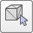
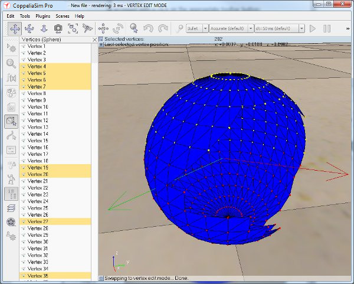
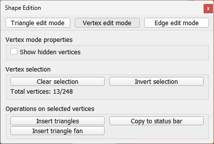
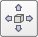
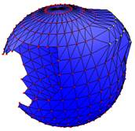

# Vertex edit mode

The vertex edit mode can be accessed with a click on the appropriate toolbar button:

*[Shape edit mode toolbar button]*

The above toolbar button is only active if a [shape](shapes.md) is selected. If the last selected shape is not a simple shape, but a compound shape, the [edit mode for compound shapes](groupedShapeEditMode.md) will be activated instead. In the vertex edit mode all vertices composing the shape are individually displayed in red. When selecting vertices (using the same procedure as for selecting [objects](objects.md)), they will appear in yellow and the last selected vertex in white. Shortcut copy/cut/paste/delete is supported (ctrl-c, ctrl-x, ctrl-v, delete). Selection can be cleared with the esc-key, with the deselect toolbar button, or by ctrl-clicking onto an empty area of the [scene](scenes.md). A shift-selection will select all vertices under the selection area, also hidden vertices (if you wish to only select visible vertices via a shift-selection, hold down the ctrl-key in addition to the shift-key). In the vertex edit mode, the portion of the window that normally displays the [scene hierarchy](userInterface.md#SceneHierarchy) is used to display the vertices of the shape being edited as a list. Items in the list can be selected with the mouse as for objects in the hierarchy window.

*[Vertex edit mode]*

After entering the vertex edit mode, the edit menu items ([Menu bar > Edit]) will become specific to the vertex edit mode, and the following dialog will be displayed:

*[Vertex edit mode dialog]*

- **Triangle / Vertex / Edge Edit Mode**: the currently activated edit mode. The user can switch from one edit mode to the others via these buttons (the selected items will be preserved).
- **Show Hidden Vertices**: when selected, will also display hidden vertices.
- **Clear selection**: clears the selection of vertices.
- **Invert selection**: inverts the selection state of vertices.
- **Insert Triangles**: will insert triangles between selected vertices. The order in which vertices are selected is important.
- **Insert Triangle Fan**: will insert a triangle fan between selected vertices. The order in which vertices are selected is important. The last selected vertex will be the common vertex between the newly inserted triangles.
- **Copy to status bar**: prints the selected vertices to the status bar.

Vertices can be precisely positioned via the [coordinate and transformation dialog](coordinateDialog.md). They can also be directly translated with the mouse, using the toolbar's object/item translation button to translate the selected vertex/vertices in a plane perpendicular to the view direction:

*[Object/item translation toolbar button]*

*[Shape in vertex edit mode]*
