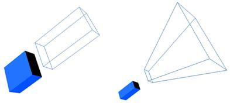
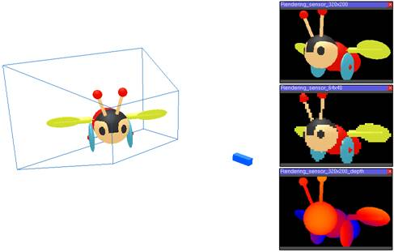

# Vision sensor types and mode of operation

[Vision sensors](visionSensors.md) come in 2 different types and can be adjusted for different purposes:

- **Orthographic projection-type**: the field of view of orthographic projection-type vision sensors is rectangular. They are well suited for close-range infrared sensors, or laser range finders.
- **Perspective projection-type**: the field of view of perspective projection-type vision sensors is trapezoidal. They are well suited for camera-type sensors.

*[Orthogonal projection-type and perspective projection-type vision sensors]*

Refer also to [`visionSensor.perspective`](sim-2/property_visionSensor_perspective.md).

Vision sensors, which are [viewable objects](viewableObjects.md), can be *looked-through* like [camera objects](cameras.md) [Popup menu > View > Associate view with selected vision sensor]. See also the section on [pages and views](pagesAndViews.md) for more details.

*[Vision sensor and various image processings]*

Vision sensors are very powerful in the sense that they can be used in various and flexible ways. For instance they can be used to display still or moving images from an external application or a [plugin](plugins.md). Plugins can also provide customized image processing algorithms as well as evaluation algorithms (e.g. triggering conditions). [Vision callback functions](visionCallbackFunctions.md) represent the mechanism where image processing can take place, and where triggers can be generated (you can react to triggers in a [trigger callback function](triggerCallbackFunctions.md)).
