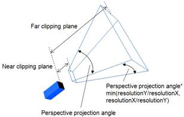

# Vision sensor dialog

The vision sensor dialog is part of the [scene object dialog](sceneObjectPropertiesDialog.md), which is located at [Tools > Scene object properties]. You can also open the dialog with a double-click on an object icon in the [scene hierarchy](userInterface.md#SceneHierarchy), or with a click on its [toolbar](userInterface.md#toolbars) button:

*[Scene object properties toolbar button]*

In the scene object dialog, click the **Vision sensor** button to display the vision sensor dialog (the **Vision sensor** button only appears if the last selection is a [vision sensor](visionSensors.md)). The dialog displays the settings and parameters of the last selected vision sensor. If more than one vision sensor is selected, then some parameters can be copied from the last selected vision sensor to the other selected vision sensors (**Apply to selection**-buttons):

*[Vision sensor dialog]*

- **Explicit handling**: indicates whether the sensor should be explicitly handled. If checked, the sensor will not be handled when sim.handleVisionSensor(sim.handle_all_except_explicit) is called, but only if sim.handleVisionSensor(sim.handle_all) or sim.handleVisionSensor(visionSensorHandle) is called. This is useful if the user wishes to handle the sensor in a [simulation script](simulationScripts.md) rather than in the [main script](mainScript.md) (if not checked the sensor will be handled twice, once when sim.handleVisionSensor(sim.handle_all_except_explicit) is called in the main script, and once when sim.handleVisionSensor(visionSensorHandle) is called in the simulation script). Refer also to the section on [explicit and non-explicit calls](explicitHandling.md).
- **External input**: when selected, then the vision sensor's normal operation will be altered so as to be able to handle external images instead (e.g. video images).
- **Ignore RGB info (faster)**: if selected, the RGB information of the sensor (i.e. the color) will be ignored so that it can operate faster. Use this option if you only rely on the depth information of the sensor.
- **Ignore depth info (faster)**: if selected, the depth information of the sensor will be ignored so that it can operate faster. Use this option if you do not intend to use the depth information of the sensor.
- **Packet1 is blank (faster)**: if selected, then CoppeliaSim won't automatically extract specific information from acquired images, so that it can operate faster. Use this option if you do not intend to use the first packet of auxiliary values returned by API functions [sim.readVisionSensor](sim/simReadVisionSensor.htm) or [sim.handleVisionSensor](sim/simHandleVisionSensor.htm).
- **Render mode**: three modes are currently available:
- **Legacy OpenGL** (default): renders the visible color channels of objects.
- **Legacy OpenGL, color coded handles**: renders the objects by coding their handles into the colors. The first data packet returned by the [sim.readVisionSensor](sim/simReadVisionSensor.htm) or [sim.handleVisionSensor](sim/simHandleVisionSensor.htm) API functions represents the detected object handles (round the values down).
- **POV-Ray**: uses the POV-Ray plugin to render images, allowing for shadows (also soft shadows) and material effects (much slower). The plugin source code is located [here](https://github.com/CoppeliaRobotics/simPovRay).
- **OpenGL3**: uses the [simOpenGL3 plugin](https://github.com/coppeliaRobotics/simOpenGL3), courtesy of Stephen James. The plugin offers shadow casting, which is currently not possible natively in CoppeliaSim. Light projection and shadows can be adjusted for each light, via the object's [extension string](sceneObjectPropertiesDialog.md#common), e.g. *openGL3 {lightProjection {nearPlane {0.1} farPlane {10} orthoSize {8} bias {0.001} normalBias {0.005} shadowTextureSize {2048}}}*
- **Near / far clipping plane**: the minimum / maximum distance from which the sensor will be able to detect.
- **Perspective angle**: the maximum opening angle of the detection volume when the sensor is in perspective mode.
- **Orthographic size**: the maximum size (along x or y) of the detection volume when the sensor is not in perspective mode.

*[Detection value parameters of the orthographic-type vision sensor]*

*[Detection value parameters of the perspective-type vision sensor]*

- **Resolution X / Y**: desired x- / y-resolution of the image captured by the vision sensor. Carefully choose the resolution depending on your application (high resolution will result in slower operation). With older graphic card models, the actual resolution might be different from what is indicated here (old graphic card models only support resolutions at 2^n, where n is 0, 1, 2, etc.).
- **Default image color**: allows specifying the color that should be used in areas where nothing was rendered. By default, the [environment](environment.md) fog color is used.
- **Sensor size**: size of the body-part of the vision sensor. This has no functional effect.
- **Show view frustum**: if selected, the view frustum (volume) is shown.
- **Color**: allows adjusting the color of the sensor.
