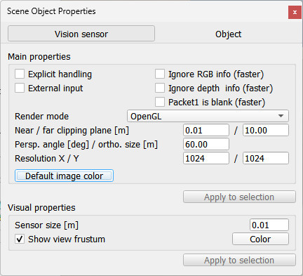
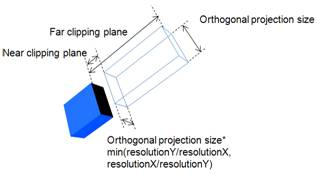

# Vision sensor dialog

The vision sensor dialog is part of the [scene object dialog](sceneObjectPropertiesDialog.md), which is located at [Tools > Scene object properties]. You can also open the dialog with a double-click on an object icon in the [scene hierarchy](userInterface.md#SceneHierarchy), or with a click on its [toolbar](userInterface.md#toolbars) button:

*[Scene object properties toolbar button]*

In the scene object dialog, click the **Vision sensor** button to display the vision sensor dialog (the **Vision sensor** button only appears if the last selection is a [vision sensor](visionSensors.md)). The dialog displays the settings and parameters of the last selected vision sensor. If more than one vision sensor is selected, then some parameters can be copied from the last selected vision sensor to the other selected vision sensors (**Apply to selection**-buttons):

*[Vision sensor dialog]*

- **Explicit handling**: indicates whether the sensor should be explicitly handled. If checked, the sensor will not be handled automatically, but only if [visionSensor:handleSensor](sim/visionSensor_handleSensor.md) is called. Refer also to [visionSensor.explicitHandling](sim/property_visionSensor_explicitHandling.md)
- **External input**: when selected, then the vision sensor's normal operation will be altered so as to be able to handle external images instead (e.g. video images). Refer also to [visionSensor.useExtImage](sim/property_visionSensor_useExtImage.md)
- **Ignore RGB info (faster)**: if selected, the RGB information of the sensor (i.e. the color) will be ignored so that it can operate faster. Use this option if you only rely on the depth information of the sensor. Refer also to [visionSensor.ignoreImageInfo](sim/property_visionSensor_ignoreImageInfo.md)
- **Ignore depth info (faster)**: if selected, the depth information of the sensor will be ignored so that it can operate faster. Use this option if you do not intend to use the depth information of the sensor. Refer also to [visionSensor.ignoreDepthInfo](sim/property_visionSensor_ignoreDepthInfo.md)
- **Packet1 is blank (faster)**: if selected, then CoppeliaSim won't automatically extract specific information from acquired images, so that it can operate faster. Use this option if you do not intend to use [visionSensor.packet1](sim/property_visionSensor_packet1.md) data.
- **Render mode**: five modes are available (refer also to [visionSensor.renderMode](sim/property_visionSensor_renderMode.md)):
  - **Legacy OpenGL** (default): renders the visible objects. This mode does not work when operating CoppeliaSim in true headless mode.
  - **Legacy OpenGL, color coded handles**: renders the visible objects by coding their handles into the colors. This mode does not work when operating CoppeliaSim in true headless mode. [visionSensor.packet1](sim/property_visionSensor_packet1.md) then represents the detected object handles (round the values down).
  - **POV-Ray**: uses the POV-Ray plugin to render visible objects, allowing for shadow casting. This mode works also in true headless mode. The plugin source code is located [here](https://github.com/CoppeliaRobotics/simPovRay).
  - **OpenGL3**: uses the [simOpenGL3 plugin](https://github.com/coppeliaRobotics/simOpenGL3), initially developed by Stephen James, to render visible objects, allowing for shadow casting. This mode works also in true headless mode.
  - **OpenGL3, color coded handles**: uses the simOpenGL3 plugin. Renders the visible objects by coding their handles into the colors. This mode works also in true headless mode. [visionSensor.packet1](sim/property_visionSensor_packet1.md) then represents the detected object handles (round the values down).
- **Near / far clipping plane**: the minimum / maximum distance from which the sensor will be able to detect. Refer also to [visionSensor.clippingPlanes](sim/property_visionSensor_clippingPlanes.md)
- **Perspective angle**: the maximum opening angle of the detection volume when the sensor is in perspective mode. Refer also to [visionSensor.perspective](sim/property_visionSensor_perspective.md) and [visionSensor.viewAngle](sim/property_visionSensor_viewAngle.md)
- **Orthographic size**: the maximum size (along x or y) of the detection volume when the sensor is not in perspective mode. Refer also to [visionSensor.perspective](sim/property_visionSensor_perspective.md) and [visionSensor.viewSize](sim/property_visionSensor_viewSize.md)

*[Detection value parameters of the orthographic-type vision sensor]*

*[Detection value parameters of the perspective-type vision sensor]*

- **Resolution X / Y**: desired x- / y-resolution of the image captured by the vision sensor. Refer also to [visionSensor.resolution](sim/property_visionSensor_resolution.md)
- **Default image color**: allows specifying the color that should be used in areas where nothing was rendered. By default, the [environment](environment.md) fog color is used.
- **Sensor size**: size of the body-part of the vision sensor. This has no functional effect. Refer also to [visionSensor.size](sim/property_visionSensor_size.md))
- **Show view frustum**: if selected, the view frustum (volume) is shown. Refer also to [visionSensor.showFrustum](sim/property_visionSensor_showFrustum.md)
- **Color**: allows adjusting the color of the sensor.
