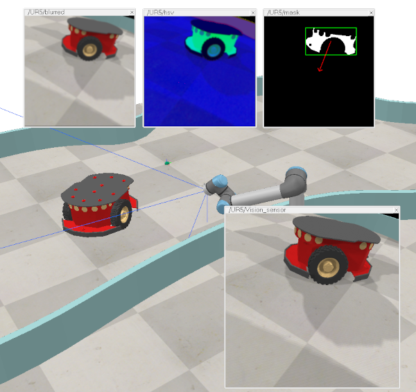

# Vision sensors

A vision sensor is an instance of the [visionSensor type](mainObjectTypes.md#visionSensor), which in turn derives from the [sceneObject type](mainObjectTypes.md#sceneObject). It is a [viewable object](viewableObjects.md) and operates in a very similar way to a [camera](cameras.md): it renders the [scene objects](objects.md) that are in its field of view and triggers detection if specified thresholds are over- or under-shot. Vision sensors should be used over proximity sensors mainly when color, light or structure plays a role in the detection process (e.g. infrared sensors, or, more generally, sensors sensitive to light (cameras)). However, depending on the graphic card the application is running on, or on the complexity of the scene objects, vision sensors might be a little bit slower than proximity sensors.

*[Image acquisition and processing]*

Make sure not to mix-up vision sensors with [cameras](cameras.md). The following are the main differences:

- A vision sensor has a fixed resolution. A camera has no specific resolution (i.e. it adjusts automatically to the view size).
- A vision sensor's image content can be accessed via the [API](apisOverview.md), and image processing handled via [vision callback functions](visionCallbackFunctions.md). A camera's image content is not directly available via the API.
- A vision sensor generally requires more CPU time and operates slower than cameras.
- A vision sensor can mainly display [shapes](shapes.md). A camera can display all [object types](objects.md).

Vision sensors are added to the [scene](scenes.md) with [Add > Vision sensor]. Refer also to [`sim.scene:createObject`](sim-2/scene_createObject.md) and [visionSensor-related methods and properties](apiFunctions.md#methodsAndProperties_visionSensor).
