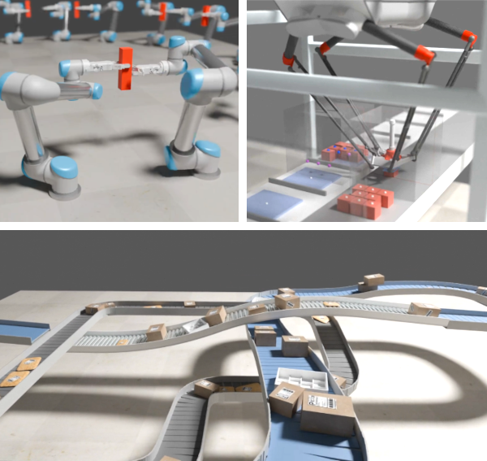

# CoppeliaSim User Manual

The user manual is included in the downloadable CoppeliaSim packages

Version 4.11

The robotics simulator CoppeliaSim, with integrated development environment, is based on a distributed control architecture: each object/model can be individually controlled via an embedded script, a plugin, ROS / ROS2 nodes, remote API clients, or a custom solution. This makes CoppeliaSim very versatile and ideal for multi-robot applications. Controllers can be written in C/C++, Python, Java, Lua, Matlab or Octave.

The following are just a few of CoppeliaSim's applications:

- Simulation of factory automation systems
- Remote monitoring
- Hardware control
- Fast prototyping and verification
- Safety monitoring
- Fast algorithm development
- Robotics related education
- Product presentation

CoppeliaSim can be used as a stand-alone application or can easily be embedded into a main client application: its small footprint and elaborate API make CoppeliaSim an ideal candidate to embed into higher-level applications. The Lua or Python script interpreter makes CoppeliaSim an extremely versatile application, leaving the freedom to the user to combine the low/high-level functionalities to obtain new high-level functionalities.

A good way to get a quick start with CoppeliaSim is to have a look at the [tutorial section](tutorials.md) first.

Refer also to CoppeliaSim's overview description in other languages: [English](overviewTranslations.md#English), [Deutsch (German)](overviewTranslations.md#German), [Français (French)](overviewTranslations.md#French), [Italiano (Italian)](overviewTranslations.md#Italian), [Español (Spanish)](overviewTranslations.md#Spanish), [Türkçe (Turkish)](overviewTranslations.md#Turkish), [Português (Portugues)](overviewTranslations.md#Portuguese), [日本語 (Japanese)](overviewTranslations.md#Japanese), [한국어 (Korean)](overviewTranslations.md#Korean), [简体中文(simplified Chinese)](overviewTranslations.md#Chinese), [繁体中文(traditional Chinese)](overviewTranslations.md#TraditionalChinese).
