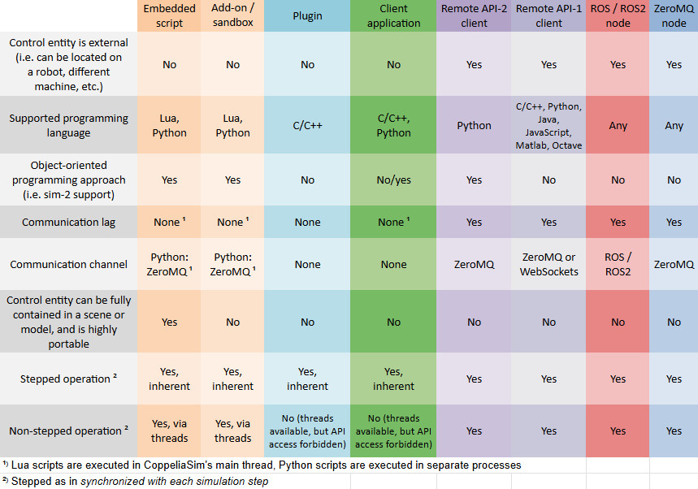

# Writing code in and around CoppeliaSim

CoppeliaSim is a highly customizable simulator: every aspect of a [simulation](simulation.md) can be customized. Moreover, the simulator itself can be customized and tailored so as to behave exactly as desired. This is allowed through an elaborate [Application Programming Interface](apisOverview.md) (API). 7+ different programming or coding approaches are supported, each having particular advantages over the others, but all seven are mutually compatible (i.e. can be used at the same time, or even hand-in-hand). The control code of a [model](models.md), [scene](scenes.md), or the simulator itself can be located inside:

- An [embedded script](scripts.md) (i.e. customizing a simulation (i.e. a [scene](scenes.md) or [models](models.md)) via scripting): this method, which consists in writing [Lua](http://www.lua.org) or [Python](http://www.python.org) scripts, is very easy and flexible, with guaranteed compatibility with every other default CoppeliaSim installation (as long as customized API functions are not used, or are used with distributed [plugins](plugins.md)). This method allows customizing a particular simulation, a simulation scene, and to a certain extent the simulator itself. This is the easiest and most used programming approach.
- An [add-on](addOns.md) or [a sandbox](sandboxScript.md): this method, which consists in writing Lua or Python scripts, allows you to quickly customize the simulator itself. Add-ons or sandboxes can start automatically and run in the background, or they can be called as functions (e.g. convenient when writing importers/exporters). Add-ons should not be specific to a certain simulation or model; they should rather offer a more generic, simulator-bound functionality.
- A [plugin](plugins.md) (i.e. customizing the simulator and/or a simulation via a plugin): this method basically consists in writing a plugin for CoppeliaSim. Oftentimes, plugins are only used to provide a simulation with [customized API commands](apiFunctions.md#functions_c_aux), and so are used in conjunction with the first methods. Other times, plugins are used to provide CoppeliaSim with a special functionality requiring either fast calculation capability (scripts are most of the time slower than compiled languages), a specific interface to a hardware device (e.g. a real robot), or a particular communication interface.
- The [client application](coppeliaSimLibrary.md) (i.e. customizing the simulator and/or a simulation via a custom client application): this basically consists in writing a custom main application for the CoppeliaSim library. This allows you for instance to launch/shutdown CoppeliaSim several times in a row, or in a particular manner.
- A [remote API](remoteApiOverview.md) client (i.e. customizing the simulator and/or a simulation via a remote API client application): this method allows an external application (e.g. located on a robot, another machine) to connect to CoppeliaSim in a very easy way, using remote API commands.
- A [ROS node](rosInterfaces.md) (i.e. customizing the simulator and/or a simulation via a ROS node): this method allows an external application (e.g. located on a robot, another machine) to connect to CoppeliaSim via [ROS](http://www.ros.org), the Robot Operating System.
- A node talking [TCP/IP](meansOfCommunication.md#sockets), [ZeroMQ](meansOfCommunication.md#zmq): this method allows an external application (e.g. located on a robot, another machine) to connect to CoppeliaSim via various communication means.

 The above 7 methods are also discussed in the [external controller tutorial](externalControllerTutorial.md). The following table describes in detail the respective advantages and disadvantages of each method:

*[Possible control methods in and around CoppeliaSim]*
